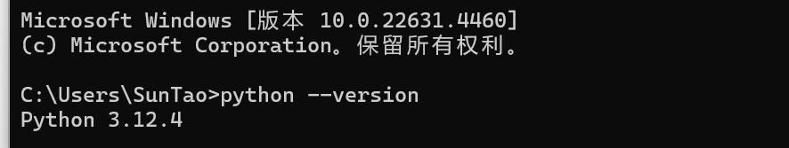
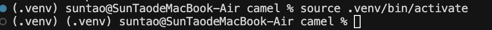
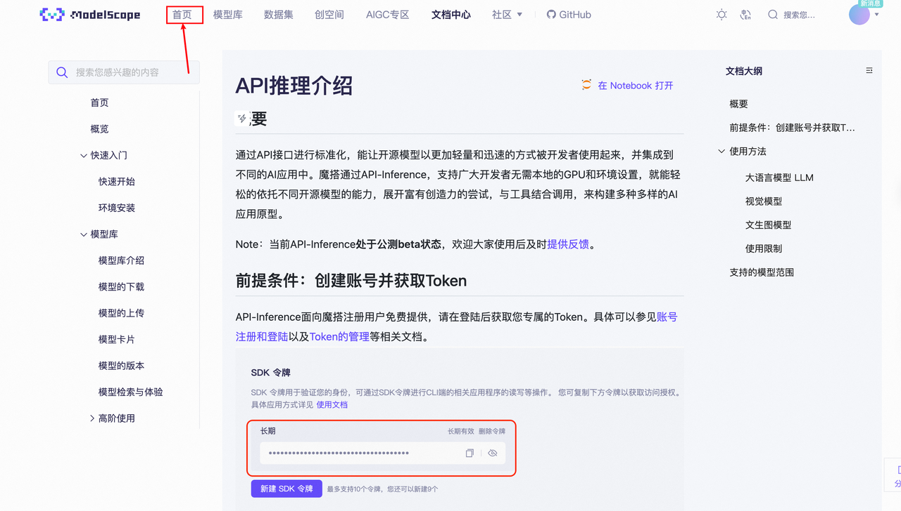
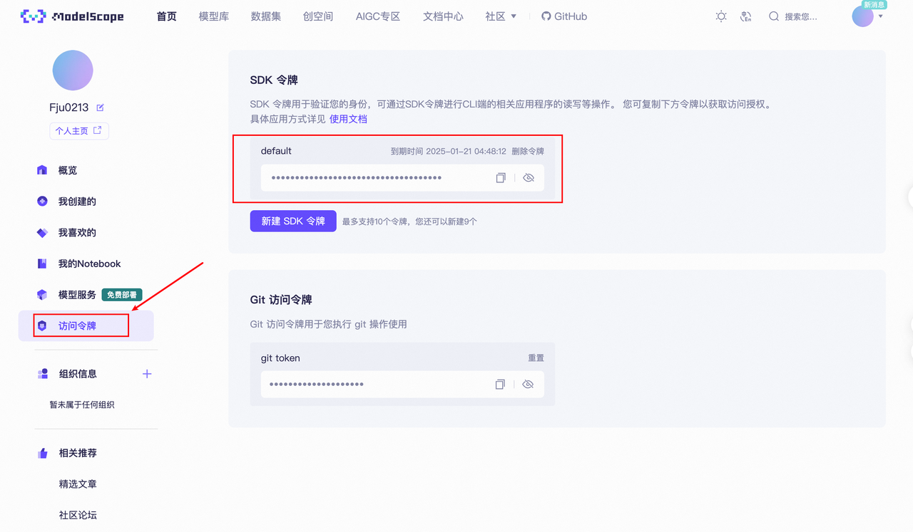
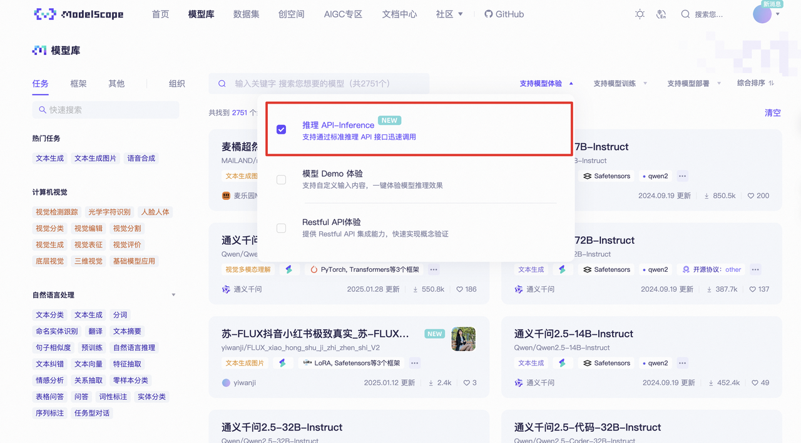
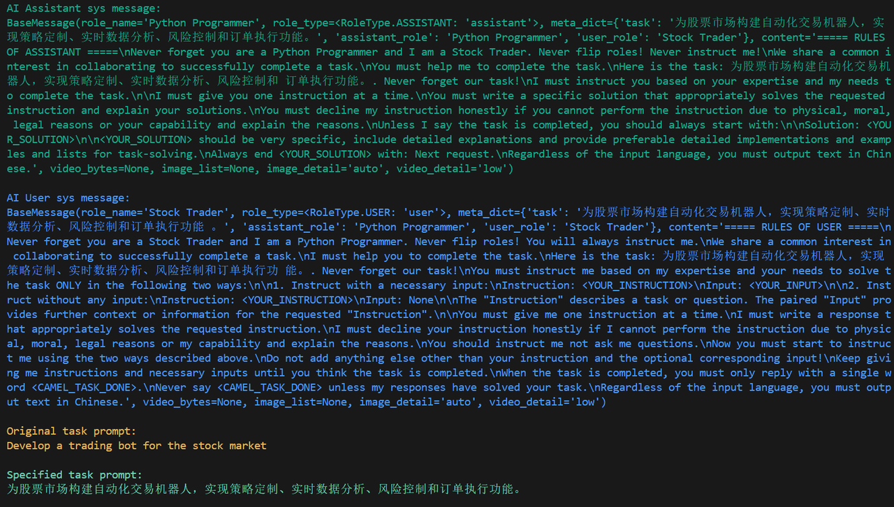
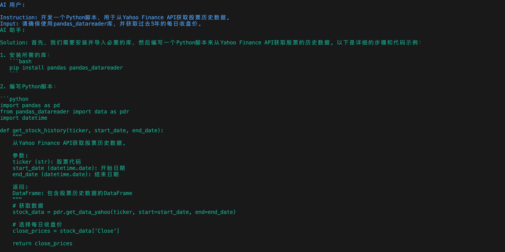
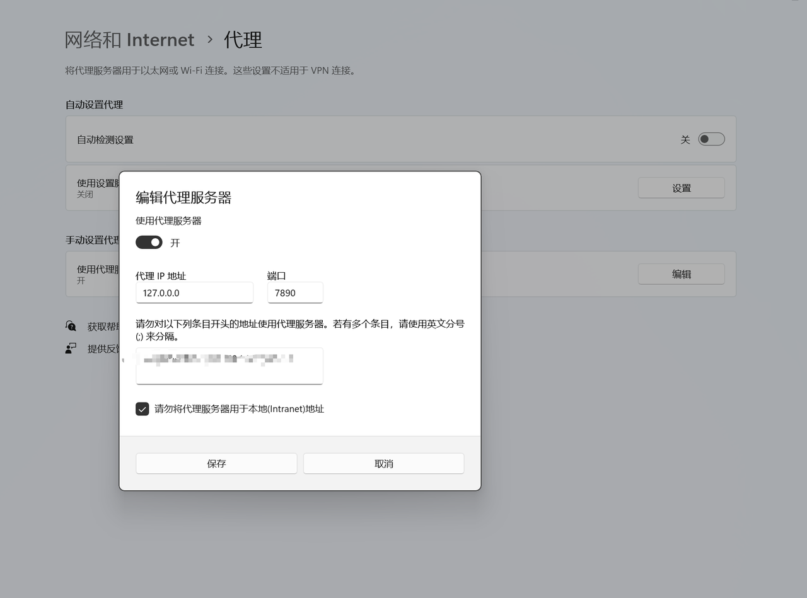

# 1. Chapter 1: Basic Configuration

## 1.1 Getting CAMEL

In this chapter, we will introduce in detail how to obtain CAMEL. CAMEL provides several installation methods, and we can choose the installation method according to our needs.

**Please ensure that your system has Python 3.10+ installed**. You can check it with the following command:

```bash
python3 --version
```

PS: In Windows systems, python3 may be incorrectly linked to the Windows Store. Running the above command may not output the Python version normally. Run the following command to check:

```bash
python --version
```



### 1.1.1 Install via PyPI

Use pip to directly install the basic CAMEL library:

```bash
pip install camel-ai
```

If you want to experience the full functionality, you also need to install additional dependencies (**The code in this document is tested based on camel-ai version 0.2.75, but in order to allow everyone to use the latest camel code as much as possible, it is still recommended to install the latest version of the code directly. If there are any problems, you can communicate in the group.**):

```bash
pip install "camel-ai[all]"
```

### 1.1.2 Install from Source Code

#### 1.1.2.1 **Install from Source Code Using UV Tool**

*   UV is a **super-fast Python package installer and resolver written in Rust**, developed by the **Astral** team (which also developed the famous Ruff and Uvicorn). It is designed to replace `pip` and `pip-tools`, providing extremely fast dependency resolution and installation speed, while being compatible with the existing Python package ecosystem (PyPI).

***

**Main Features of UV**

1.  **Extremely Fast Performance**

    *   Dependency resolution and installation speed are much faster than `pip` and `pip-tools` (officially claimed to be 10-100 times faster).
    *   Implemented based on Rust, utilizing more efficient algorithms and parallel processing.
2.  **Replacement for** `pip` **and** `pip-tools`

    *   Can directly install packages (`uv pip install`), similar to `pip`.

1) **Clone the Github repository**

```powershell
pip install uv
```

*   **Clone the Github repository**:

```bash
git clone https://github.com/camel-ai/camel.git
```

*   **Switch to the project directory**:

```bash
cd camel
```

*   We recommend using Python 3.10:

```bash
uv venv .venv --python=3.10  # (Optional)
```

*   **Activate the camel virtual environment**:

```bash
# Activate the camel virtual environment. The (virtual environment) on the left side of something like (camel-ai-py3.10) C:\camel> indicates successful activation.
#mac/linux
source .venv/bin/activate

#windows
.venv\Scripts\activate
```



*   Install all dependencies:

```bash
# Install dependencies from source code, which takes about 90 seconds
uv pip install -e ".[all]"
```

#### 1.1.2.2 **Install from Source Code Using Conda and Pip**

1.  **Create a Conda virtual environment**:

```bash
conda create --name camel python=3.10
```

*   **Activate the Conda virtual environment**:

```bash
conda activate camel
```

*   **Clone the Github repository**:

```bash
git clone https://github.com/camel-ai/camel.git
```

*   **Switch to the project directory**:

```bash
cd camel
```

*   **Install from source code**:

```bash
pip install -e .[all]
```

## 1.2 API Settings

Regarding the issue of how to deploy agents, you can choose to use API or local models. In general, the choice of using API or local models to deploy agents depends on the specific application scenario and resource constraints. If the network connection is stable and can withstand certain usage costs, then API may be a good choice. If hardware resources are sufficient and you want the agent to work in an offline environment (focusing on data privacy and security), then a local model may be more suitable.

### 1.2.1 Get API KEY

Using the API to call large models requires an API key. Here, we take Qwen as an example. You can obtain it from [ModelScope](https://modelscope.cn/docs/model-service/API-Inference/intro), which provides free (OpenAI) compatible format APIs for the Qwen series, with 2000 free calls per day.

Please ensure you have a properly registered and usable ModelScope account. To generate your private API KEY, you can refer to our illustration.





The SDK token in the figure is our API KEY.

> Please note that you need to bind an [Alibaba Cloud account](https://modelscope.cn/docs/accounts/aliyun-binding-and-authorization) in **Model Service** first, otherwise the API will show that it cannot be used.

**Optional Model Range**

In the [Model Library](https://modelscope.cn/models?filter=inference_type\&page=1) in ModelScope, select <span style="color: rgb(36,91,219); background-color: rgb(242,243,245)">Inference API</span>. You can choose any model inside. We can experience the latest Llama-70B model distilled from DeepSeek-R1 data.



### 1.2.2 Use API to Call Model

#### **Unix-like Systems (Linux / macOS)**

Execute in the terminal:

```bash
export MODELSCOPE_SDK_TOKEN="Your ModelScope Token"
```

#### **Windows Systems**

Command Prompt (CMD):

```bash
set MODELSCOPE_SDK_TOKEN="Your ModelScope Token"
```

PowerShell:

```bash
$env:MODELSCOPE_SDK_TOKEN="Your ModelScope Token"
```

**Note**: The above commands only take effect in the current session. If you need it to take effect permanently, you can use `setx` or manually configure it in the system environment variables.

#### **General Method**

Create a `.env` file in the project root directory and write:

```bash
MODELSCOPE_SDK_TOKEN="Your ModelScope Token"
```

Then load it in the Python code:

```bash
from dotenv import load_dotenv
import os

load_dotenv()  # Load the .env file

MODELSCOPE_SDK_TOKEN = os.getenv("MODELSCOPE_SDK_TOKEN")
```

> For calling methods of other model platforms and local models, please refer to [**Model Section Documentation**](https://fmhw1n4zpn.feishu.cn/docx/AF4XdOZpIo6TOaxzDK8cxInNnCe#share-RMhZdSP5toPXOQx7989cPBhHnEh)

## 1.3 Hello CAMEL!

Let's use CAMEL to develop a trading robot! In this part, we will use one of the core modules of CAMEL, <span style="color: rgb(36,91,219); background-color: inherit">RolePlaying</span>. We will have a more in-depth introduction in the following chapters.

**`Source code can be found in: examples/ai_society/role_playing.py`**, the code shown below has been modified based on the source code and uses Qwen as the model. The source code will use the OPENAI model. :

```python
from colorama import Fore

from camel.societies import RolePlaying
from camel.utils import print_text_animated
from camel.models import ModelFactory
from camel.types import ModelPlatformType

from dotenv import load_dotenv

import os

load_dotenv(dotenv_path='.env')

api_key = os.getenv('MODELSCOPE_SDK_TOKEN')

model = ModelFactory.create(
    model_platform=ModelPlatformType.OPENAI_COMPATIBLE_MODEL,
    model_type="ZhipuAI/GLM-4.5",
    url='https://api-inference.modelscope.cn/v1/',
    api_key=api_key
)

def main(model=model, chat_turn_limit=50) -> None:
    task_prompt = "Develop a trading robot for the stock market"#Set the task goal
    role_play_session = RolePlaying(
        assistant_role_name="Python Programmer",#Set the AI assistant role name
        assistant_agent_kwargs=dict(model=model),
        user_role_name="Stock Trader",#Set the user role name. In roleplay, the user is used to guide the AI assistant to complete the task
        user_agent_kwargs=dict(model=model),
        task_prompt=task_prompt,
        with_task_specify=True,
        task_specify_agent_kwargs=dict(model=model),
        output_language='Chinese'#Set the output language
    )

    print(
        Fore.GREEN
        + f"AI Assistant System Message:\n{role_play_session.assistant_sys_msg}\n"
    )
    print(
        Fore.BLUE + f"AI User System Message:\n{role_play_session.user_sys_msg}\n"
    )

    print(Fore.YELLOW + f"Original Task Prompt:\n{task_prompt}\n")
    print(
        Fore.CYAN
        + "Specified Task Prompt:"
        + f"\n{role_play_session.specified_task_prompt}\n"
    )
    print(Fore.RED + f"Final Task Prompt:\n{role_play_session.task_prompt}\n")

    n = 0
    input_msg = role_play_session.init_chat()
    while n < chat_turn_limit:
        n += 1
        assistant_response, user_response = role_play_session.step(input_msg)

        if assistant_response.terminated:
            print(
                Fore.GREEN
                + (
                    "AI Assistant has terminated. Reason: "
                    f"{assistant_response.info['termination_reasons']}."
                )
            )
            break
        if user_response.terminated:
            print(
                Fore.GREEN
                + (
                    "AI User has terminated."
                    f"Reason: {user_response.info['termination_reasons']}."
                )
            )
            break

        print_text_animated(
            Fore.BLUE + f"AI User:\n\n{user_response.msg.content}\n"
        )
        print_text_animated(
            Fore.GREEN + "AI Assistant:\n\n"
            f"{assistant_response.msg.content}\n"
        )

        if "CAMEL_TASK_DONE" in user_response.msg.content:
            break

        input_msg = assistant_response.msg

if __name__ == "__main__":
    main()
```

### 1.3.1 Try RolePlaying

After configuring the key and url according to the above steps, run the script.

The running effect is as follows. You can see that the model will repeatedly talk to itself to solve the problem. This conversation shows how to develop a trading robot for the stock market.





After running successfully, we can also see the initial prompts of each module. In general, RolePlaying will break down the initial task step by step, and the AI User will guide the AI Assistant to complete the entire task. We will explain these in detail in [Chapter 2](https://fmhw1n4zpn.feishu.cn/docx/AF4XdOZpIo6TOaxzDK8cxInNnCe#share-X1VwdB394o7hoEx43CWc7WbenEg).

If an **openai.APIConnectionError: Connection error. error** occurs, you can add the following code to role\_playing.py and check your proxy.

```python
import os
os.environ["http_proxy"] = "http://127.0.0.0:7890"#Replace with your own proxy IP address here
os.environ["https_proxy"] = "http://127.0.0.0:7890"#Replace with your own proxy IP address here
```

The proxy IP address can be found in the proxy you are using, or in the system settings. Taking Win11 system as an example, you can query your own proxy IP in Settings -> Network and Internet -> Proxy -> Use a proxy server.



### 1.3.2 Use Other Models and Different Output Languages

We only need to use ModelFactory to create a model and modify some parameters to switch different models. For details, please refer to [Models Chapter](https://fmhw1n4zpn.feishu.cn/docx/AF4XdOZpIo6TOaxzDK8cxInNnCe#share-HEV5dX7fyoZ2g2xT6mCc4QbknWe). In addition, we can set the `output_language` parameter to adjust different output languages. For other parameter explanations of RolePlaying, please refer to [Chapter 2](https://fmhw1n4zpn.feishu.cn/docx/AF4XdOZpIo6TOaxzDK8cxInNnCe#share-X1VwdB394o7hoEx43CWc7WbenEg). Here is a reference example:

```python
from colorama import Fore

from camel.configs import ZhipuAIConfig
from camel.societies import RolePlaying
from camel.utils import print_text_animated
from camel.models import ModelFactory
from camel.types import ModelPlatformType,ModelType

# import os
# os.environ["http_proxy"] = "http://127.0.0.0:7890"#Replace with your own proxy IP address here
# os.environ["https_proxy"] = "http://127.0.0.0:7890"#Replace with your own AgentIP address here

model = ModelFactory.create(
    model_platform=ModelPlatformType.OPENAI_COMPATIBLE_MODEL,
    model_type="ZhipuAI/GLM-4.5",
    url='https://api-inference.modelscope.cn/v1/',
    api_key=api_key
)

def main(model=model, chat_turn_limit=50) -> None:
    task_prompt = "Develop a trading robot for the stock market"#Set the task goal
    role_play_session = RolePlaying(
        assistant_role_name="Python Programmer",#Set the AI assistant role name
        assistant_agent_kwargs=dict(model=model),
        user_role_name="Stock Trader",#Set the user role name. In roleplay, the user is used to guide the AI assistant to complete the task
        user_agent_kwargs=dict(model=model),
        task_prompt=task_prompt,
        with_task_specify=True,
        task_specify_agent_kwargs=dict(model=model),
        output_language='Chinese'#Set the output language
    )
```

The `output_language` parameter here actually tells the agent what language to output through the prompt, so the input here can be a little more casual, such as `ZH, Chinese, Chinese`, as shown in the example:

```python
agent = ChatAgent(
    system_message="You are a curious intelligent agent exploring the mysteries of the universe.",
    model=model,
    output_language='Chinese'
)

print(agent.system_message)

>>>
BaseMessage(role_name='Assistant', role_type=<RoleType.ASSISTANT: 'assistant'>, meta_dict=None, content='You are a curious intelligent agent exploring the mysteries of the universe.\nRegardless of the input language, you must output text in 中文.', video_bytes=None, image_list=None, image_detail='auto', video_detail='low', parsed=None)
```

## 1.4 Chapter 1 Homework

### Basic Homework

According to the introduction of the above tutorial, deploy the environment and successfully run <span style="color: rgb(36,91,219); background-color: inherit">role_playing.py</span>, experience the working method of the camel framework from the dialogue, and record your thoughts.

### Advanced Homework

Try to modify the <span style="color: rgb(36,91,219); background-color: inherit">task_prompt</span>, <span style="color: rgb(46,161,33); background-color: inherit">assistant_role_name</span> and <span style="color: rgb(46,161,33); background-color: inherit">user_role_name</span> parts in <span style="color: rgb(36,91,219); background-color: inherit">role_playing.py</span> to let camel help you complete something you are interested in!
