# 2. Chapter 2: Components of an Agent

## 2.1 Agent Overview

An agent is a system that can perceive its environment and act autonomously within it to achieve specific goals. It has the following key characteristics:

1.  Autonomy - Agents can operate without direct human intervention, making decisions and taking actions on their own.

2.  Responsiveness - Able to perceive the environment and respond promptly to environmental changes.

3.  Proactiveness - Not only passively responds to the environment but can also proactively take actions to achieve goals.

4.  Social Ability - Able to interact and collaborate with other agents or humans.

From an application perspective, agents can be divided into several categories:

1.  Task-oriented agents - Focused on completing specific tasks, such as virtual assistants, intelligent customer service, etc.

2.  Learning agents - Continuously learn and improve through interaction with the environment, such as reinforcement learning agents.

3.  Collaborative agents - Multiple agents work together to form a multi-agent system.

4.  Conversational agents - Specifically used for natural language interaction, such as language models like me.

In terms of implementation, modern agents are typically based on the following technologies:

*   Large Language Models (LLM) as the core of cognition and decision-making.

*   Planning systems for formulating action plans.

*   Memory systems for storing relevant information and experiences.

*   Tool usage capabilities to expand the scope of action.

The timeline of development in this field is as follows (incomplete statistics):

*   **"CAMEL" - Released on March 21, 2023 (see Section 2.3 for details):** CAMEL-AI is an open-source community dedicated to researching autonomous and communicative agents. The community believes that large-scale research on these agents can provide valuable insights into their behavior, capabilities, and potential risks. To promote research in this field, the CAMEL framework provides, implements, and supports various types of agents, tasks, etc. \[1](https://www.camel-ai.org/?_blank). The official website of CAMEL-AI is www.camel-ai.org, which is a platform for communicative agents to explore large language model societies, submitted by Guohao Li, Hasan Abed Al Kader Hammoud, Hani Itani, Dmitrii Khizbullin, Bernard Ghanem et al. on March 31, 2023, and revised on November 2, 2023 \[2](https://github.com/camel-ai/camel?_blank). The CAMEL framework aims to design practical general artificial intelligence. As the earliest multi-agent framework based on large language models, it is now a general framework for building and using agents based on large language models to solve real-world tasks \[3](https://arxiv.org/abs/2303.17760?_blank). In addition, the CAMEL AI framework's GitHub page camel-ai/camel provides public notifications, branches, stars, etc., with v0.2.20a1 being the latest version, released on February 07, 2025 \[4](https://camel-ai.github.io/camel/?_blank).

*   **"AutoGPT" - Released on March 30, 2023:** Auto-GPT is based on GPT-4 and allows AI to act autonomously without users having to provide detailed prompts for each action. Users can set an overall goal for Auto-GPT, and it will then take steps to achieve that goal. Unlike ChatGPT, Auto-GPT can make decisions autonomously, a feature that ChatGPT does not have. It can automatically prompt and generate every necessary prompt to complete a task.

*   **"HuggingGPT" - Released on March 30, 2023:** HuggingGPT is an agent based on ChatGPT, designed to leverage AI models on Hugging Face to solve complex AI tasks across domains and modalities. The framework uses ChatGPT to develop task plans based on user requests, then selects AI models on Hugging Face to execute sub-tasks, and finally summarizes the execution results and provides a response. HuggingGPT has achieved good results in language, vision, speech, and other tasks. The framework was first submitted on March 30, 2023, and the latest version was released on December 3, 2023 \[1](https://arxiv.org/abs/2303.17580?_blank). The core idea of HuggingGPT is to use large language models (LLMs) as controllers to manage and organize the collaboration of expert models to solve complex AI tasks \[2](https://ar5iv.labs.arxiv.org/html/2303.17580?_blank). The release of this framework marks a key step towards artificial general intelligence (AGI) \[3](https://blog.csdn.net/weixin_43336281/article/details/139123423?_blank).

    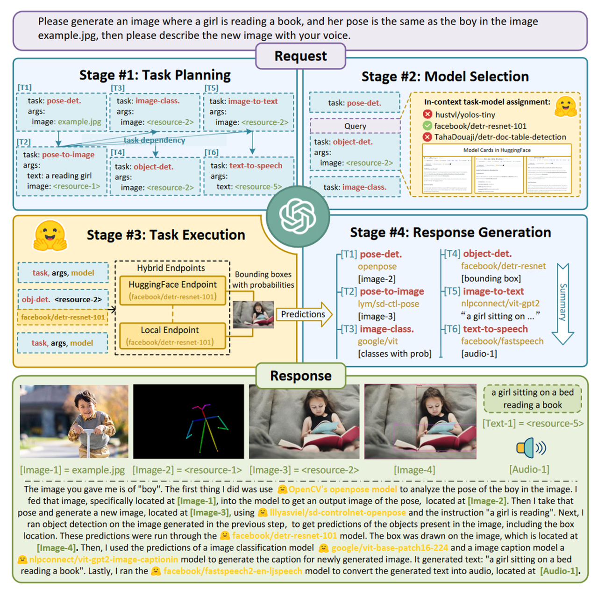

    Figure 2-9 HuggingGPT Working Principle Diagram

*   **"Westworld" Simulation (Stanford Westworld Town) - Released on April 7, 2023:** A virtual town of Smallville used to study the behavior of artificial intelligence in social interactions. This town has 25 AI agents with the ability to work, socialize, make friends, and even host Valentine's Day parties. Each AI agent has a unique personality and backstory, and they move freely in the public scenes of Smallville, such as cafes, bars, parks, schools, dormitories, houses, and shops. The AI agents in Smallville exhibit human-like behaviors, such as turning off the stove when they see breakfast is on fire, waiting outside when someone is in the bathroom, and stopping to chat when they encounter someone they want to talk to. This project has caused a sensation in the AI community and is considered one of the most exciting agent experiments of 2023. The Smallville project address is: [https://github.com/joonspk-research/generative\_agents](https://github.com/joonspk-research/generative_agents).

*   **"VOYAGER" - Released on May 25, 2023:** VOYAGER is an innovative open-source AI agent project that demonstrates the autonomous learning capabilities of large language models in a game environment. This project runs in the Minecraft game world and can learn new skills, develop plans, and execute complex tasks through environmental interaction. It adopts a curriculum learning approach and integrates a skill library system to store and reuse learned skills, making it the first AI agent to demonstrate continuous learning capabilities in Minecraft. The project was developed by the MineDojo team, and its source code can be viewed on GitHub (github.com/MineDojo/Voyager). Related research is published in the paper "VOYAGER: An Open-Ended Embodied Agent with Large Language Models." More details about the project can be found at minedojo.org. This pioneering project is of great significance for understanding the continuous learning capabilities of AI in open environments.

*   **"MetaGPT" - Released in July 2023:** MetaGPT is a framework that transforms LLMs into multiple collaborative software company roles. It can transform a product requirement into a complete software project, including analysis, design, coding, and other processes. Each role (such as product manager, architect, programmer, etc.) is played by an LLM Agent, and they work together to complete software development tasks. Reference link: <https://github.com/geekan/MetaGPT>

*   **"ChatDev" - Released on August 28, 2023:** The main features of ChatDev include:

    1.  **Incremental Development:** Supports development based on existing code by specifying the source code directory path.

    2.  **Docker Support:** Achieves secure execution through Docker, thanks to ManindraDeMel's contribution.

    3.  **Multi-Agent Collaboration:** Agents of different roles interact and collaborate after the user specifies task requirements to generate a complete software product.

    4.  **ChatDev IDE:** This is a tool for building Agents, supporting JavaScript, which can accelerate prompt engineering and is suitable for game NPC or powerful Agent tool design.

ChatDev's potential lies in integrating large language models (LLMs) into the field of software development, bringing new perspectives and possibilities to the software development process. It not only improves the efficiency and cost-effectiveness of software development but also proves its advantages in the software development process through experiments.

*   **"XAgent" - Released on October 23, 2023:** Is an innovative autonomous Agent framework developed by the Knowledge Engineering Laboratory of Tsinghua University, which can understand and execute complex computer tasks like human developers. The system is built on large language models and has working memory and self-reflection capabilities. It can solve various problems through task decomposition, code writing, debugging, and optimization. XAgent adopts a modular design and integrates multiple tools, including code execution, web browsing, and file operations. It also has core components such as task planning, action execution, and tool invocation. It not only supports recursive decomposition and execution monitoring of complex tasks but also has failure recovery and retry mechanisms. It can be widely used in software development, data analysis, automated testing, and document management. The complete source code of the project has been open-sourced on GitHub (github.com/OpenBMB/XAgent), and related technical details can be found in its paper "XAgent: An Autonomous Agent for Complex Task Solving."

*   **"Amazon Bedrock Agents" - Released in November 2023:** Amazon released Bedrock Agents, an enterprise-grade AI Agent development platform built on Amazon Bedrock. It supports multiple foundation models such as Claude and Llama 2 and provides complete knowledge base management and tool integration capabilities. Developers can use Bedrock Agents to create AI assistants that can perform specific tasks while ensuring enterprise-level security and compliance.

    Following this, in December 2023, Amazon launched AWS Q, an AI assistant specifically for the AWS ecosystem. AWS Q can assist developers with code generation, problem diagnosis, system architecture design, and other tasks, and provide AWS best practice recommendations. Its launch marks a significant breakthrough for Amazon in professional field AI assistants.

    Entering 2024, Amazon continues to strengthen its AI Agent product line. In January 2024, the company launched SageMaker Agents, an intelligent assistant system focused on machine learning workflows. It can automate data processing, model training, and deployment processes, significantly improving machine learning development efficiency. In February 2024, CodeWhisperer Agent received a major update, adding complete conversational capabilities and code explanation functions, further strengthening its position as a code AI assistant.

    Amazon's AI Agent strategy particularly emphasizes enterprise-level application scenarios, focusing on security and scalability. Through deep integration with AWS cloud services, these AI Agents can seamlessly integrate into existing enterprise technology stacks. Bedrock Agents: <https://aws.amazon.com/bedrock/agents/>

*   **"OpenAssistant Pythia" - Released in January 2024:** This is an open-source conversational AI framework supported by organizations such as LAION and Anthropic. Its goal is to create a transparent and open AI assistant ecosystem. The project is continuously active, providing multilingual support and various task processing capabilities. Reference link: <https://github.com/LAION-AI/Open-Assistant>

*   **"Ray" - 2024 Version:** A distributed computing framework developed by Anyscale, Ray's Agent system is a complete distributed AI framework that integrates multiple key components such as reinforcement learning, model serving, and distributed training. At its core, RLlib provides rich reinforcement learning algorithm support, including PPO, DQN, and SAC, and can achieve large-scale distributed training. Ray Serve is responsible for the deployment and service of Agents, providing real-time inference, load balancing, and A/B testing functions. Ray Train focuses on the implementation of distributed training, supporting hyperparameter optimization and progress tracking features. In terms of technical implementation, Ray adopts the Actor programming model, making it easy for developers to build and deploy distributed Agent systems. Each Agent can be regarded as an independent Actor, capable of maintaining its own state and performing asynchronous communication. The system supports automatic resource management and scheduling, ensuring that computing resources are used efficiently. At the same time, Ray's fault tolerance mechanism can automatically handle node failures and other issues, ensuring the stability of the system. Reference link: [https://ray-project.github.io/q4-2021-docs-hackathon/0.4/ray-api-references/ray-rllib/agents/](https://ray-project.github.io/q4-2021-docs-hackathon/0.4/ray-api-references/ray-rllib/agents/)

*   **"OpenAI Swarm" - Early 2024:** OpenAI Swarm is an experimental framework launched by OpenAI to help developers coordinate multi-agent systems. This is a groundbreaking framework that simplifies the orchestration process of multi-agent systems. It introduces advanced concepts such as agents, handoffs, routines, and function calling, providing powerful tools for experimenting with the coordination of multiple AI agents. The core functions of the framework include AI units specifically designed to perform specific tasks, handoff mechanisms that allow seamless task transitions between agents, routine systems that define standardized workflows, and function calling capabilities that enable agents to interact with external systems. Reference link: [https://github.com/openai/swarm](https://github.com/openai/swarm)

## 2.2 Agent Design Principles and Methods

The design of an agent needs to follow a series of principles and adopt specific methods to ensure its effectiveness and reliability. When designing an agent, we must first clarify its goal orientation, that is, each behavior of the agent should serve a predetermined goal. This goal orientation is not only reflected in the final result but also needs to run through the entire execution process. At the same time, the design of the agent should follow the modularization principle, dividing different functions into independent modules, which not only ensures the maintainability of the code but also improves the flexibility of the system.

A typical agent contains three core parts:

*   Perception module: processes input information

*   Decision module: formulates action plans

*   Execution module: implements specific actions

These three modules form a complete cycle, enabling the agent to work continuously and effectively.

The design of the agent should adopt an iterative development approach. First, implement basic functions, and then improve the system through continuous testing and feedback. In this process, pay attention to collecting and analyzing performance data, and adjust design parameters and strategies according to the actual operating conditions. This progressive development method can help us build a more robust and efficient agent system.

By following these design principles and methods, we can build an agent system that can not only complete specific tasks but also has good scalability and maintainability. Such a system can not only meet current needs but also adapt to new requirements and challenges that may arise in the future.

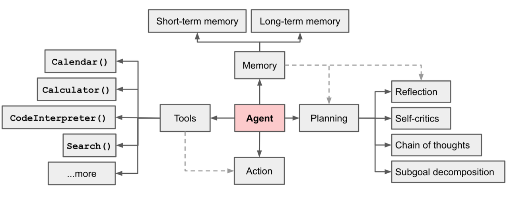

## 2.3 Models

The Model is the brain of the Agent, responsible for processing all input and output data. By effectively calling different models, the agent can perform text analysis, image recognition, and complex reasoning operations according to task requirements. CAMEL provides a series of standard and customizable interfaces and seamlessly integrates with various components to empower the development of large language model (LLM)-driven applications. In this section, we will introduce the models currently supported by CAMEL, their working principles, and how to interact with the models.

### 2.3.1 Currently Supported Models

[You can click here to view the currently supported models](https://github.com/camel-ai/camel/blob/master/docs/key_modules/models.md#2-supported-model-platforms-in-camel)

### 2.3.2 Calling Models via API

We can create different models by using the `create` method of `ModelFactory`, and then modify the following three parameters to call different models: `model_platform`, `model_type`, `model_config_dict`.

Here, we use the `ChatAgent` module in CAMEL to simply call the model. For further descriptions of `ChatAgent`, please refer to the subsequent content. Here, we simply understand it as a basic model calling module.

**Using Language Models**

```python
from camel.agents import ChatAgent
from camel.models import ModelFactory
from camel.types import ModelPlatformType

model = ModelFactory.create(
    model_platform=ModelPlatformType.OPENAI_COMPATIBLE_MODEL,
    model_type="ZhipuAI/GLM-4.5",
    url='https://api-inference.modelscope.cn/v1/',
    api_key='你的api_key'
)

agent = ChatAgent(
    model=model,
    output_language='中文'
)

response = agent.step("你好，你是谁？")
print(response.msgs[0].content)

>>>
你好，我是来自阿里云的大规模语言模型，我叫通义千问。
```

If you want to use an interface compatible with OpenAI's API (that is, follow the API specifications and authentication methods provided by OpenAI), you can replace the model with the following code: `model`

```python
model = ModelFactory.create(
    model_platform=ModelPlatformType.OPENAI_COMPATIBLE_MODEL,
    model_type="a-string-representing-the-model-type",
    api_key=os.environ.get("OPENAI_COMPATIBILIY_API_KEY"),
    url=os.environ.get("OPENAI_COMPATIBILIY_API_BASE_URL"),
    model_config_dict={"temperature": 0.4, "max_tokens": 4096},
)
```

**Using Multimodal Models**

```python
from camel.agents import ChatAgent
from camel.models import ModelFactory
from camel.types import ModelPlatformType
from camel.messages import BaseMessage

from io import BytesIO
import requests
from PIL import Image


model = ModelFactory.create(
    model_platform=ModelPlatformType.OPENAI_COMPATIBLE_MODEL,
    model_type="Qwen/QVQ-72B-Preview",
    url='https://api-inference.modelscope.cn/v1/',
    api_key='API'
)

agent = ChatAgent(
    model=model,
    output_language='中文'
)

# 图片URL
url = "https://img0.baidu.com/it/u=2205376118,3235587920&fm=253&fmt=auto&app=120&f=JPEG?w=846&h=800"
response = requests.get(url)
img = Image.open(BytesIO(response.content))

user_msg = BaseMessage.make_user_message(
    role_name="User", 
    content="请描述这张图片的内容", 
    image_list=[img]  # 将图片放入列表中
)

response = agent.step(user_msg)
print(response.msgs[0].content)

>>>
这是一张金毛寻回犬的特写照片。这只狗有着浓密的金色毛发，耳朵垂在头部两侧，眼睛明亮而有神，鼻子黑色且湿润。它的嘴巴微微张开，露出了粉红色的舌头，看起来非常友好和快乐。背景是一片模糊的绿色，可能是在户外的自然环境中拍摄的。整体画面非常温暖和愉悦，突出了金毛寻回犬的亲和力和活力。
```

**Video Understanding**

```python
from camel.agents import ChatAgent
from camel.models import ModelFactory
from camel.types import ModelPlatformType
from camel.messages import BaseMessage

from dotenv import load_dotenv
import os

load_dotenv()

api_key = os.getenv('MODELSCOPE_SDK_TOKEN')

model = ModelFactory.create(
    model_platform=ModelPlatformType.OPENAI_COMPATIBLE_MODEL,
    model_type="Qwen/QVQ-72B-Preview",
    url='https://api-inference.modelscope.cn/v1/',
    api_key=api_key
)

# 创建代理
agent = ChatAgent(
    model=model,
    output_language='中文'
)

# 读取本地视频文件
video_path = "vedio_test.mp4"
with open(video_path, "rb") as video_file:
    video_bytes = video_file.read()

# 创建包含视频的用户消息
user_msg = BaseMessage.make_user_message(
    role_name="User", 
    content="请描述这段视频的内容", 
    video_bytes=video_bytes  # 将视频字节作为参数传入
)

# 获取模型响应
response = agent.step(user_msg)
print(response.msgs[0].content)

>>>
这是一幅令人惊叹的超现实主义景观画，画面中有一只狗在一条被雪覆盖的道路上奔跑。整个场景被一种奇幻而美丽的氛围所包围，让人感受到一种超凡脱俗的美。

首先，画面的背景是一片壮丽的天空，天空中布满了浓密的云层，这些云层呈现出丰富的纹理和层次感。云层的颜色以粉色和紫色为主调，其间还夹杂着一些金色和蓝色的光影，形成了一个绚丽多彩的天幕。在云层之间，有一道明亮的光线穿过，这道光线像是从天际线的尽头射来，照亮了整个场景，给人一种希望和温暖的感觉。

地面上是一条被雪覆盖的道路，道路两旁是连绵起伏的雪山和丘陵。雪地上的足迹和轮胎印清晰可见，表明这里虽然人迹罕至，但仍有生命活动的痕迹。一只白色的狗正在这条道路上奔跑，它的姿态轻盈而欢快，仿佛在享受着这美好的一刻。

整个画面的色彩非常丰富，粉色、紫色、金色、蓝色相互交织，营造出一种梦幻般的氛围。这种色彩的运用让画面充满了活力和生命力，令人不禁沉醉其中。

总的来说，这幅画通过超现实主义的手法，创造了一个美轮美奂的幻想世界，让观者在现实与幻想之间徘徊，感受到艺术带来的无限魅力。
```

### 2.3.3 Using Open Source Models

**Using Ollama**

Ollama is an open-source machine learning framework focused on making it easy for users to create and use various language models. It provides a simple API that can integrate pre-trained language models (such as the GPT series) into your application. Ollama supports many mainstream machine learning models and tasks, such as text generation, dialogue systems, and text classification. Through its simple interface, developers can easily load models, perform inference, and interact with models.

An advanced solution is to deploy a server with a local model in the backend and use it as a local alternative to the API. Here, we use <span style="color: rgb(46,161,33); background-color: inherit">Qwen2.5</span> deployed by <span style="color: rgb(46,161,33); background-color: inherit">Ollama</span> as an example.

0.  First install [Ollama](https://ollama.com/download)

1.  After setting up Ollama, pull the <span style="color: rgb(46,161,33); background-color: inherit">Qwen2.5</span> model by typing the following command in the terminal (<span style="color: rgb(220,155,4); background-color: inherit">here we use the 7B model, which requires about 16GB of memory, and the 70B model requires about 64GB or more of memory. You can choose different parameter models according to your own configuration and needs</span>). Ollama is implemented based on llama.cpp, and the local CPU inference efficiency is very high (of course, if there is a GPU, the inference efficiency will be higher). It is also compatible with the openai interface. :

```bash
ollama pull qwen2.5:7b
```

Then use the following code to replace `model`:

```python
#如果出现openai.InternalServerError: Error code: 502错误可以尝试设置一下http_proxy及https_proxy
#import os

# os.environ["http_proxy"] = "http://localhost:11434/v1/"
# os.environ["https_proxy"] = "http://localhost:11434/v1/"

model = ModelFactory.create(
    model_platform=ModelPlatformType.OLLAMA,
    model_type="qwen2.5",
    model_config_dict={"temperature": 0.4},#可选
)
```

**Using vLLM**

vLLM is an efficient inference library for large-scale language models, designed to improve inference speed and reduce resource consumption. A core feature of vLLM is its ability to run efficiently in a variety of hardware environments (e.g., single GPU, multi-GPU, or even CPU), greatly reducing inference costs.

1.  First install [vLLM](https://docs.vllm.ai/en/latest/getting_started/installation.html)

2.  After setting up vLLM, start a server compatible with OpenAI, for example:

```python
python -m vllm.entrypoints.openai.api_server --model microsoft/Phi-3-mini-4k-instruct --api-key vllm --dtype bfloat16
```

Then use the following code to replace `model`:

```python
vllm_model = ModelFactory.create(
    model_platform=ModelPlatformType.VLLM,
    model_type="microsoft/Phi-3-mini-4k-instruct",
    url="http://localhost:8000/v1", # 可选
    model_config_dict={"temperature": 0.4}, #可选
    )
```

***

## 2.4 Messages

### 2.4.1 Overview

> **What is an Agent's Message?**

When you chat with friends, search for information online, or say "check the weather for me" to a mobile voice assistant, you are actually sending a "Message" to an "Agent." The "Agent" here can be a person, or an intelligent program or system that can execute instructions, and the "Message" is the instruction, question, or data you are passing. In daily life, this kind of information interaction is often imperceptible, but in computer science, artificial intelligence, and automation tasks, the "Agent's Message" is a crucial basic concept.

In simple terms, **an Agent's Message refers to the instructions or data packets that "agents" or "proxies" in the system pass to each other**. It's like sending a WeChat message to a friend asking them to bring you a cup of coffee. In an intelligent system, "Agent" refers to those roles responsible for completing tasks, and "Message" is the tool they use to communicate and collaborate. When an Agent receives a Message, it makes decisions, executes tasks, or replies to information based on the content.

In the CAMEL system, `BaseMessage` is the base class for all message objects, providing a unified structure and standardized processing method for each piece of information in the conversation. Whether it is a piece of text entered by the user, or a data packet containing multimodal information such as pictures and videos, it can be uniformly represented and managed through `BaseMessage`.

> **Why is a unified message structure needed?**

In a dialogue system, messages may come from multiple parties (such as users, systems, and different types of Agents), and the content of the information is not limited to plain text, but may also include images, videos, and even custom metadata. Without a unified base class to constrain the format of these messages, developers will face the following problems:

*   **Complex types and difficult to maintain**: Different message types require their own code logic and data structures, which increases the complexity of the system.

*   **Difficult to expand and connect**: When you need to add new types of messages (such as introducing new media formats or context information), you may need to make significant modifications to the original code.

*   **Difficult general processing**: Lack of a unified structure will make debugging, logging, and analyzing dialogue information more troublesome.

By using `BaseMessage`, you can:

*   Standardize the creation, transformation (such as format conversion), and transmission of messages.

*   Simplify the expansion of message types and improve code maintainability and readability.

*   Provide a unified data foundation for subsequent functional modules (such as message filtering, routing, and multi-turn dialogue management).

And mastering the content related to Message is very important for our subsequent RAG applications or model fine-tuning! We will introduce it to you in the following chapters.

***

### 2.4.2 Creating and Using Messages

After understanding the meaning of `BaseMessage`, let's directly see how to create and use it through instantiation. Through a minimized example, we will master the key attributes and basic usage of `BaseMessage`, and then further expand to multimodal content.

**Minimized example of creating a `BaseMessage` instance**

Below is a basic code example that will create a text message from a user:

```python
from camel.messages import BaseMessage
from camel.types import RoleType

# Create a simple user message
message = BaseMessage(
    role_name="example_user",
    role_type=RoleType.USER,
    content="Hello, CAMEL!",
    meta_dict={} # Add the required meta dict parameter, even if it is empty, otherwise a TypeError will be reported
)

print(message)

>>>
BaseMessage(role_name='example_user', role_type=<RoleType.USER: 'user'>, meta_dict={}, content='Hello, CAMEL!', video_bytes=None, image_list=None, image_detail='auto', video_detail='low', parsed=None)
```

In the above example, we created a USER type message from `example_user` with the plain text content `"Hello, CAMEL!"`. This is a minimized `BaseMessage` example.

**Introduction to key attributes**

*   `role_name`: Give the message an easily identifiable name, such as `"User"`, `"Assistant"`, or `"System"`. In more complex scenarios, you may have multiple users and multiple Agents, and `role_name` can help you track the source of the message.

*   `role_type`: The role type generally comes from the `RoleType` enumeration to clarify the identity of this message in the conversation. For example:

    *   `RoleType.USER`: Indicates that the message comes from the user

    *   `RoleType.ASSISTANT`: Indicates that the message comes from the intelligent assistant

*   `content`: The core carrier of the message, generally text, may also be parsing instructions, problem descriptions, or descriptive text.

***

**Simple extension: adding multimodal content**

In addition to plain text, `BaseMessage` also supports including multimodal information such as pictures and videos. This can bring a richer interactive experience to your dialogue system. The following example shows how to add an image to `BaseMessage`. Assume that you have loaded an image as a `PIL.Image` object:

```python
from PIL import Image
from io import BytesIO
import requests

# Download an image and create a PIL Image object
url = "https://raw.githubusercontent.com/camel-ai/camel/master/misc/logo_light.png"
response = requests.get(url)
img = Image.open(BytesIO(response.content))

# Create a user message containing an image
image_message = BaseMessage(
    role_name="User_with_image",
    role_type=RoleType.USER,
    content="Here is an image",
    meta_dict={},
    image_list=[img]  # Pass the image list as a parameter
)

print(image_message)

>>>
BaseMessage(role_name='User_with_image', role_type=<RoleType.USER: 'user'>, meta_dict={}, content='Here is an image', video_bytes=None, image_list=[<PIL.PngImagePlugin.PngImageFile image mode=RGBA size=3520x720 at 0x1DDFF8E88F0>], image_detail='auto', video_detail='low', parsed=None)
```

Similarly, if you have video data (such as `video_bytes`), you can also pass the video information to `BaseMessage`. When your message contains rich media information such as pictures and videos, subsequent components (such as `ChatAgent`) can use these multimodal data for more intelligent and flexible responses.

***

### 2.4.3 Handling Different Types of Messages

In the process of using `BaseMessage`, you can not only easily create basic user messages, but also quickly generate instances of other types (such as system messages, assistant messages) through its built-in methods, and update and convert their content. In addition, `BaseMessage` provides a variety of convenient conversion methods, which can convert messages into different formats, making it easy to connect with back-end services such as OpenAI.

**Quickly generate different types of messages**

Through the class methods of `BaseMessage`, we can quickly create messages from users (User) and assistants (Assistant):

```python
from camel.messages import BaseMessage

# Create a user message
user_msg = BaseMessage.make_user_message(
    role_name="User_1",
    content="Hi, what can you do?"
)

# Create an assistant message
assistant_msg = BaseMessage.make_assistant_message(
    role_name="Assistant_1",
    content="I can help you with various tasks."
)

print("User Message:", user_msg)
print("Assistant Message:", assistant_msg)
```

In the above example, you no longer need to manually specify `role_type`. You can easily create messages for specific roles by using these class methods. This helps keep your code clean and readable in your application.

***

**Update message content**

Sometimes you need to create a new message with slight modifications based on an existing message. `BaseMessage` provides the `create_new_instance()` method, which allows you to easily update `content` while maintaining the basic information of the original message:

```python
# Create a new message based on the user message, with slight modifications to the content
updated_user_msg = user_msg.create_new_instance("Hi, can you tell me more about CAMEL?")
print("Updated User Message:", updated_user_msg)
```

This method is very useful for dynamically constructing message flows based on context during a conversation without having to create all parameters from scratch.

***

**Convert messages to dictionary format**

If you need to view the internal structure of the message, or pass the message data to other systems, or serialize and save it, the `to_dict()` method of `BaseMessage` can directly convert the message object into a dictionary structure:

```python
msg_dict = assistant_msg.to_dict()
print("Message as dict:", msg_dict)
```

The output dictionary will contain information such as the message's `role_name`, `role_type`, and `content`, making it easy for you to connect with other data processing flows.

***

**Adapt to OpenAI back-end message format**

In practical applications, you may need to pass messages to the OpenAI dialogue interface. `BaseMessage` provides a set of methods to quickly convert existing messages into a format that meets the needs of the OpenAI back-end. For example:

```python
from camel.types import OpenAIBackendRole

# Convert the user message into an OpenAI back-end compatible user message
openai_user_msg = user_msg.to_openai_message(role_at_backend=OpenAIBackendRole.USER)
print("OpenAI-compatible user message:", openai_user_msg)

# Convert the assistant message into an OpenAI back-end assistant message
openai_assistant_msg = assistant_msg.to_openai_assistant_message()
print("OpenAI-compatible assistant message:", openai_assistant_msg)
```

Through these methods, you can easily connect `BaseMessage` objects to the calling process of the OpenAI interface without manually writing cumbersome conversion logic.

***

### 2.4.4 Collaborating with ChatAgent

In the previous sections, we learned how to create and manipulate `BaseMessage`. Now, let's put what we have learned into practice and hand these messages over to `ChatAgent` to make the conversation truly "alive".

`ChatAgent` is a component in the CAMEL system responsible for dialogue processing and intelligent response. When you pass a `BaseMessage` object to `ChatAgent`, `ChatAgent` will generate a context-aware response based on the content of the system and user messages.

**Basic usage of directly handing text messages to `ChatAgent`**

If you only want to have a simple conversation with the intelligent assistant, you can directly construct a text-type user message and use the `step()` method of `ChatAgent` to respond. In actual use, we do not need to strictly follow the BaseMessage format to set our message. `ChatAgent` will convert the string format msg into BaseMessage through methods such as make\_assistant\_message. We only need to use the simplest string to set our message. Of course, if you have special requirements for role\_name and role\_type, you can also set the message according to the BaseMessage format:

```python
from camel.agents import ChatAgent
from camel.models import ModelFactory
from camel.types import ModelPlatformType
import os
from dotenv import load_dotenv

load_dotenv()
api_key = os.getenv('MODELSCOPE_SDK_TOKEN')

model = ModelFactory.create(
    model_platform=ModelPlatformType.OPENAI_COMPATIBLE_MODEL,
    model_type="ZhipuAI/GLM-4.5",
    url='https://api-inference.modelscope.cn/v1/',
    api_key=api_key
)

# Create a system message to tell ChatAgent its role
system_msg = "You are a helpful assistant that responds to user queries."

# Instantiate a ChatAgent
chat_agent = ChatAgent(model=model, system_message=system_msg,output_language='zh')

# Construct a user message
user_msg = "Hello! Can you tell me something about CAMEL AI?"

# Pass the user message to ChatAgent and get a response
response = chat_agent.step(user_msg)
print("Assistant Response:", response.msgs[0].content)

>>>
Assistant Response: Of course! CAMEL AI is an advanced language model designed for multi-turn conversations, understanding complex instructions, and generating high-quality text. This model can handle various tasks, such as answering questions, writing articles, creating stories, etc. CAMEL AI's goal is to provide users with a more intelligent and humanized interactive experience through natural language processing technology. If you have any specific questions or need help, please feel free to tell me!
```

In this example, we first provide `ChatAgent` with a system message to specify its identity, then send a user text message, and finally obtain a text reply from the intelligent assistant.

***

**Use `BaseMessage` to pass richer context and multimodal information to `ChatAgent`**

`BaseMessage` can not only be used to pass plain text, but also can be extended to multimodal messages. When you add pictures, videos, or custom metadata to the conversation, `ChatAgent` has the opportunity to provide more targeted answers based on this additional information. For example, when sending a message, you can include a list of pictures or custom `meta_dict` information in `BaseMessage` to help `ChatAgent` understand the context or additional prompts:

```python
from camel.messages import BaseMessage
# Add metadata to the user message
user_msg_with_meta = BaseMessage.make_user_message(
    role_name="User",
    content="Here is some extra context in the metadata.",
    meta_dict={"processing_time": 1.23, "api_version": "v2", "user_id": "1234567890"}
)

response_with_meta = chat_agent.step(user_msg_with_meta)
print("Assistant Response with metadata:", response_with_meta.msgs[0].content)

>>>
Assistant Response with metadata: Got it! If you can provide more specific information or context about the metadata, I can better help you answer or deal with related questions. Please tell me what aspects of the content you want to know?
```

In this example, `meta_dict` is mainly used internally by the system, rather than direct model interaction. It can be used for message routing and state management in complex dialogue systems.

```python
# Show the message's metadata and content
print("=== Message metadata information ===")
print(f"User ID: {user_msg_with_meta.meta_dict['user_id']}")
print(f"API version: {user_msg_with_meta.meta_dict['api_version']}")
print(f"Processing time: {user_msg_with_meta.meta_dict['processing_time']} seconds")

>>>
=== Message metadata information ===
User ID: 1234567890
API version: v2
Processing time: 1.23 seconds
```

***

**Practical case: sending a picture and getting an intelligent reply**

Now let's demonstrate a more complete use case: sending a picture to `ChatAgent` and letting it describe the content of the picture or answer related questions. This can be used in scenarios such as: letting the intelligent assistant identify objects in the image, extract image information, or describe the picture.

```python
from camel.agents import ChatAgent
from camel.messages import BaseMessage
from camel.models import ModelFactory
from camel.types import ModelPlatformType,RoleType

from io import BytesIO
import requests
from PIL import Image
import os
from dotenv import load_dotenv

load_dotenv()
api_key = os.getenv('MODELSCOPE_SDK_TOKEN')

model = ModelFactory.create(
    model_platform=ModelPlatformType.OPENAI_COMPATIBLE_MODEL,
    model_type="Qwen/QVQ-72B-Preview",
    url='https://api-inference.modelscope.cn/v1/',
    api_key=api_key
)

# Instantiate ChatAgent
chat_agent = ChatAgent(model=model,output_language='中文')

# Image URL
url = "https://img0.baidu.com/it/u=2205376118,3235587920&fm=253&fmt=auto&app=120&f=JPEG?w=846&h=800"
response = requests.get(url)
img = Image.open(BytesIO(response.content))

user_image_msg = BaseMessage.make_user_message(
    role_name="User", 
    content="请描述这张图片的内容", 
    image_list=[img]  # Put the image in the list
)

# Pass the message containing the picture to ChatAgent
response_with_image = chat_agent.step(user_image_msg)
print("Assistant's description of the image:", response_with_image.msgs[0].content)
```

In this case, when `ChatAgent` receives a message containing a picture, it will try to describe the picture based on its own knowledge and processing capabilities. This example demonstrates the potential of multimodal message passing, allowing intelligent dialogue systems to handle information that is not just text.

### 2.4.5 Responses

In the process of interacting with users, Agents generate corresponding responses based on user input. These responses not only include messages to be displayed to the user, but may also include additional information, such as session status, context data, etc. The `camel.responses` module is an important part of the CAMEL framework for processing chat Agent responses. The `ChatAgentResponse` class is used to encapsulate the interaction output of the chat Agent (`ChatAgent`), structure the response content, and facilitate developers to access information such as messages and session status.

A typical Agent response usually includes the following parts:

*   **Message Content**: This is the part that the user directly sees, such as text, pictures, etc.

*   **Session Status**: Indicates whether the session continues, ends, or needs to perform other operations.

*   **Additional Information**: Used to store context data, debugging information, or other auxiliary data.

The class attributes of `ChatAgentResponse` include:

*   `msgs`: A list containing `BaseMessage` objects, representing the messages generated by the Agent. The content of the list will vary depending on the mode:

    *   Empty list: Indicates that an error occurred when the message was generated.

    *   Single message: Indicates a normal message generation operation.

    *   Multiple messages: Indicates that the Agent is in "critic mode".

*   `terminated`: A boolean value indicating whether the chat session has been terminated by the Agent.

*   `info`: A dictionary containing additional information related to the session, such as usage statistics or tool call information.

The following code shows how to use the `ChatAgentResponse` class:

```python
from camel.responses import ChatAgentResponse
from camel.messages import BaseMessage
from camel.types import RoleType

# Create a ChatAgentResponse instance
response = ChatAgentResponse(
    msgs=[
        BaseMessage(
            role_name="Assistant",  # Assistant's role name
            role_type=RoleType.ASSISTANT,  # Specify the role type
            content="Hello, what can I help you with?",  # Message content
            meta_dict={}  # Provide an empty metadata dictionary (can be filled as needed)
        )
    ],  
    terminated=False,  # Session not terminated
    info={"usage": {"prompt_tokens": 10, "completion_tokens": 15}}  # Additional information
)

# Access attributes
messages = response.msgs  # Get the messages generated by the Agent
is_terminated = response.terminated  # Whether the session is terminated
additional_info = response.info  # Get additional information

# Print message content
print("Message content:", messages[0].content)
# Print whether the session is terminated
print("Whether the session is terminated:", is_terminated)
# Print additional information
print("Additional information:", additional_info)

>>> Message content: Hello, what can I help you with?
>>> Whether the session is terminated: False
>>> Additional information: {'usage': {'prompt_tokens': 10, 'completion_tokens': 15}}
```

The `camel.responses` package provides a structured and standardized way for Agent responses. By using the `ChatAgentResponse` class, developers can ensure that all responses conform to the expected format and are easy to extend and maintain.

### 2.4.6 Practice Exercises

After studying this chapter, you have learned about the positioning and importance of `BaseMessage` in the CAMEL system. From basic text messages to multimodal messages containing pictures and metadata, and then to how to integrate these messages with `ChatAgent`, this chapter builds a basic framework for you, allowing you to freely control the message flow. Here are some exploration directions you can try.

1.  **Extend message attributes**:

    Create a user message and add several metadata to `meta_dict` (such as user preferences, language settings, etc.). Pass the message to `ChatAgent` and observe whether the system changes in the response.
2.  **Multi-turn dialogue scenario**:

    Use `BaseMessage` to continuously send multiple user messages to simulate a multi-turn dialogue. For example, first ask about the purpose of CAMEL, and then ask follow-up questions based on the reply to see if `ChatAgent` can maintain context coherence.
3.  **Multimodal information attempt**:

    Try passing in different pictures or using parameters such as `image_detail` to observe the changes in `ChatAgent`'s response. You can try asking `ChatAgent` to compare two different pictures and describe the differences.
4.  **Integration with OpenAI interface** (optional, advanced challenge):

    Convert the generated `BaseMessage` into a message format available to the OpenAI back-end, and then use OpenAI's ChatCompletion interface to get the answer. Compare the differences with the response implemented internally by `ChatAgent`.

Through the practice of these small tasks, you will better understand the actual application scenarios of `BaseMessage` and lay a solid foundation for subsequent in-depth exploration.

## 2.5 Prompt Engineering

> Prompts, refer to [OpenAI prompt suggestions](https://platform.openai.com/docs/guides/prompt-engineering/six-strategies-for-getting-better-results)

### 2.5.1 Overview

Prompt Engineering is an indispensable part of intelligent Agent interaction, guiding intelligent agents on how to understand and respond to user needs. This section will explore how to design effective prompts and how to guide intelligent Agents with precise language to provide more accurate services and responses.

I want to write a Prompt design guide that is as easy to understand as possible, so that even non-technical personnel who are new to large models can learn how to use it properly. However, I was worried when I wrote this sentence, because the first question I encountered was: How should I introduce "What is prompt engineering? What is the definition of Prompt?"
So I first asked the large model and had a conversation with it.

```markdown
Q: What is prompt engineering? What is the definition of Prompt?

A:
- Prompt Engineering is a technique used to guide large language models (LLMs) to generate expected results without changing the model's internal parameters or weights. Simply put, it is giving instructions to the AI to make it do what you want. This technology can be applied to various tasks, such as answering questions, doing arithmetic, writing articles, etc. Mastering prompt engineering can help us better understand and utilize the capabilities and limitations of large language models.
- Prompt refers to the initial text input we give to the AI. By giving the AI a prompt, we can guide it to generate the answer we want or complete a specific task. A prompt can be a question, a description, some keywords, or other forms of text used to guide the AI to generate specific content.

For example, when we use ChatGPT, we usually give it a prompt, such as "Help me write an article about environmental protection" or "Tell me what the weather is like today." ChatGPT will generate relevant content based on this prompt, trying to meet our needs.
```

> Why is prompt engineering important?

The importance of prompt engineering lies in the fact that it allows us to better control the output of AI. Just like in life, when we talk to others, the clearer we speak, the easier it is for the other person to understand and respond correctly. Similarly, when interacting with large language models, a clear and detailed prompt can help the AI more accurately understand our intentions, thereby generating answers that are more in line with expectations.

Here's a simple example:

Imagine you want the AI to help you write a thank-you letter. If you directly tell the AI: "Write a thank-you letter.", the AI might write a very generic letter. But if you say: "Write a thank-you letter, thanking my friend Xiao Li, who came to see me every day when I was sick and brought me a lot of delicious food.", this detailed prompt will allow the AI to generate a thank-you letter that better suits your needs.

A good Prompt is to express your needs as accurately as possible (just like a product manager making requirements to a programmer).

### 2.5.2 How to write good prompts?

In order for large language models (LLMs) to better understand and complete tasks, there are some basic principles to follow when writing prompts. Here are some key steps and examples to help beginners master the skills of prompt engineering.

**1. Clearly express needs**

First, we need to clearly express our needs. If we want a large language model (LLM) to help us write a resume, we can directly tell it in everyday language: "Please help me write a resume." Generally speaking, the LLM will try to generate a preliminary resume based on limited information.

```plain&#x20;text
Q: Please help me write a resume.

A: Of course! Please provide some basic information, such as your name, occupation, education background, and work experience.
```

**2. Propose a task**

We can imagine the LLM as a real person who can communicate naturally. Suppose we want the LLM to help us generate a resume, we can directly ask the LLM in natural language: "Help me generate a resume." It can be seen that it can complete the task well.

```plain&#x20;text
Q: Help me generate a resume.
A: Of course! Here is a sample resume:
Name: Zhang San
Age: 28
Occupation: Software Engineer
... (more details)
```

However, if we create a new conversation and ask the same question again, the result may be slightly different. This time, the large model may ask us for more details.

```plain&#x20;text
Q: Help me generate a resume.
A: What specific information do you need to include? Such as education background, work experience, skills, etc.
```

**3. Describe details**

Why are the two results different? Because we only proposed the task without describing the details of the task, such as what specific information the resume needs to include, the LLM will naturally be confused.

Suppose I directly ask you who is reading this document, "Help me generate a resume.", what would your reaction be?

1. Answer directly without thinking: "Name: Zhang San, Age: 28, Occupation: Software Engineer..."

2. Add some extra content: "Of course I can help you generate a resume, here is an example: Name: Zhang San, Age: 28, Occupation: Software Engineer..."

3. Or maybe be confused: "What specific information do you need to include? Such as education background, work experience, skills, etc."

Like us, if we do not limit the details of the task for the LLM, it may produce unclear or unstable output. Now let's modify the way we ask the question and try again.

```plain&#x20;text
Q: Help me generate a resume, including name, age, occupation, education background, and work experience.
A: Okay, here is a resume containing this information:
Name: Li Si
Age: 30
Occupation: Data Analyst
Education Background: XX University, Bachelor of Computer Science
Work Experience: ABC Company, Data Analyst, 5 years
```

This time the result is closer to our expectations because the details we described are more specific. However, the generated content is still a bit lengthy.

**4. Describe details more accurately**

It can be seen that the fundamental way to make the LLM follow your ideas is to describe the task and the details of the task as clearly as possible. We continue to make requests to it, trying to reduce unnecessary content. Next, we need to provide more task details. For example, the resume should include personal information, career goals, education background, work experience, and skills.

```plain&#x20;text
Q: Help me generate a resume, including name, age, occupation, education background, and work experience, without outputting extra content.
A: Name: Wang Wu, Age: 32, Occupation: Project Manager, Education Background: XX University, Master of Business Administration, Work Experience: DEF Company, Project Manager, 7 years
```

**5. Guidance for complex tasks**

Next, we can describe the task more precisely, specifying the specific content and format of each part. For example, we want to list the detailed responsibilities of each job in the work experience section.

```plain&#x20;text
Q: Please help me write a resume, including the following parts:

- Personal Information: Name, Contact Information
- Career Goal: A brief career goal statement
- Education Background: School Name, Degree, Major, and Graduation Time
- Work Experience: Company Name, Position, Work Time, and Detailed Responsibilities
- Skills: List relevant skills

A: Okay, please provide the specific content of the above information, and I will generate your resume based on this information.
```

Sometimes, direct and concise instructions can allow the LLM to understand and execute tasks more quickly. For example, we can tell the LLM to directly generate a resume containing specific information.

```plain&#x20;text
Q: Generate a resume, including name (Zhang San), contact information (123456789), career goal (become a software engineer), education background (Peking University, Computer Science, Bachelor, graduated in 2020), work experience (ABC Company, Software Development Engineer, 2020-2023, responsible for developing and maintaining software systems), and skills (Java, Python, SQL).

A:
Resume

| Name       | Zhang San          |
| ---------- | ------------- |
| Contact Information   | 123456789     |

Career Goal

| Career Goal     |
| ------------ |
| Become a software engineer |

Education Background

| School Name     | Degree   | Major       | Graduation Time |
| ------------ | ------ | ---------- | -------- |
| Peking University     | Bachelor   | Computer Science | 2020   |

Work Experience

| Company Name     | Position         | Work Time       | Responsibilities                     |
| ------------ | ------------ | -------------- | ------------------------ |
| ABC Company      | Software Development Engineer | 2020-2023  | - Responsible for developing and maintaining software systems |
|              |              |                | - Participate in system architecture design       |
|              |              |                | - Optimize existing code and fix vulnerabilities |

Skills

| Skills         |
| ------------ |
| Java         |
| Python       |
| SQL          |
```

In order to obtain the results that best meet our needs, we can further provide more details. For example, specify the format and length requirements for each part.

```plain&#x20;text
Q: Based on the information provided last time, generate a resume based on the following supplements, with the following format:

- Personal Information: Name (Zhang San), Contact Information (123456789), each item occupies one line.
- Career Goal: A one-sentence career goal.
- Education Background: Including school name, degree, major, and graduation time, each item occupies one line.
- Work Experience: List company name, position, work time, and responsibilities, each responsibility occupies one line.
- Skills: List relevant skills, each skill occupies one line.

A:
Resume

Name: Zhang San
Contact Information: 123456789

Career Goal

Become a software engineer

Education Background

Peking University
Computer Science
Bachelor
Graduated in 2020

Work Experience

ABC Company
Software Development Engineer
2020-2023
- Responsible for developing and maintaining software systems
- Participate in system architecture design
- Optimize existing code and fix vulnerabilities

Skills

Java
Python
SQL
```

In this way, we can understand how to build effective prompts by gradually increasing details and clarity so that the LLM can generate the expected results. This format is not only beautiful but also easy to read and understand.

**6. Give clear boundaries**

Next, we will use another example to illustrate the role of specific boundary descriptions. Suppose we are developing a sentiment analysis software. The user inputs a sentence and asks the LLM to judge the sentiment of the text.

```markdown
Q: Please analyze the sentiment of the following text:
I am very happy today!

A: Positive
```

When we put the LLM into production, the input prompt will often change. For example, developers need to hand over the sentences entered by users to the LLM for sentiment analysis, which can be achieved by constructing a prompt template. However, some users may not listen and enter "Please analyze the sentiment of what I just said."

```plain&#x20;text
Q: Please analyze the sentiment of the following text:
Please analyze the sentiment of the text above
A: Please analyze the sentiment of what I just said.
```

This directly fished out our prompt template. To solve this problem, we can limit the scope of the text involved in the task in the prompt.

```plain&#x20;text
Q: Please analyze the sentiment of the text between ||| below:
|||Please analyze the sentiment of what I just said|||
A: Positive
```

This time the LLM understands that the text we want to analyze is between |||, even if the text between ||| is also a task. We can use a variety of common separators to distinguish text boundaries, such as: """ \`\`\` --- <<< >>> {{{ }}} \[\[\[ ]]] etc.

At the same time, agreeing on the output format is very important. Just mentioned that we are developing a sentiment analysis software. Now the product manager has made the requirements a little more complicated. We need to analyze the sentences entered by users into positive, negative, and neutral respectively. First, let's ask the LLM for requirements.

```plain&#x20;text
Q: Please analyze the sentiment of the text between ||| below and output it as positive, negative, and neutral respectively:
|||Please analyze the sentiment of what I just said|||
A: Positive: Positive
    Negative: Negative
    Neutral: Neutral
```

Although the LLM correctly completed the requirements, this made it difficult for the developers: how to extract the results from the output? You can't just show Positive: Positive to the user, right? To solve this problem is very simple, we can continue to agree on the output format with the LLM in the prompt.

```plain&#x20;text
Q: Please analyze the sentiment of the text between ||| below.
The output should be divided into three lines, the first line is positive, the second line is negative, and the third line is neutral.
|||Please analyze the sentiment of what I just said|||
A: Positive
    Negative
    Neutral
```

It is also possible to agree to use Json output, which is also a commonly used return data format.

```plain&#x20;text
Q: Please analyze the sentiment of the text between ||| below.
The output should be a Json, which has three fields: positive, negative, and neutral, which represent the analysis results of positive, negative, and neutral respectively.
|||Please analyze the sentiment of what I just said|||
A: {
    "positive": "Positive",
    "negative": "Negative",
    "neutral": "Neutral"
}
```

**7. Give examples (FewShot)**

In fact, for the scene just now, the LLM may also output: the output Json is: {} and other irrelevant content, which affects parsing. Or, I want the LLM to put the Json on one line when outputting, instead of line breaks after a field. In this case, we can give the LLM examples (FewShot).

```plain&#x20;text
Q: Your task is to perform sentiment analysis on the text of <input>.
The output should be a Json, which has three fields: positive, negative, and neutral, which represent the analysis results of positive, negative, and neutral respectively.

Here is an example
<input>I am very happy today
<output>{"positive": "Positive","negative": "Negative","neutral": "Neutral"}

<input>Please analyze the sentiment of what I just said
<output>
A: {"positive": "Positive", "negative": "Negative", "neutral": "Neutral"}
```

Most of the existing generative models generate the following text based on the previous text, so when we write FewShot, we can just write to the part that we want the LLM to continue generating. In the example, the prompt ends with <output>. What will happen if we don't do this?

```plain&#x20;text
Q: Your task is to perform sentiment analysis on the text of <input>.
The output should be a Json, which has three fields: positive, negative, and neutral, which represent the analysis results of positive, negative, and neutral respectively.

Here is an example
<input>I am very happy today
<output>{"positive": "Positive","negative": "Negative","neutral": "Neutral"}

<input>Please analyze the sentiment of what I just said
A: <output>{"positive": "Positive", "negative": "Negative", "neutral": "Neutral"}
```

Of course, this situation is not absolute, and it is mainly affected by the fine-tuned instruction data set. Since this document is about how to train LLM, it will not be expanded for the time being.

### 2.5.3 In-Context Learning (ICL)

> Refer to Stanford's [Blog1](https://ai.stanford.edu/blog/in-context-learning/),[Blog2](https://ai.stanford.edu/blog/understanding-incontext/)

In-Context Learning (ICL) is a special prompt form first proposed by GPT-3, and it has become one of the typical methods for utilizing large language models (LLMs). The GPT-3 model demonstrates some emergent abilities that only large models have (such as the ability to appear only when the model size reaches tens of billions), one of which is in-context learning.

ICL's development history

* Early 2021: Prompt learning was introduced, which is an early form of ICL.

* End of 2021: Developed into Demonstration learning, which further enriched the utilization of contextual information.

* Early 2022: Evolved into In-context learning, marking the further maturity of ICL technology in understanding and applying context.

**What is ICL?**

In-Context Learning refers to the process of providing several task examples/instructions to allow the pre-trained model to understand the task itself. The model does not need to be fine-tuned, and only a few example inputs and outputs can generate the correct output for new inputs.

The GPT-n series models belong to the **autoregressive** class of language models. The principle of autoregressive models is to predict the next word based on the current input, and then concatenate the prediction result with the input, and then use it as the input of the model for the next word prediction, and so on. The training goal of the autoregressive model is to sample training samples from a super-large corpus so that the model outputs a probability vector based on the input. Since the text data comes with annotations, we know the real next word, so the loss function uses cross-entropy.

The pre-trained GPT-3 model has a magical ability called contextual learning. When migrating to a new task, GPT-3 does not need to be retrained, and only needs to provide a task description (optional) and several examples (task queries and corresponding answers, organized in pairs), and finally add the query that the model needs to answer. Package these contents as the input of the model, and the model can output the correct answer.

Example: Taking the task of translating English into French as an example, the input format is as follows:

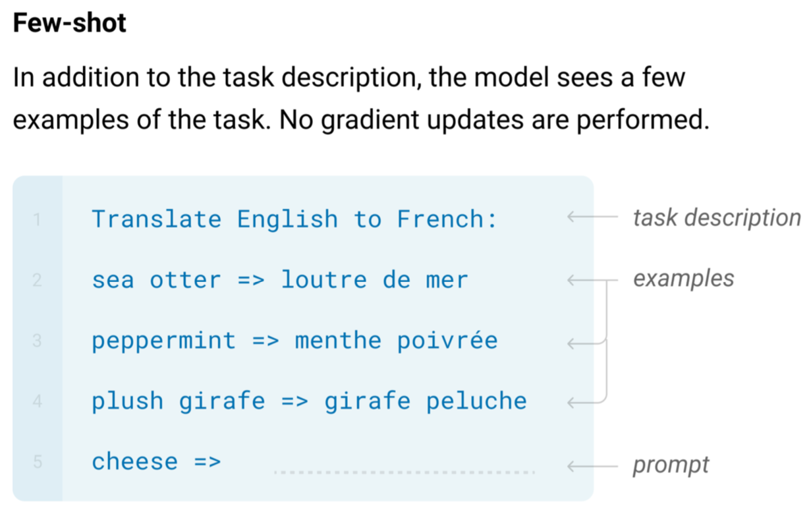

Figure 3-x Example of translation task

* First line: Task description, telling the model to do translation

* The next three lines: Example pairs, containing English words and corresponding French words

* Last line: English word to be translated

Taking the above content as a whole as the input of GPT-3, the model can output the corresponding French word. The application of contextual learning is very flexible. In addition to translation tasks, it can also be used for grammar modification and even code writing.

In addition, the GPT-3 training process does not explicitly provide training data similar to the task description plus examples in the testing phase. However, since the amount of GPT-3 training data is extremely huge (including wiki, books and periodicals, discussions on reddit, etc.), perhaps it already contains data with similar structures for various tasks, and the GPT-3 model capacity is large enough to remember all the training data.

Currently, the cause of contextual learning ability is still an open question. Why do only large-scale language models have this ability? Perhaps it is not enough to have a large number of model parameters, but the amount of training data must be large enough for the model to show this ability. These issues still need further research and exploration.

**ICL basic principles**

By providing some demonstrative <input-label> pairs, ICL can accurately predict new inputs without updating model parameters. This ability has shown great potential in various application scenarios. Although ICL has shown excellent performance, its specific working principle is still a mystery. To explain this phenomenon, researchers from Tsinghua University, Peking University, and Microsoft published a [paper](https://arxiv.org/abs/2301.00234) that regards language models as a meta-optimizer and understands ICL as an implicit fine-tuning. This perspective helps us better understand the operating mechanism of ICL.

ICL can be divided into the following three types:

1. **Few-shot Learning**: Provide multiple examples. For example: "Translate Chinese into English. Hello->hello, Goodbye->goodbye, Purchase->purchase, Sale->", the model should predict the next output as "sell".

2. **One-shot Learning**: Provide one example. For example: "Translate Chinese into English. Hello->hello, Sale->", the model should predict the next output as "sell".

3. **Zero-shot Learning**: No examples. For example: "Translate Chinese into English. Sale->", the model should predict the next output as "sell".

Its main process includes the following steps:

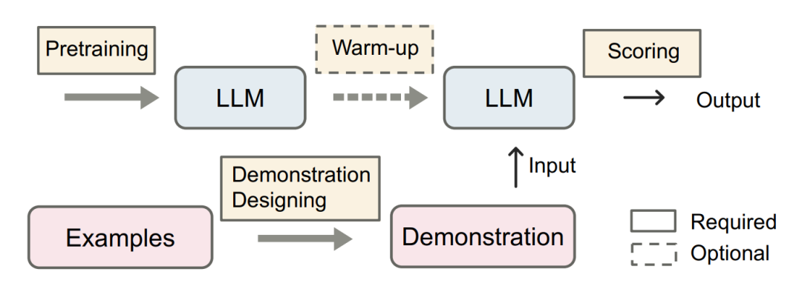

Figure 3-x ICL steps

* **Pre-training stage**: Train the ICL ability of the language model through a large-scale corpus. The optional warm-up stage can further improve the performance of the model.

* **Demonstration design**: Use pre-trained LLM and carefully designed examples, plus appropriate scoring strategies, to generate the final output of the task. The quality of the examples does not significantly affect the ICL effect.

* **Inference stage**: Combine examples and query questions to form a prompt, and input it into the model for prediction.

ICL's powerful performance relies on two stages:

* **Training stage**: Train the ICL ability of LLM. Language models are trained directly on language modeling goals, such as left-to-right generation. Although these models are not specifically optimized for contextual learning, ICL still has surprising abilities.

* **Inference stage**: LLM makes predictions based on demonstrations of specific tasks. Since input and output labels are represented in interpretable natural language templates, there are multiple directions to improve the performance of ICL.

As the model size and corpus expand, research shows that LLMs can use ICL to complete a series of complex tasks, including solving mathematical reasoning problems. These abilities have been widely verified, showing the potential of ICL as an emerging ability of large language models.

The core idea of ICL is based on analogical learning. Simply put, ICL extracts patterns from given examples and applies these patterns to new tasks, thereby achieving accurate predictions and solving problems.

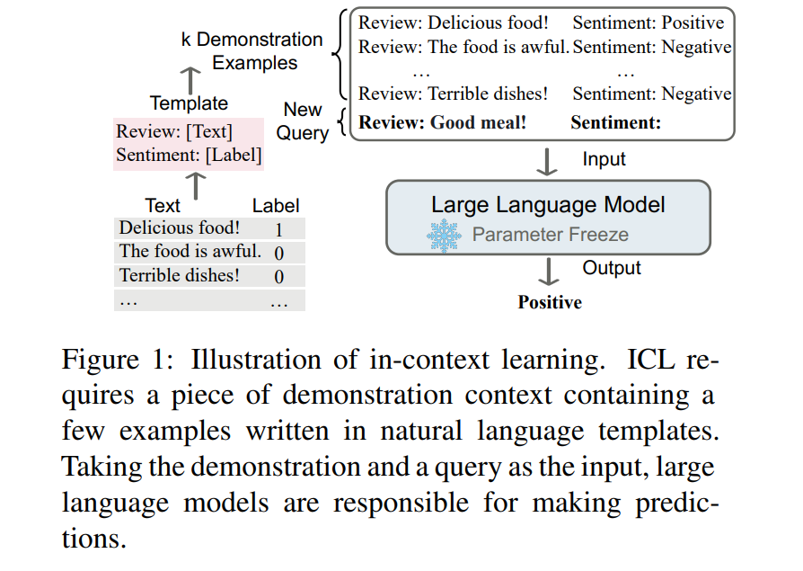

In ICL, some examples are first needed to form a demonstration context. Examples are usually written using natural language templates. Then, ICL connects a query question and a demonstration context together to form a prompt. Finally, it is input into the language model for prediction. ICL does not require parameter updates and directly predicts the pre-trained language model. The model is expected to learn the patterns hidden in the demonstration and make correct predictions accordingly.

As a new paradigm, ICL has many attractive advantages. First, demonstrations are written in natural language format, providing an interpretable interface to communicate with large language models. This paradigm makes it much easier to incorporate human knowledge into language models by changing demonstrations and templates. Second, contextual learning is similar to the human analogical decision-making process. Third, compared with supervised learning, ICL is an unsupervised learning framework. This not only greatly reduces the computational cost of adapting the model to new tasks, but also makes language model as a service possible and can be easily applied to large-scale real-world tasks.

However, there are still some problems and properties in ICL that need further research. Although ordinary GPT-3 models show ICL capabilities, the capabilities can be significantly improved through adaptation during pre-training. In addition, the performance of ICL is sensitive to specific settings, including prompt templates, the selection of contextual examples, and the order of examples. Although it is intuitively reasonable, the working mechanism of ICL is still unclear, and few studies provide preliminary explanations.

### 2.5.4 Chain of Thought (CoT)

CoT is an improved Prompt strategy designed to improve the performance of LLM in complex reasoning tasks. Unlike ICL, CoT not only focuses on input and output, but also specifically emphasizes incorporating the intermediate steps in the reasoning process into the Prompt. This method enables the model to more clearly demonstrate its thinking process, thereby performing well in tasks such as arithmetic reasoning, common sense reasoning, and symbolic reasoning.

**What is CoT?**

In 2022, Google published a [paper](https://arxiv.org/pdf/2201.11903) that mentioned a technology called "Chain-of-Thought" (CoT for short). Simply put, this method is to let large models (such as ChatGPT) gradually decompose a complex problem into several simpler sub-problems, solve them step by step, until the answer is obtained. This decomposition process is called "Chain of Thought".

Why do this? Imagine when you are solving math problems, you don't just write down the answer directly, but write down every step of the solution, which is not only easier to understand, but also makes the whole process clearer. This is the principle of Chain of Thought - by decomposing the problem, it makes it easier for AI to find the correct answer.

**The difference between traditional methods and CoT**

Usually, our questions to AI are like a straight line process from input to output. For example, you ask a question and AI gives you the answer directly. When using Chain of Thought, this process becomes three parts: **input** → **Chain of Thought (reasoning process)** → **output**.

For a simple example, if you let AI answer "If there are 5 apples, each apple is worth 3 yuan, how much does it cost in total?" The traditional method may directly answer "15 yuan". But using Chain of Thought, AI will first write: "There are 5 apples, each worth 3 yuan, so it is 5 × 3, the answer is 15 yuan." By showing these intermediate steps, AI's answer is easier to understand.

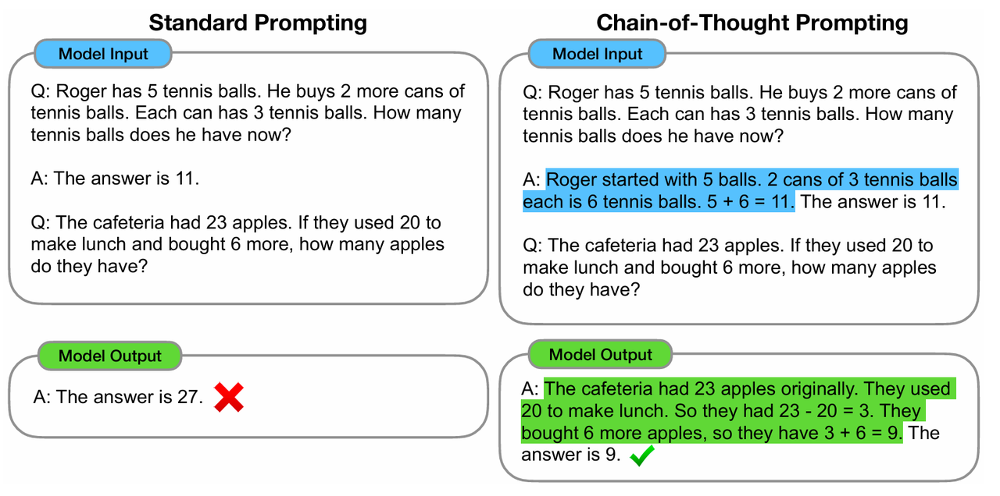

The above picture shows the difference between Standard Prompting and Chain-of-Thought Prompting.

In the standard prompt on the left, we see that the model directly gives the answer without explaining the process, so the model is prone to errors when facing complex problems. For example, when asked "Roger has 5 tennis balls, and he bought 2 more cans of tennis balls, each can has 3 tennis balls. How many tennis balls does he have now?", the model directly gives the answer "11". Although the answer is correct, it does not show the intermediate reasoning steps, which makes its reliability and understanding lower.

In the Chain of Thought prompt on the right, the model is required to gradually explain the whole process: "Roger originally had 5 tennis balls, and bought 2 more cans of tennis balls, each can has 3 tennis balls, a total of 6 tennis balls. 5 + 6 = 11." By showing the reasoning process step by step, the model not only gets the correct answer, but also makes people clearly see the logic of solving the problem.

In another example, there are 23 apples in the cafeteria, 20 were used to make lunch, and 6 more apples were bought. How many apples are left? Under the standard prompt, the model answers "27", which is wrong. When using Chain of Thought prompt, the model will explain step by step: "There were originally 23 apples, 20 were used to make lunch, so there are 3 left. Then 6 more apples were bought, so 3 + 6 = 9 apples." Finally get the correct answer.

**Different types of CoT**

By carefully decomposing the prompts that use the Chain of Thought (CoT) method, we can gain a deeper and clearer insight into the working mechanism and process of Chain of Thought. According to whether it contains examples, we can divide Chain of Thought into two types:

* **Zero-Shot-CoT**: No specific examples are provided, just add a sentence "Let's think step by step" in the question. This simple prompt can "wake up" the AI's reasoning ability.

* **Few-Shot-CoT**: Give AI some examples, each example contains questions, reasoning process and answers, like explaining the problem-solving steps to AI. Through these examples, AI can imitate these reasoning steps to solve new problems.

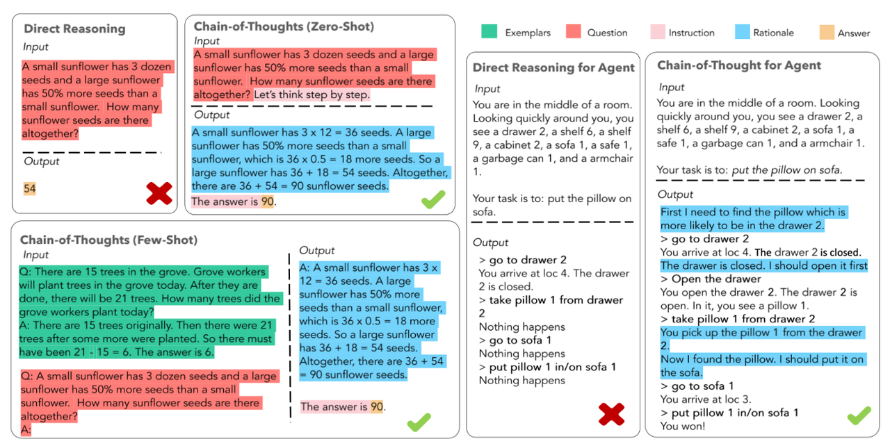

The above picture shows the difference between standard prompts (Direct Reasoning) and Chain of Thought prompts (Chain-of-Thought Reasoning).

In the direct reasoning on the left, we see that the model directly gives the answer without explaining the process, so the model is prone to errors when facing complex problems. For example, when asked "The small sunflower has 3 dozen seeds, and the large sunflower has 50% more seeds than the small sunflower. How many seeds are there in total?", the model directly gets the wrong answer "54".

In the Chain of Thought reasoning on the right, the model is required to gradually explain the whole process: "The small sunflower has 3 dozen seeds, that is 3 × 12 = 36 seeds, the large sunflower has 50% more seeds than the small sunflower, that is 36 × 0.5 = 18 seeds. So the large sunflower has 36 + 18 = 54 seeds, a total of 36 + 54 = 90 seeds." By showing the reasoning process step by step, the model not only gets the correct answer, but also makes people clearly see the logic of solving the problem.

**Why is CoT effective?**

So far, there is no fully recognized scientific explanation to explain why Chain of Thought is effective. However, many experiments have observed some interesting phenomena that can help us understand CoT:

* **The model size must be large enough**: If the AI is too small (for example, the understanding is insufficient), Chain of Thought may not work, because it does not even understand the basic knowledge.

* **The task cannot be too simple**: For some very simple questions, Chain of Thought is not very helpful, because AI can already give the answer directly.

* **The connection of training data**: If the data learned by AI in training is closely related to each other, the effect of Chain of Thought will be better.

* **Errors in the examples**: Interestingly, even if there are some wrong steps in the examples given to AI, Chain of Thought is still effective. This shows that CoT is more like "commanding" AI to do step-by-step reasoning, rather than teaching AI how to do it specifically.

In short, the effect of Chain of Thought may lie in the fact that it forces AI to think step by step, just like a teacher asks students to write down the problem-solving process, not only to get the answer, but also to better understand the process of the problem.

### 2.5.5 Prompt in CAMEL

Now let's see how to use CAMEL's Prompt function to better understand the concept of Prompt through practical operation.

**Use CoT prompts to create task-specific Agents**

CAMEL provides some convenient tools to help users use CoT. We can use `TaskSpecifyAgent` to create a task-specific Agent, which will automatically call the template with CoT. For example, here is a code example:

```python
from camel.agents import TaskSpecifyAgent
from camel.models import ModelFactory
from camel.types import ModelPlatformType, TaskType
import os
from dotenv import load_dotenv

load_dotenv()
api_key = os.getenv('MODELSCOPE_SDK_TOKEN')

model = ModelFactory.create(
    model_platform=ModelPlatformType.OPENAI_COMPATIBLE_MODEL,
    model_type="ZhipuAI/GLM-4.5",
    url='https://api-inference.modelscope.cn/v1/',
    api_key=api_key
)
task_specify_agent = TaskSpecifyAgent(
    model=model, task_type=TaskType.AI_SOCIETY,output_language='中文'
)
specified_task_prompt = task_specify_agent.run(
    task_prompt="Improving stage presence and performance skills",
    meta_dict=dict(
        assistant_role="Musician", user_role="Student", word_limit=100
    ),
)
print(f"Specified task prompt:\n{specified_task_prompt}\n")

>>>
Specified task prompt:
Musician will coach Student on dynamic stage movement, audience engagement techniques, and emotional expression during performances, enhancing overall charisma and connection with the audience.
```

In this example, we use `TaskSpecifyAgent` to generate a task prompt with Chain of Thought. By specifying roles for the Agent, we let it gradually generate solutions to the problem.

**Use custom Prompt templates**

CAMEL also allows users to create their own Prompt templates, making the generated Prompt more in line with user needs. We can write our own Chain of Thought prompt templates and then apply them to `TaskSpecifyAgent`. Here is a simple example:

```python
from camel.agents import TaskSpecifyAgent
from camel.models import ModelFactory
from camel.prompts import TextPrompt
from camel.types import ModelPlatformType
import os
from dotenv import load_dotenv

load_dotenv()
api_key = os.getenv('MODELSCOPE_SDK_TOKEN')

model = ModelFactory.create(
    model_platform=ModelPlatformType.OPENAI_COMPATIBLE_MODEL,
    model_type="ZhipuAI/GLM-4.5",
    url='https://api-inference.modelscope.cn/v1/',
    api_key=api_key
)

my_prompt_template = TextPrompt(
    'Here is a task: I\'m a {occupation} and I want to {task}. Help me to make this task more specific.'
)  # You can customize any template according to your needs
task_specify_agent = TaskSpecifyAgent(
    model=model, task_specify_prompt=my_prompt_template
)
response = task_specify_agent.run(
    task_prompt="get promotion",
    meta_dict=dict(occupation="Software Engineer"),
)
print(response)

>>>
Certainly! To make your goal of getting a promotion as a Software Engineer more specific, you can break it down into clear, actionable steps. Here’s a more detailed version of your task:

### Specific Task: Get Promoted as a Software Engineer

#### 1. **Understand the Promotion Criteria**
   - **Research Company Policies:** Review your company's promotion guidelines and criteria.
   - **Talk to Your Manager:** Schedule a meeting with your manager to discuss what is required for a promotion, including specific skills, projects, and performance metrics.
   - **Analyze Peer Promotions:** Look at the career paths of colleagues who have been promoted recently to identify common traits and achievements.

#### 2. **Set Clear Goals**
   - **Short-Term Goals (Next 3-6 months):** Identify 3-5 specific, achievable goals that align with your promotion criteria.
     - Example: Complete a critical project ahead of schedule, improve code quality by 20%, or lead a small team on a new initiative.
   - **Long-Term Goals (Next 6-12 months):** Set 2-3 ambitious goals that demonstrate leadership and advanced technical skills.
     - Example: Mentor junior engineers, contribute to a major architectural change, or publish a paper or blog post on a relevant topic.

#### 3. **Enhance Your Skills**
   - **Technical Skills:** Identify areas where you need to improve and create a plan to enhance these skills.
     - Example: Take online courses, attend workshops, or work on side projects to gain expertise in new technologies.
   - **Soft Skills:** Develop leadership, communication, and problem-solving skills.
     - Example: Join a public speaking club, take a leadership course, or volunteer for cross-functional projects.

#### 4. **Build Relationships**
   - **Network Internally:** Build strong relationships with colleagues and senior leaders.
     - Example: Participate in company events, join employee resource groups, or offer to help on other teams' projects.
   - **Seek Mentors:** Find mentors within the company who can provide guidance and advocate for your promotion.
...
   - **Gather Recommendations:** Ask for recommendations from colleagues and managers who can vouch for your skills and contributions.
   - **Practice Interviewing:** If there is an interview process, practice answering common promotion interview questions.

By breaking down your goal into these specific steps, you can create a clear roadmap to achieving your promotion. Good luck!
```

Through these practical examples, we can see how to use Chain of Thought prompts through CAMEL's Prompt function. This can not only make the output results more logical, but also better control the quality and relevance


## 2.6 Memory

### 2.6.1 Introduction

In an Agent system, the Memory module is a crucial component whose primary function is to store and retrieve information to support the agent's learning and decision-making processes. This module simulates certain features of human memory, capable of dynamically saving and updating information, enabling the agent to use past experiences for reasoning and decision-making.

**Why have a Memory module?**

Imagine if the agent had no memory when you interact with it, it would be impossible to have multi-turn conversations. Each time you ask a question, it would be like starting a new conversation, and the conversation would lack continuity.

The Memory module typically includes the following core functions:

1. **Information Storage**: Efficiently store various forms of data, including facts, events, rules, and contextual information, for quick access when needed.

2. **Information Retrieval**: Support quick retrieval of relevant information based on specific queries or context, helping the agent make accurate judgments when needed.

3. **Memory Update**: Dynamically update stored content based on new information and experiences to reflect changes in the environment or task.

4. **Memory Management**: Includes aging mechanisms and priority management to ensure that more important information is retained long-term, while unnecessary information can be effectively cleared to optimize the use of storage resources.

The Memory module in CAMEL provides a flexible system for storing, retrieving, and managing Agent information. It enables Agents to maintain context in conversations and retrieve relevant information from past interactions, thereby improving the coherence and relevance of AI responses.

### 2.6.2 **ChatHistoryBlock**

ChatHistoryBlock is a chat history memory block implementation based on key-value storage.

*   Uses a key-value storage backend (BaseKeyValueStorage)

*   Supports window-based retrieval

*   Implements a message weight decay mechanism

    **Initialization parameters**

*   `storage`: Storage backend, defaults to `InMemoryKeyValueStorage`

*   `keep_rate`: Historical message weight decay rate, defaults to 0.9

    This module mainly implements the following methods:

*   `retrieve()`: Retrieves the most recent chat history using an optional window size

*   `write_records()`: Writes new records to the chat history

*   `clear()`: Deletes all chat messages

**keep\_rate Overview**

`keep_rate` is an important parameter in the CAMEL memory system used to control the weight decay of historical messages. It is mainly used to adjust the importance of historical messages in the context.

*   Value range: \[0,1]

*   Default value: 0.9

*   Target object: Non-system messages (system messages always maintain score=1.0)

Its working principle is as follows when retrieving historical messages:

1.  The initial score of the latest message is 1.0

2.  For each message going back, the score is multiplied by keep\_rate

3.  The final score value of each message determines its importance in the context

Now suppose there are 5 historical messages, keep\_rate=0.9:

| Message Position | Score Calculation | Final Score |
| ---------------- | ----------------- | ----------- |
| Latest Message   | 1.0               | 1.0         |
| 1 message back   | 1.0 \* 0.9        | 0.9         |
| 2 messages back  | 0.9 \* 0.9        | 0.81        |
| 3 messages back  | 0.81 \* 0.9       | 0.729       |
| 4 messages back  | 0.729 \* 0.9      | 0.656       |

In fact, its working principle is very similar to our human brain. We have a deeper impression of recent events, while the opposite is true for things that happened longer ago. Here are some noteworthy points:

1.  score does not affect the storage of messages, but it determines which messages should be retained when generating the context when the total number of tokens exceeds the limit.

2.  system messages are not affected by score, which means that system\_msg will always be retained when generating the context.

3.  keep\_rate can be used in conjunction with window\_size to better control the context

4.  A too low keep\_rate may cause valuable historical information to be excessively weakened

5.  A too high keep\_rate may cause the context to be too lengthy

**Example Usage**

We can intuitively feel the role of keep\_rate in ChatHistoryBlock through the following example.

```python
from camel.memories.blocks import ChatHistoryBlock
from camel.memories.records import MemoryRecord
from camel.types import OpenAIBackendRole
from camel.messages import BaseMessage

# Create a ChatHistoryBlock instance
chat_history = ChatHistoryBlock(keep_rate=0.8)

# Simulate writing some message records
chat_history.write_records([
    MemoryRecord(message=BaseMessage.make_user_message(role_name="user", content="Hello, how are you feeling today?"), role_at_backend=OpenAIBackendRole.USER),
    MemoryRecord(message=BaseMessage.make_assistant_message(role_name="assistant", content="I'm fine, thank you!"), role_at_backend=OpenAIBackendRole.ASSISTANT),
    MemoryRecord(message=BaseMessage.make_user_message(role_name="user", content="What can you do?"), role_at_backend=OpenAIBackendRole.USER),
    MemoryRecord(message=BaseMessage.make_assistant_message(role_name="assistant", content="I can help you with various tasks."), role_at_backend=OpenAIBackendRole.ASSISTANT),
])

# Retrieve the most recent 3 messages
recent_records = chat_history.retrieve(window_size=4)

for record in recent_records:
    print(f"Message: {record.memory_record.message.content}, Weight: {record.score}")
    
>>>
Message: hello, how are you?, Weight: 0.40960000000000013
Message: I'm fine, thank you!, Weight: 0.5120000000000001
Message: What can you do?, Weight: 0.6400000000000001
Message: I can help you with various tasks., Weight: 0.8
```

### 2.6.3 VectorDBBlock

`VectorDBBlock` is a semantic memory block implementation based on a vector database. For the vector part, you can refer to [Chapter 4](https://fmhw1n4zpn.feishu.cn/docx/AF4XdOZpIo6TOaxzDK8cxInNnCe#share-BedFdnFgCongRUxPTczcuvrInfc).

*   Uses a vector storage backend (`BaseVectorStorage`)

*   Supports semantic similarity retrieval

*   Implements vectorized storage of messages

**Initialization parameters**

*   `storage`: Optional BaseVectorStorage (default: `QdrantStorage`)

*   `embedding`: Optional BaseEmbedding (default: `OpenAIEmbedding`)

This module mainly implements the following methods:

*   `retrieve()`: Retrieves similar records based on keywords

*   `write_records()`: Converts and writes new records to the vector database

*   `clear()`: Deletes all records from the vector database

The workflow of this module is as follows:

1.  Storage process:

    *   Convert the message content into a vector representation

    *   Generate a unique identifier (UUID)

    *   Store the vector and original message into the vector database

2.  Retrieval process:

    *   Convert the query keywords into vectors

    *   Search for similar vectors in the vector space

    *   Return the record with the highest similarity

**Example Usage**

If the `embedding` parameter in VectorDBBlock is not defined here, the default OpenAI's text-embedding-3-small model will be called, which requires the corresponding OpenAI API KEY. Thoughtfully, CAMEL also provides us with a convenient and quick way to call our local embedding model with one click. You only need to import `SentenceTransformerEncoder`, and then select the embedding model we want to use according to the scenario (default is intfloat/e5-large-v2). Here is a Chinese scenario, and the author chose bge-m3 as our embedding model. For model selection and more related information, please refer to [Hugging Face(embedding\_model)](https://huggingface.co/models?library=sentence-transformers) and our [Embedding chapter](https://fmhw1n4zpn.feishu.cn/docx/AF4XdOZpIo6TOaxzDK8cxInNnCe#share-CTBSdtqsPowmFyxdH6wcmEXVnKh).

```python
from camel.memories.blocks.vectordb_block import VectorDBBlock
from camel.memories.records import MemoryRecord
from camel.messages import BaseMessage
from camel.embeddings import SentenceTransformerEncoder
from camel.types import OpenAIBackendRole

# Create a VectorDBBlock instance
vector_db_block = VectorDBBlock(embedding=SentenceTransformerEncoder(model_name="BAAI/bge-m3"))

# Create some example chat records
records = [
    MemoryRecord(message=BaseMessage.make_user_message(role_name="user", content="The weather is great today!"), role_at_backend=OpenAIBackendRole.USER),
    MemoryRecord(message=BaseMessage.make_user_message(role_name="user", content="What sports do you like?"), role_at_backend=OpenAIBackendRole.USER),
    MemoryRecord(message=BaseMessage.make_user_message(role_name="user", content="The weather is nice today, let's go for a walk."), role_at_backend=OpenAIBackendRole.USER),
]

# Write the records to the vector database
vector_db_block.write_records(records)

# Use keywords to retrieve
keyword = "weather"
retrieved_records = vector_db_block.retrieve(keyword=keyword, limit=3)

for record in retrieved_records:
    print(f"UUID: {record.memory_record.uuid}, Message: {record.memory_record.message.content}, Score: {record.score}")
>>>
UUID: f7519828-afe7-41e4-8331-7bbc4d7dcbd5, Message: The weather is great today!, Score: 0.779863416845349
UUID: 0fbab391-f0e0-4580-877b-8fa2a837675b, Message: The weather is nice today, let's go for a walk., Score: 0.6920892191464151
UUID: a640cf33-987b-4b52-ac2b-a987dd474e4e, Message: What sports do you like?, Score: 0.534536213348924
```

### 2.6.4 Specific Practices in CAMEL

CAMEL currently supports three forms of key\_value, graph, and vector for storing LLM information for retrieval when needed. The core principle of large models generating natural language text is based on prediction. Specifically, the main task of a language model is to predict the next word based on the given context.

CAMEL mainly uses two data structures, chat\_history and context, to process memory information. Among them, Chat\_history is used to standardize the chat records during the agent's use process, and the context part is used to obtain the context from chat\_history. Since the model has input token limitations, it is crucial to obtain sufficiently effective and important context from the records and provide it to the model. CAMEL uses a weighting mechanism to filter important parts from chat\_history to form the context, thereby ensuring the effectiveness of decision-making capabilities.

The following uses a case to demonstrate the implementation of memory in CAMEL. We first create a memory object, then create an agent, and assign the memory object to the agent's memory attribute.

```python
from camel.memories import (
    LongtermAgentMemory,
    MemoryRecord,
    ScoreBasedContextCreator,
    ChatHistoryBlock,
    VectorDBBlock,
)
from camel.messages import BaseMessage
from camel.types import ModelType, OpenAIBackendRole
from camel.utils import OpenAITokenCounter
from camel.embeddings import SentenceTransformerEncoder

# 1. Initialize the memory system
memory = LongtermAgentMemory(
    context_creator=ScoreBasedContextCreator(
        token_counter=OpenAITokenCounter(ModelType.GPT_4O_MINI),
        token_limit=1024,
    ),
    chat_history_block=ChatHistoryBlock(),
    vector_db_block=VectorDBBlock(embedding=SentenceTransformerEncoder(model_name="BAAI/bge-m3")),
)

# 2. Create memory records
records = [
    MemoryRecord(
        message=BaseMessage.make_user_message(
            role_name="User",
            content="What is CAMEL AI?"
        ),
        role_at_backend=OpenAIBackendRole.USER,
    ),
    MemoryRecord(
        message=BaseMessage.make_assistant_message(
            role_name="Agent",
            content="CAMEL-AI is the first LLM multi-agent framework and an open source community dedicated to finding agent scaling laws."
        ),
        role_at_backend=OpenAIBackendRole.ASSISTANT,
    ),
]

# 3. Write memory
memory.write_records(records)

context, token_count = memory.get_context()

print(context)
print(f'token consumption: {token_count}')

>>>
[{'role': 'user', 'content': 'What is CAMEL AI?'}, {'role': 'assistant', 'content': 'CAMEL-AI is the first LLM multi-agent framework and an open source community dedicated to finding agent scaling laws.'}]
token consumption: 52
```

Let's first try calling the agent directly:

```python
from camel.agents import ChatAgent
from camel.models import ModelFactory
from camel.types import ModelPlatformType
import os
from dotenv import load_dotenv

load_dotenv()
# Define the system message
sys_msg = "You are a curious agent, exploring the mysteries of the universe."

# Initialize the agent Call online ZhipuAI/GLM-4.5
api_key = os.getenv('MODELSCOPE_SDK_TOKEN')

model = ModelFactory.create(
    model_platform=ModelPlatformType.OPENAI_COMPATIBLE_MODEL,
    model_type="ZhipuAI/GLM-4.5",
    url='https://api-inference.modelscope.cn/v1/',
    api_key=api_key
)
agent = ChatAgent(system_message=sys_msg, model=model)

# Define the user message
usr_msg = "Tell me, based on our discussion, which is the first LLM multi-agent framework?"

# Send the message to the agent
response = agent.step(usr_msg)

# View the response
print(response.msgs[0].content)

>>>
"As of now (2023), there is no specific project or platform that is clearly and widely recognized as the "first" LLM multi-agent framework. However, with the rapid development of large language models (LLMs) and multi-agent system research, some early attempts to combine the two can be regarded as pioneers.

For example, "AgentVerse" is a multi-agent framework based on large language models, which allows different AI agents to interact with each other to complete tasks or solve problems. Although it cannot be said to be the first, it is indeed an example of an early exploration in this field.

In addition, there are other studies and projects that are also exploring how to use LLMs to build multi-agent systems, such as simulating social dynamics and collaborative problem-solving. These works have promoted the progress of the field to varying degrees.

If you have a more specific time frame or other criteria to define "first", please provide more information so that I can try to give a more accurate answer."
```

Then we assign the previously set memory to the agent:

```python
# Assign memory to the agent
agent.memory = memory
# Send the message to the agent
response = agent.step(usr_msg)
# View the response
print(response.msgs[0].content)
>>>
"Based on our discussion, CAMEL-AI is the first multi-agent framework based on large language models (LLM)."
```

It can be seen that our newly created agent can answer questions based on the set memory.

## 2.7 Protocol

### 2.7.1 Introduction to Protocols

**1.1 The Rise of AI Agents and the "Communication Problem" They Face**

Today, AI Agents based on large language models (LLMs) are becoming increasingly intelligent. You can think of them as intelligent assistants with super brains. They can not only process information, but also think deeply, break down complex tasks into small steps, and even interact with the external environment, such as calling various tools to enhance their capabilities. They can even simulate user behavior to provide feedback for us to test and improve information systems.


However, as these AI Agents are increasingly applied to various fields, some challenges have also emerged. For example, we live in an era of information explosion, and the questions raised by users are becoming more and more complex and diverse, which is a considerable test for traditional search and information processing methods. AI Agents need to effectively understand and manage large amounts of contextual information and deal with a wide variety of external tools and systems. A common problem is that AI Agents encounter difficulties in performing complex actions that require multiple steps, or in maintaining a continuous understanding of the same thing in multiple interactions, just like people sometimes "blank out." Many existing AI applications are not designed with a unified method to tell the LLM what background information it needs to know at the moment, which often leads to temporary fixes when integrating external tools, and the effect is not stable.

**1.2 Why do we need standardized "communication rules"?**

Currently, many AI Agents adopt some "one-time" solutions when integrating external tools or collaborating with other Agents. These solutions are not only difficult to promote and expand, but also difficult to ensure security, let alone cross-domain applications. If we want to give full play to the potential of AI Agents, especially in systems where multiple AI Agents work together, we urgently need a powerful and standardized set of "communication rules." These rules can help them use tools uniformly, share necessary background information, and coordinate tasks between different systems.


Imagine that without unified language and behavioral norms, it would be difficult for AI Agents from different companies or developed based on different technical backgrounds to cooperate smoothly. This will limit the expansion of the AI Agent network, and ultimately limit their ability to solve more complex real-world problems. This situation is a bit like the early days of the Internet, when various computer systems were incompatible and the connection was very limited, which led to the slow development of the entire network. A unified communication protocol can not only solve the immediate interoperability problem, but also has the potential to give birth to a huge network composed of countless intelligent agents. In this network, various forms of intelligence can flow freely, and ultimately form a collective intelligence that transcends the capabilities of any single AI Agent. Therefore, standardized protocols are essential for achieving seamless connection, efficient collaboration, and the formation of collective intelligence between AI Agents.

**1.3 Main Content of this Section**

This section will take you to understand several very critical standardized protocols in the current LLM Agent field, focusing on Model Context Protocol (MCP), Agent-to-Agent Protocol (A2A), and Agent Network Protocol (ANP). These protocols provide effective ideas for solving the difficulties of AI Agents in understanding context, using tools, and collaborating with each other. We will explain in detail what these protocols are, what their goals are, what the core design ideas are, how they work, and where they can be used.

In addition, we will also give an example of how CAMEL applies the MCP protocol in practice. Specifically, we will talk about: how to use MCP tools in the CAMEL environment, how to convert the tools you developed with CAMEL into services that can be recognized and used by other MCP systems, and how to turn the AI Agents you created with CAMEL into an MCP service for other systems to call. This part will include some code examples that can be run directly to help you better understand and get started.

### 2.7.2 **MCP Protocol (Model Context Protocol)**

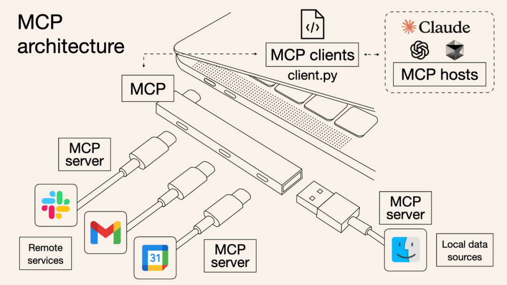

**2.1 What is MCP? What does it want to do?**

Model Context Protocol (MCP) can be understood as a standardized framework designed for AI models (such as the LLM Agent we often talk about) to interact with external data sources and tools. Its core goal is to solve the problem that large language models lack a unified and standardized "understanding background information" mechanism when using external information and tools. MCP strives to provide a standard method so that applications can clearly tell the LLM what tools are available now, what data can be referenced, and what basic instructions should be followed. Some people vividly compare MCP to the "USB-C interface in the field of artificial intelligence," which means that it hopes to become a universal connection standard. Through this standardization, MCP can support the flexible "plug and play" of various tools, safely integrate into existing IT facilities, and ensure good compatibility between different LLM providers. This protocol enables AI models to more effectively retain and share contextual information in different Agent interactions, thereby enhancing their ability to handle complex real-world problems.

**2.2 MCP's Design Philosophy**

MCP follows some core principles in its design. These principles determine its architecture and implementation methods, ensuring that it is both easy to use and reliable:

*   **Interoperability:** MCP aims to work across different AI models, platforms, and environments. No matter which AI technology you use, MCP hopes to provide a consistent context management method. This is reflected in its design that does not rely on specific programming languages and standardized data formats.

*   **Simplicity:** The protocol strives to be simple, clear, and easy to use. It focuses on a small set of core functions that can be combined to support complex application scenarios. This can lower the threshold for everyone to learn and use, and encourage consistent implementation in different systems.

*   **Extensibility:** While keeping the core simple, MCP also designs a clear extension mechanism. This means that new functions can be easily added in the future, or adjusted for specific professional fields, without breaking existing compatibility. This balance enables the protocol to adapt to changing needs.

*   **Security and privacy by design:** MCP puts security and privacy in a very important position from the beginning, rather than making up for it afterwards. This includes clear permission management, the principle of using as little data as possible, and mechanisms to control the flow of information between different components.

*   **Human-centered control:** The design of the protocol also considers maintaining appropriate manual supervision and control, especially when dealing with sensitive operations or important decisions. This reflects the recognition of the importance of human judgment in AI systems.

**2.3 How does MCP work?**

MCP adopts a common client-server architecture. In this architecture, the AI model (such as LLM Agent) plays the role of "client," while external data sources or tools run as "servers." This clear division of labor helps each perform its own duties: the client focuses on AI's thinking and reasoning, while the server is responsible for providing data and executing the functions of the tool.

The communication between them is mainly through JSON-RPC 2.0. This is a lightweight remote procedure call protocol that uses JSON, a common data format, to encode information, thereby ensuring that systems developed in different programming languages can understand each other. MCP's communication method is also very flexible. It can be carried out through the standard input and output streams (Stdio) between computer programs, or through the HTTP protocol commonly used in web pages in conjunction with the server-sent events (SSE) technology to adapt to different deployment scenarios and interaction needs.

MCP defines a set of standardized "primitives" (which can be understood as basic instructions or components) for context management. These primitives are divided into two categories: server-side and client-side:

*   **Server-side primitives:**

    *   **Prompts:** Some pre-defined instructions or templates. AI clients can request these prompts from the server to ensure the consistency of their behavior.

    *   **Resources:** Structured data or documents that can be sent to the AI model. They usually come with descriptive information (metadata) to provide the AI with the necessary background knowledge.

    *   **Tools:** Executable functions that AI can call to perform certain operations or obtain specific information. Each tool will clearly define its name, description of its purpose, what input parameters are required, and what type of results will be returned.

*   **Client-side primitives:**

    *   **Roots:** Entry points that allow the server to access specific data areas of the client, mainly used to set permission boundaries and clarify which information the server can access.

    *   **Sampling:** A mechanism for the MCP server to request the AI model to generate a piece of continuation or completion content. This enables the server to use the AI model's reasoning ability to complete certain tasks.

This architecture and component design enables MCP to be deployed flexibly, and the client and server can develop and update independently, as long as they both comply with the provisions of the MCP protocol.

**2.4 MCP's "Life": Three Stages of Interaction**

The interaction between an MCP client (such as an AI Agent) and a server (such as a tool service) follows a clearly defined three-stage life cycle. This design ensures robust session management, secure capability negotiation, and a clear termination process.


*   **Initialization:** Everything starts here. First, the client and server must confirm that they "speak the same language," that is, the protocol versions are compatible. They will negotiate the highest protocol version supported by both parties. Then, they will exchange their respective "capability lists," such as whether sampling is supported, whether prompts are provided, what tools are available, whether logging is supported, and so on. After the client receives the server's response agreeing to initialization, it will send a "I'm ready" notification, marking that both parties can start formal business communication.

*   **Operation:** This is the core activity stage. In this stage, the client and server will send each other JSON-RPC formatted instruction calls and notifications according to the capabilities negotiated in the initialization stage. Both parties must strictly abide by the previously agreed scope of functions to ensure compatibility and predictability. When the client calls a function of the server, it can set a timeout period. If the server's response is not received within this time, the client can send a cancellation notification to prevent resources from being occupied ineffectively or performing outdated operations.

*   **Shutdown:** This stage ensures that the entire session can end cleanly. Either party can initiate termination by closing the underlying communication connection (usually an HTTP connection or stdio stream). Once closed, both the client and server are responsible for cleaning up the resources they occupy, such as canceling pending timeout settings, unsubscribing, and releasing related child processes. After this, no new protocol messages should be sent by either party, except for necessary diagnostic information (such as ping messages to test whether the network is connected or refreshing logs).

**2.5 How is MCP different from other communication methods?**

*   **Compared with traditional "Agent Communication Languages" (ACLs):** Traditional ACLs like FIPA-ACL and KQML provide a set of formalized languages and standardized message structures to support complex interaction patterns like notifications, requests, and queries. They focus more on defining the "speech acts" of communication behavior (such as "inform," "request"). In contrast, MCP focuses more on how the model obtains and utilizes external "knowledge" and "capabilities" (that is, contextual resources and tools), rather than general Agent-to-Agent dialogue logic. ACLs can sometimes appear complex and heavyweight, while MCP strives for simplicity.

*   **Compared with "ontology"-based communication:** Ontology-based communication relies on everyone sharing a set of "ontology" (which can be understood as a structured representation of domain knowledge) to provide a common vocabulary and semantic framework to ensure that Agents have a unified understanding of concepts in a specific domain. This method can achieve very precise communication of domain concepts, but it usually requires a lot of effort to pre-develop this "ontology." MCP itself does not mandate complex ontologies, but instead defines the interfaces of tools and resources through structured JSON schemas, focusing more on operational interoperability.

*   **Compared with "natural language" communication:** With the development of LLM technology, it has become increasingly feasible for AI Agents to communicate directly in natural languages (such as Chinese and English). Natural language is very flexible and expressive. However, natural language is also prone to ambiguity, leading to difficulties in understanding. MCP provides clear, machine-parsable interfaces through JSON-RPC, reducing ambiguity and providing higher reliability for structured interactions such as tool calls.

In general, MCP can be seen as a protocol that focuses on the "last mile" connection between AI models and the external environment (tools and data). It emphasizes the structured, secure, and interoperable integration of contextual information and functions.

**2.6 Where can MCP be used?**

*   **Enterprise Knowledge Management:** Imagine that in a large company, AI Agents can connect to various internal data warehouses (such as databases, document systems, and various API interfaces) through MCP. In this way, AI Agents can help employees quickly find information, answer their questions, and even automate some processes that require a lot of knowledge processing. MCP ensures that AI Agents can access these diverse internal resources in a consistent and secure manner.

*   **Scientific Research Collaboration:** In the field of scientific research, LLM Agents can interact with multiple academic databases, simulation calculation tools, or experimental data analysis services through MCP. For example, an AI Agent can use MCP tools to collect academic papers from different sources, and then use another MCP tool to perform data analysis and visualization, and finally generate a comprehensive research report.

*   **Distributed Problem Solving:** In some complex distributed systems, multiple specialized AI Agents may need to work together to solve problems. MCP can serve as a standard interface for them to interact with shared tools or data services. For example, in supply chain management, one AI Agent may be responsible for predicting market demand, and another may be responsible for optimizing inventory. They can both access shared sales data and optimization algorithm tools through MCP.

*   **Dynamic Calling of External Tools:** AI Agents can dynamically discover and call available external tools through MCP according to the needs of the current task, such as performing web searches, generating images, executing code, and so on. This greatly expands the boundary of AI Agent capabilities without having to pre-build all possible functions into the Agent.

These application scenarios all highlight the value of MCP in enhancing the capabilities of AI Agents, improving their perception of the environment, and promoting seamless integration with the external world.

### 2.7.3 A2A Protocol (Agent-to-Agent Protocol)

**3.1 What is A2A? What does it want to do?**

The Agent-to-Agent Protocol (A2A) is a technical framework promoted by companies such as Google, with the goal of enabling autonomous AI Agents to conduct structured, secure, and interoperable communication. Its main purpose is to support AI Agents in enterprise-level workflows to outsource tasks and collaborate with each other on a point-to-point basis. As AI systems evolve from executing simple processes to requiring multiple AI Agents to perform complex collaborative work, protocols like A2A become essential. It is dedicated to solving the problem that in the absence of unified collaboration standards, different AI Agents (whether written by humans or driven by AI) find it difficult to effectively discover each other, negotiate tasks, and execute them together. A2A promotes effective interaction, discovery, and interoperability by providing a declarative, identity-aware framework that allows AI Agents to share descriptive information about their capabilities.


**3.2 Core Design Principles of A2A**

The design of the A2A protocol is based on the following core principles to ensure its effectiveness and security in multi-Agent environments:

*   **Agentic-first:** The design of the protocol focuses on the independent operation of AI Agents. Agents exchange information through clear communication and do not rely on shared memory or shared tools by default. This emphasizes the autonomy of each Agent in the ecosystem.

*   **Standards-compliant:** A2A utilizes widely used Web technologies such as HTTP (Hypertext Transfer Protocol), JSON-RPC (a data exchange format), and Server-Sent Events (SSE, a technology for servers to push messages to browsers). This reduces the learning cost for developers and ensures compatibility with existing IT infrastructure.

*   **Secure by default:** Integrated authentication and authorization measures are the basic components of the protocol design. This means that how to protect sensitive data and transaction security is considered from the beginning, rather than making up for it afterwards.

These principles together form the foundation of the A2A protocol, enabling it to support complex multi-Agent interactions while maintaining security and ease of use.

**3.3 How does A2A work?**

The A2A protocol defines a clear architecture and interaction process, mainly involving the following roles:

*   **User:** The initiator of the A2A interaction. This "user" can be a real person, or a system, service, or other AI Agent. The user initiates the request through the "client Agent."

*   **Client Agent:** Represents the user to communicate with remote AI Agents. It is responsible for converting the user's request into an actionable task and coordinating all received responses.

*   **Remote Agent / Server:** An AI Agent that provides specific capabilities and performs tasks.

The interaction between them usually follows these steps:


1.  The client Agent requests `/.well-known/agent.json` (Agent Card) from the remote Agent.

2.  The remote Agent returns the Agent Card.

3.  After authentication, the client Agent sends a JSON-RPC request to the remote Agent's `a2aEndpointUrl` via HTTPS (distinguishing between `tasks.send` and `tasks.sendSubscribe` paths).

4.  The remote Agent processes the task and returns the task status and artifacts via HTTP response (`tasks.send`) or SSE event (`tasks.sendSubscribe`).

5.  (Optional) If input is required, the client Agent sends subsequent information.

6.  The task is completed, and the final result is notified to the client.

7.  (Optional) The remote Agent sends push notifications via Webhook. This diagram can highlight the use of HTTPS and JSON-RPC.]

*   **Discovery:** The client Agent first needs to "discover" the remote Agent. It does this by obtaining something called an \*\*“Agent Card”\*\* from a standardized path (usually the `/.well-known/agent.json` file on the remote Agent server). This "card" is a JSON-formatted metadata file that declares the remote Agent's basic information, what skills it has, the A2A communication address (`a2aEndpointUrl`), and which authentication method it requires (specified through the OpenAPI 3.x security scheme object).

*   **Initiation:** The client Agent authenticates according to the authentication method declared on the "Agent Card." After successful authentication, it sends a JSON-RPC request to the remote Agent's `a2aEndpointUrl` via HTTPS (a secure web transfer protocol). Two main methods are used:

    *   `tasks.send`: Used for tasks that may be completed synchronously or do not require immediate streaming updates.

    *   `tasks.sendSubscribe`: Used for tasks that need to run for a long time and need to continuously send updates on a persistent HTTPS connection via Server-Sent Events (SSE).

*   **Processing & Interaction:**

    *   For non-streaming tasks (i.e., tasks initiated using `tasks.send`), the server returns the final Task object in the HTTP response after processing the task.

    *   For streaming tasks (i.e


### 2.7.4 **ANP Protocol (Agent Network Protocol)**

**4.1 What is ANP? What does it want to do? **

Agent Network Protocol (ANP) is a protocol designed to support AI Agents discovering each other and collaborating securely in an open network environment. Its core goal is to create an open, secure and efficient collaboration network that connects a large number of AI Agents from different providers and may have different structures, forming a so-called "Internet of Agents". ANP is particularly focused on solving the limitations of the current Internet, which is primarily optimized for human interaction rather than for autonomous AI agents. It is committed to meeting the needs of AI Agents for low-latency communication, native API interfaces, and decentralized identity authentication. By standardizing the connection mechanism between AI Agents, ANP hopes to break down data silos and ensure that AI can access complete contextual information, thereby promoting deeper collaboration and the emergence of collective intelligence.

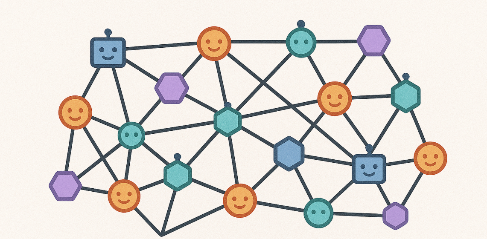

**4.2 The core concept and hierarchical design of ANP**

The construction of ANP is based on three core principles, which guide its development direction:

* **Interconnectivity:** The goal is to enable all AI Agents to communicate with each other, break down information barriers, and ensure that AI can obtain complete background information when making decisions.

* **Native Interfaces:** Allow AI Agents to interact with the digital world through APIs and protocols optimized for machine-to-machine communication, rather than being limited by interfaces and habits designed for human interaction.

* **Efficient Collaboration:** By utilizing automatic organization and automatic negotiation mechanisms, AI Agent can establish a more cost-effective and efficient collaboration network.

To implement these principles, ANP adopts a layered architecture, like building blocks, with each layer having a specific function:

* **Identity and Encrypted Communication Layer:** This layer utilizes the Decentralized Identifier (DID) standard of the World Wide Web Consortium (W3C) to establish a decentralized authentication mechanism. This means that AI agents can have a verifiable identity that is not controlled by any single agency. This ensures end-to-end encrypted communication without the need to trust each other in advance, allowing AI agents across different platforms to securely authenticate each other's identities.

* **Meta-Protocol Layer:** This layer plays the role of "protocol of protocols". It allows AI Agents to autonomously negotiate and coordinate the communication protocols to be used between them using natural language (such as through a system called Agora). This supports the dynamic adaptability of communication protocols to meet the needs of different interaction scenarios.

* **Application Protocol Layer:** This layer is responsible for defining standardized protocols and is used to standardize the following aspects:

  * How other AI Agents on the Internet discover an AI Agent.

  * How to describe the information, capabilities and available interfaces these AI Agents can provide.

  * Application-level protocols used to accomplish domain-specific tasks.

This layered design provides ANP with flexibility and scalability, allowing it to adapt to the diverse needs of future AI Agent networks.

**4.3 "ID Card" and "Roadfinding Guide" in ANP**

ANP adopts a decentralized and semantic approach to managing AI Agent identities and helping them discover each other:

* **Decentralized Identifiers (DIDs):** The core of ANP is to use the decentralized identifiers (DIDs) standard recommended by the W3C (World Wide Web Consortium) to manage the "digital ID card" of the AI Agent. Specifically, it might take something like`did:wba`Such a specific DID method. DIDs allow each AI Agent to have a verifiable, globally unique identity without relying on a centralized identity authentication authority. This lays a solid foundation for establishing trust and security authentication between AI Agents.

* **JSON-LD graph:** In order to describe what capabilities an AI Agent has, what services it can provide, and how to interact with it, ANP utilizes the JSON-LD (a JSON format for linking data) graph. JSON-LD allows data to be expressed in a structured and semantically rich way, allowing AI agents to better understand each other's functionality. These description files containing JSON-LD maps are crucial for the discovery of AI Agents.

* **Discovery process:** When a local AI Agent wants to find other AI Agents, it will first find a list of other AI Agents through a standardized discovery path (such as a predefined network endpoint, or a distributed hash table). Then, it will access the AI Agent description file referenced in this list and parse the JSON-LD and other information contained in it to understand what functions the target AI Agent has and how to interact with it.

By combining DIDs and JSON-LD, ANP aims to implement an open and interoperable AI Agent discovery mechanism, enabling AI Agents to find and understand each other in a vast network.

**4.4 How does ANP ensure security and collaboration? **

ANP ensures safe collaboration between AI agents through its architectural design and adopted technologies:

* **Secure Identity and Communication:**

  * **HTTPS-hosted DIDs:** DID documents (files containing AI Agent identity information) are usually served over HTTPS (Secure Web Transfer Protocol), ensuring their security during retrieval.

  * **DID signature verification:** Identity verification between AI Agents relies on cryptographic verification of digital signatures related to DID to ensure the authenticity of the communicating party and prevent counterfeiting.

  * **Cryptographic signature of interfaces:** The interface and service descriptions provided by AI Agent can also be cryptographically signed to prevent tampering and ensure that their sources are reliable.

  * **End-to-end encrypted communication:** ANP's identity and encrypted communication layer is designed to achieve end-to-end encrypted communication without prior trust and protect communication content from eavesdropping.

* **Collaboration and Negotiation:**

  * **Meta-Protocol Negotiator:** The meta-protocol layer of ANP allows the AI Agent to dynamically negotiate an interaction protocol that is compatible with both parties. This means that if the communication protocols initially used by two AI agents do not exactly match, they can determine a common communication method or parameters through a higher-level negotiation process. This is essential to facilitate collaboration between different types of AI agents and provides a potential mechanism for resolving conflicts (for example, disagreements about data formats or interaction sequences) by reaching agreement through negotiation.

  * **Automatic organization and negotiation:** ANP emphasizes automatic organization and automatic negotiation mechanisms to achieve a more efficient collaboration network. This shows that the design goal of the protocol is to enable AI Agents to form collaborative relationships autonomously and solve problems that arise during the collaboration process without much manual intervention.

Through these mechanisms, ANP strives to achieve secure and flexible multi-AI Agent collaboration in an open network environment.

### 2.7.5 CAMEL’s MCP

The content of this chapter needs to be updated to the latest version of CAMEL.

```bash
pip install "camel-ai[all]==0.2.71a9"
```

To enhance its agent’s ability to interact with external tools and environments, and integrate into the broader AI ecosystem, CAMEL integrates the Model Context Protocol (MCP). By supporting MCP, CAMEL agents can discover and call external tools in a standardized way, which not only simplifies the tool integration process, but also improves the modularity and scalability of the system. This integration enables CAMEL to better embrace the MCP ecosystem and leverage the standardized interfaces it provides to interact with a variety of MCP-compatible servers and services.

#### Implementation principle of MCP module in CAMEL

`camel.toolkits.mcp_toolkit.MCPToolkit` Provides the CAMEL framework with the ability to access multiple MCP Servers “one-stop”:

1. Support local STDIO process, Streamable-HTTP, SSE transmission method

2. Automatically detect the server type and uniformly package it as CAMEL's FunctionTool

3. Use AsyncExitStack to uniformly manage multiple connection life cycles

Process description

1. Toolkit initialization: The application side creates MCPToolkit, passes in the configuration file, and generates a Client for each MCP Server based on the configuration file.

2. connection phase

   * Toolkit uses AsyncExitStack to sequentially enter the async-context of each MCPClient

   * MCPClient automatically selects the transport layer and establishes ClientSession based on ServerConfig

   * Call list\_tools immediately after building the link to cache tool metadata

3. Tool aggregation: MCPToolkit.get\_tools() traverses all Clients, collects and tightens the schema

4. Tool call: call\_tool() finds the corresponding Client according to the name and transparently transmits the request to the Server

5. Disconnect: When Toolkit exits, AsyncExitStack is responsible for closing all Clients and underlying transports in sequence.

So you can find that in CAMEL, the tools in MCP will be converted into FunctionTool available in CAMEL, and finally a JSON description that conforms to OpenAI strict-schema will be generated.

#### How to use MCP in CAMEL

Using MCP tools in the CAMEL framework mainly involves configuring the MCP server and using`MCPToolkit`Perform connection and tool management and call these tools through CAMEL agents.

**5.1.1 MCP server configuration**

CAMEL via a JSON configuration file (e.g.,`mcp_servers_config.json`) to specify the MCP server to be connected. This file defines the startup commands, parameters, and possible required environment variables for each server. Here are the steps on how to connect a CAMEL-AI agent to a Time MCP server:

```json
{
  "mcpServers": {
    "time": { // 服务端标识名
      "command": "uvx", // 启动服务器的命令
      "args": ["mcp-server-time", "--local-timezone=Asia/Riyadh"] // 命令参数
    }
  }
}
```

The flexibility of this profile allows users to integrate a variety of existing or custom MCP servers, providing CAMEL agents with a wide range of external capabilities.

**5.1.2 CAMEL `MCPToolkit`**

in the CAMEL framework`MCPToolkit`It is the core component that interacts with the MCP server. It is responsible for reading configuration files, managing connections to one or more MCP servers, and aggregating available tools from these servers into a format that can be used by CAMEL agents.

```python
import asyncio
from camel.toolkits.mcp_toolkit import MCPToolkit
from camel.agents import ChatAgent
# 确保已定义 ChatAgent 所需的 model 对象
# from camel.models import ModelFactory, ModelPlatformType
# model = ModelFactory.create(model_platform=ModelPlatformType.OPENAI, model_type="gpt-4o-mini")

async def run_mcp_client_example():
    # 1. 初始化 MCPToolkit，指定配置文件路径
    mcp_toolkit = MCPToolkit(config_path="config/time.json") # 假设配置文件位于 config/time.json

    # 2. 异步连接到配置文件中定义的所有 MCP 服务器
    await mcp_toolkit.connect()

    # 3. 创建 CAMEL Agent 实例，并将从 MCPToolkit 获取的工具列表传递给 Agent
    camel_agent = ChatAgent(
        model=model, # Agent 使用的语言模型
        tools=[*mcp_toolkit.get_tools()], # 动态获取并解包 MCP 工具列表
    )

    # 4. Agent 执行任务，可能调用 MCP 工具
    response = await camel_agent.astep("What time is it now?")
    print(f"Agent response: {response.msgs[0].content}")
    if response.info and 'tool_calls' in response.info:
        print(f"Tool calls: {response.info['tool_calls']}")

    # 5. 任务完成后，断开与所有 MCP 服务器的连接
    await mcp_toolkit.disconnect()

# asyncio.run(run_mcp_client_example()) # 实际运行时取消注释

```

Example of expected output:

```sql
Agent response: The current local time in Riyadh is 15:57 (3:57 PM). 
Tool calls: [ToolCallingRecord(tool_name='get_current_time', args={'timezone': 'Asia/Riyadh'}, result='{\n "timezone": "Asia/Riyadh",\n "datetime": "2025-05-01T15:57:59+03:00",\n "is_dst": false\n}', tool_call_id='...')]
```

pass`MCPToolkit`, CAMEL greatly simplifies the use of standardized external tools in multi-agent environments. Developers do not need to directly deal with JSON-RPC messages or the underlying connection details of MCP, but can easily integrate and use MCP tools through high-level APIs. This abstraction capability significantly lowers the threshold for adopting standardized protocols such as MCP, allowing developers to focus more on the core logic and application scenarios of the agent rather than the complexity of the protocol itself.

**5.1.3 Code example: CAMEL Agent uses MCP tool**

The following Python code will show you how to configure a CAMEL `ChatAgent`(chat agent), enabling it to use external tools provided through the MCP protocol. This example assumes that we have prepared a file called `config/mcp_time_config.json` MCP server configuration file, this file describes how to start a local time service.

Python

```python
import asyncio
import os
import json
from camel.models import ModelFactory
from camel.types import ModelPlatformType, ModelType
from camel.toolkits import MCPToolkit
from camel.agents import ChatAgent
# from camel.logger import set_log_level # 如果需要更详细的日志，可以取消这行注释# set_log_level(level="DEBUG")# 重要提示：运行此代码前，请确保你已经设置了 OPENAI_API_KEY 环境变量# 例如：export OPENAI_API_KEY='你的OpenAI API密钥'# 或者在代码中安全地提供它。async def run_mcp_example_with_camel_agent:# 1. 配置AI模型 (我们这里用OpenAI的GPT-4o作为例子)# CAMEL可以让你方便地创建和使用不同平台和类型的AI模型# 请确保 OPENAI_API_KEY 环境变量已设置，否则模型无法工作
    model = ModelFactory.create(
        model_platform=ModelPlatformType.OPENAI, # 指定使用OpenAI平台
        model_type=ModelType.GPT_4O,             # 指定使用GPT-4o模型
    )
# 2. 初始化MCPToolkit，告诉它我们的MCP服务器配置文件在哪里# 这个配置文件 (mcp_time_config.json) 告诉CAMEL如何启动时间服务器。# 配置文件内容示例 (需要保存为 config/mcp_time_config.json):# {#   "mcpServers": {#     "time": {#       "command": "uvx",#       "args": ["mcp-server-time", "--local-timezone=America/New_York"]#     }#   }# }# 请根据你的实际文件路径调整下面的 config_file_path
    config_file_path = "config/mcp_time_config.json"
    mcp_toolkit = MCPToolkit(config_path=config_file_path)
try:# 3. 连接到配置文件中定义的所有MCP服务器
        print("正在尝试连接到MCP服务器...")await mcp_toolkit.connect # 这是一个异步操作，所以用 await
        print("成功连接到MCP服务器！")
# 4. 从MCPToolkit获取所有可用的工具
        available_tools = mcp_toolkit.get_toolsif not available_tools:
            print("没有从MCP服务器找到可用的工具。请检查你的配置文件和服务器状态。")return
        print(f"通过MCP发现的可用工具: {[tool.name for tool in available_tools]}")
# 5. 创建一个CAMEL聊天代理 (ChatAgent)，并把从MCP获取的工具交给它
        print("正在创建一个配备了MCP工具的CAMEL代理...")
        camel_agent = ChatAgent(
            model=model,                # 告诉代理使用我们之前配置的AI模型
            tools=[*available_tools],   # 把MCP工具列表交给代理
        )
        print("CAMEL代理创建完成。")
# 6. 现在我们可以和这个代理互动了，它在需要的时候会自动使用MCP工具
        task_prompt = "请问现在纽约是什么时间？" # 这是一个需要用到时间工具的问题
        print(f"向代理发送任务: {task_prompt}")
        response = await camel_agent.astep(task_prompt) # astep表示异步执行一步对话# 7. 打印代理的回复和它调用工具的信息if response and response.msgs:
            print("\n代理的最终回复:")
            print(response.msgs[-1].content) # 通常最后一条消息是最终答案# 检查代理是否调用了工具，并打印相关信息if response.info and 'tool_calls' in response.info and response.info['tool_calls']:
                 print("\n代理在此过程中进行的工具调用:")for tool_call in response.info['tool_calls']:# tool_call 的具体结构可能因CAMEL版本而异# 通常包含工具名称、传入的参数和工具返回的输出
                     print(f"  工具名称: {tool_call.get('name', '未知工具')}")
                     print(f"  调用参数: {tool_call.get('args', {})}")
                     print(f"  工具输出: {tool_call.get('outputs', '无输出')}")else:
                print("在此步骤中，代理没有报告工具调用。")else:
            print("未能从代理获取响应。")
except Exception as e:
        print(f"在执行过程中发生了错误: {e}")finally:# 8. 无论成功还是失败，最后都要断开与MCP服务器的连接，释放资源
        print("\n正在断开与MCP服务器的连接...")await mcp_toolkit.disconnect
        print("已成功断开连接。")

if name == "__main__":# 这部分代码是为了方便你运行示例：# 它会检查配置文件是否存在，如果不存在，会创建一个示例配置文件。# 它还会检查 OpenAI API 密钥是否设置。
    config_dir = "config"
    config_file = os.path.join(config_dir, "mcp_time_config.json")if not os.path.exists(config_dir):
        os.makedirs(config_dir)if not os.path.exists(config_file):with open(config_file, "w") as f:
            json.dump({"mcpServers": {"time": {# 注意: 要运行这个时间服务器，你需要先安装 'uvx' 和 'mcp-server-time'# 可以尝试用 pip install universal-unix-devserver mcp-server-time 来安装"command": "uvx","args": ["mcp-server-time", "--local-timezone=America/New_York"]
                    }
                }
            }, f, indent=2)
        print(f"已为你创建了一个示例配置文件: {config_file}")
        print("请确保你已经安装了 'uvx' 和 'mcp-server-time' 并且它们在你的系统路径中。")
        print("你可以尝试使用以下命令安装它们: pip install universal-unix-devserver mcp-server-time")
if not os.getenv("OPENAI_API_KEY"):
        print("警告: OPENAI_API_KEY 环境变量尚未设置。")
        print("此示例需要有效的OpenAI API密钥才能与AI模型交互。请先设置该环境变量。")# 如果没有API密钥，可以选择退出或提示用户输入# exit
    asyncio.run(run_mcp_example_with_camel_agent)
```

*Code explanation:* This code completely demonstrates the process of using the MCP tool in the CAMEL framework.

1. **Model Initialization:** We first use`ModelFactory`An AI model instance is created (here OpenAI’s GPT-4o). To actually run, you need to make sure that the relevant API key has been configured correctly (e.g. by setting the`OPENAI_API_KEY`environment variables).

2. **MCPToolkit initialization:** `MCPToolkit`pass`config_path`The parameters load the configuration information of the MCP server. In our case it points to`config/mcp_time_config.json`file, this file should contain the instructions required to start the MCP time server.

3. **Connect to server:** `await mcp_toolkit.connect`This line of code will connect asynchronously (without blocking the main program) to all MCP servers defined in the configuration file.

4. **Get Tools:** `mcp_toolkit.get_tools`A list will be returned, which contains tool objects obtained from all connected MCP servers and encapsulated by CAMEL.

5. **Agent Creation:** We created a`ChatAgent`(chat agent) instance and pull it from`MCPToolkit`The obtained tool list is passed to it. In this way, the agent can use these MCP tools in subsequent thinking and actions.

6. **Task Execution:** `await camel_agent.astep(task_prompt)`Send a task prompt to the agent (e.g. "What time is it in New York?"). If the agent determines that a tool is needed to answer the question (for example, calling a time server to obtain the current time), it calls the appropriate tool via the MCP protocol.

7. **Response processing:** The code will print out the agent's final reply content, as well as detailed information about the tools it may have called during the execution of the task (such as which tool was called, what parameters were used, and what results were obtained).

8. **Disconnect:** at`finally`In a code block (this means that this part will always be executed regardless of whether the previous code has an error),`await mcp_toolkit.disconnect`Ensure that the connection to the MCP server is closed properly to release occupied resources.


scripted`if name == "__main__":`The section contains some auxiliary functions: it checks whether the configuration file exists, and if it does not exist, creates a sample configuration file and prompts the user to install the necessary dependent libraries (`uvx`and`mcp-server-time`). At the same time, it will also check`OPENAI_API_KEY`Whether the environment variable is set, as this key is usually required for interacting with AI models.

This example clearly shows how the CAMEL framework works by`MCPToolkit`This "toolbox manager" simplifies the complexity of the MCP protocol and provides developers with a concise interface to leverage standardized external tools. This certainly enhances the functionality of LLM agents and their ability to work with other systems.

#### How to use CAMEL as MCP server

In addition to converting the toolkit into an MCP server, the CAMEL framework also supports a more powerful function: publishing the entire CAMEL agent itself as an MCP server. This means that a CAMEL agent that you have carefully configured - which may have a specific AI model, unique system messages, or even some other tools built in - can now run as a standalone service. Then, any client that supports the MCP protocol (such as the Claude desktop application developed by Anthropic, the Cursor code editor, or other AI agent frameworks that also support MCP) can send a request to your CAMEL agent through the MCP protocol and obtain its response.

Imagine that you developed a very specialized AI agent within the CAMEL ecosystem, perhaps leveraging some of CAMEL’s unique features (such as complex role-playing dialogue, large-scale simulations, or fine-tuning for a specific task). Now, by publishing it as an MCP server, this professional agent can be seamlessly integrated as a "component" into a broader, MCP-compliant, complex system of different types of AI agents. This effectively builds a bridge between CAMEL and other MCP-compatible frameworks and tools, promoting a higher level of interoperability - not just sharing at the tool level, but integration at the AI agent service level.
**5.3.1 Expose CAMEL Agent as MCP service**

Exposing the CAMEL agent as an MCP service actually encapsulates the agent's interactive capabilities (for example, its ability to respond to specific prompts, perform a series of thinking steps, or complete specific tasks) and provide it as one or more "tools" or "service interfaces" on the MCP server. When an MCP client connects to the MCP server driven by the CAMEL agent, it can call the CAMEL agent just like any other ordinary MCP tool.

Judging from CAMEL's documentation and development direction, some of its more complex internal modules, such as the module used to implement multi-agent role-playing (RolePlaying), or the "Workforce" module used to organize multiple agents to work together, are also planned or are being implemented as MCP servers. If these functions are also opened through MCP, then external systems can interact with the carefully designed and complex multi-agent interaction scenarios in CAMEL in a standardized way.

In addition, there is a core design philosophy in the CAMEL framework called "Code-as-Prompt". It emphasizes writing code that is both clear and understandable (for human developers) and accurately understood by AI agents. This concept coincides with the structured, clearly defined interface design advocated by the MCP protocol. Therefore, developers who are accustomed to CAMEL design principles may feel more natural and comfortable when defining and using MCP tools (including using the agent itself as an MCP tool), which will also help improve the quality and stability of integration.

**5.3.2 Code examples and configuration**

Below, we provide a conceptual code example and configuration instructions to demonstrate how to define a CAMEL agent and run it as an MCP server. It should be noted that the CAMEL framework itself is constantly developing and improving, and the exact API interface and specific tools for running the agent as an MCP server may change with version updates. Therefore, it is strongly recommended that you consult the latest version of the CAMEL official documentation** to obtain the most accurate implementation details.

1. **Define your CAMEL agent**

The purpose of this script is to define the CAMEL proxy you wish to expose as an MCP service.

```python
from camel.agents import ChatAgent
from camel.models import ModelFactory, ModelPlatformType
from camel.toolkits import FunctionTool, SearchToolkit # 假设 SearchToolkit 已定义

# 示例：定义不同功能的 Agent
chat_agent = ChatAgent(model=ModelFactory.create(model_platform=ModelPlatformType.OPENAI, model_type="gpt-3.5-turbo"))
chat_agent_description = "A general-purpose assistant."

reasoning_agent = ChatAgent(
    model=ModelFactory.create(model_platform=ModelPlatformType.OPENAI, model_type="gpt-4o-mini"))
reasoning_agent_description = "A specialized assistant for logical reasoning."

# (后续步骤通常涉及一个服务脚本，例如 agent_mcp_server.py,
#  该脚本负责加载这些 Agent 定义，并以 MCP 服务器模式运行它们。)
```

In this way, the capabilities of these Agents can be called by external systems through the MCP protocol.

* **Publish CAMEL Toolkit as MCP service**

Any CAMEL-AI toolkit can be started as an MCP server via built-in methods. The following is the `ArxivToolkit` Sample script to convert to MCP server (`arxiv_toolkit_mcp_server.py`)：

```python
# arxiv_toolkit_mcp_server.py
import argparse
import sys
from camel.toolkits import ArxivToolkit # 确保 ArxivToolkit 已定义

if __name__ == "__main__":
    parser = argparse.ArgumentParser(description="Run Arxiv Toolkit in MCP server mode.")
    parser.add_argument("--mode", choices=["stdio", "sse"], default="stdio", help="MCP server communication mode.")
    parser.add_argument("--timeout", type=float, default=None, help="Timeout for the MCP server.")
    args = parser.parse_args()

    toolkit = ArxivToolkit(timeout=args.timeout)
    toolkit.run_mcp_server(mode=args.mode) # 启动 MCP 服务器
```

Execute this script (e.g., `python arxiv_toolkit_mcp_server.py`) back,`ArxivToolkit` functions can be accessed through the MCP protocol.

Of course, you can define your own tools. Here is a basic demonstration of how to turn a function into a tool callable by the model:

```python
from camel.toolkits import FunctionTool
from camel.agents import ChatAgent  # 假设你还需要引入 ChatAgent

def my_weird_add(a: int, b: int) -> int:
    return a + b + 7

agent = ChatAgent(tools=[FunctionTool(my_weird_add)])
response = agent.step("What is 15 + 15")
print(response.msgs[0].content)

>>> 37
```

* **MCP client configuration**

Once your CAMEL proxy MCP server is running successfully, other MCP clients (such as Anthropic's Claude desktop application or Cursor code editor) need to be configured to connect to your server. This usually involves specifying how to start your server and passing the necessary parameters in the client's MCP configuration file.

Referring to the client configuration example given in Reference, a conceptual configuration might look like this (usually a JSON file) (for Claude Desktop):

```python
"camel-chat-agent": {
  "command": "/path/to/python_interpreter",
  "args": ["/path/to/camel/services/agent_mcp_server.py"], // 启动 CAMEL Agent MCP 服务器的脚本
  "env": { // 所需环境变量
    "OPENAI_API_KEY": "YOUR_API_KEY",
    "BRAVE_API_KEY": "YOUR_API_KEY"
  }
}
```

This configuration allows Claude Desktop to route requests to the specified CAMEL Agent MCP server.

* **Integration of OWL framework and MCP**

OWL (Objective-driven Working Language) is a multi-agent collaboration framework built on CAMEL-AI. OWL agents also support integration with external tools and services through MCP, expanding their application capabilities in complex task automation.

CAMEL officially launched **MCP Hub** (`mcp.camel-ai.org`), a centralized MCP server directory platform.

* **Function**: Provides visual tool cards, classification by scenario, and filtering of official and community tools.

* **Convenience**: Provides one-click copy JSON configuration function to simplify the process of integrating MCP tools into CAMEL Agent.


Two cases are provided below:

1. MCPSearchToolkit

`MCPSearchToolkit` Allows developers to dynamically search and discover available MCP servers within their code.

```python
from camel.toolkits.mcp_search import PulseMCPSearchToolkit # 示例：使用 Pulse 的注册中心

search_toolkit = PulseMCPSearchToolkit()
server_info = search_toolkit.search_mcp_servers(
    query="Slack",
    package_registry="npm", # 可选：指定包注册表
    top_k=1
)
print(server_info)
```

This tool returns metadata of the MCP server, including function descriptions, source links, etc., to assist developers in tool selection and integration.

* MCPAgent

`MCPAgent` is a CAMEL agent that can dynamically search, configure, and leverage MCP servers to perform tasks based on user queries.

```python
import os
from camel.agents import MCPAgent, MCPRegistryConfig, MCPRegistryType
# from camel.models import ModelFactory, ModelPlatformType # 确保 model 已定义
# model = ModelFactory.create(model_platform=ModelPlatformType.OPENAI, model_type="gpt-4o-mini")

# 配置 MCP 注册中心信息 (示例使用 Smithery)
smithery_config = MCPRegistryConfig(
    type=MCPRegistryType.SMITHERY,
    api_key=os.getenv("SMITHERY_API_KEY")
)

# 创建 MCPAgent 实例
agent = MCPAgent(
    model=model,
    registry_configs=[smithery_config] # 传递注册中心配置列表
)

async def run_mcp_agent_example():
    async with agent: # 使用异步上下文管理器
        response = await agent.astep("Use Brave API to search info about CAMEL-AI.org")
        print(response.msgs[0].content)

# asyncio.run(run_mcp_agent_example()) # 实际运行时取消注释
```

`MCPAgent` Able to independently query the registration center, find the appropriate MCP server (such as Brave search service), and call the service to complete the specified task.

***

**in conclusion**

The rapid development of LLM Agents has opened up exciting new possibilities for artificial intelligence, but it also makes us urgently need a standardized way for them to interact. This article conducts a technical discussion on the emerging "communication rules" of Model Context Protocol (MCP), Agent-to-Agent Agreement (A2A) and Agent Network Protocol (ANP), hoping to give you a preliminary understanding of them.

Simply put:

* **MCP** is like the "USB-C interface" of the AI agent. It provides a set of standardized contextual information and tool interfaces, solving the "last mile" problem when connecting the LLM agent to the external environment (such as various tools and data sources), making the integration of tools as convenient as "plug and play".

* **A2A协议** 则更侧重于AI代理之间的直接“对话”和任务协作。 Through mechanisms like "Agent Card", it promotes the ability of AI agents to discover each other in enterprise-level applications and effectively assign tasks to the appropriate agent to complete.

* The **ANP Protocol** envisions a more ambitious "proxy Internet" blueprint. It hopes to leverage technologies like decentralized identities (DIDs) and semantic descriptions (JSON-LD) to enable large-scale AI agents to be securely discovered and collaborate in an open network environment.

Together, these protocols aim to solve some of the key challenges prevalent in the current LLM agent ecosystem, such as the difficulty in interoperating between different agents, the high cost of integrating external tools, the difficulty of system expansion, and insufficient security. By driving standardization, they lay the foundation for a more robust, flexible and intelligent multi-agent future, enabling AI agents with different capabilities from different sources to work together effectively, unlocking greater collective intelligence potential.

Looking forward, as these "communication rules" continue to mature and more development frameworks are adopted, we can foresee a more interconnected world of LLM agents. Some ongoing development work, such as the "MCP Hub" (MCP Center) for hosting and validating MCP servers, and encapsulating more complex agent interaction modes (such as role-playing and workgroup collaboration) as MCP services, indicate that future multi-agent collaboration will reach new heights, providing unprecedented powerful capabilities for solving complex problems in the real world.

## 2.8 Tools

### 2.8.1 Tool description

Tools are the bridge between the large language model (LLM) and the external world. Although LLMs have powerful language understanding and generation capabilities, they are essentially closed language models and cannot directly:

* <span style="color: rgb(46,161,33); background-color: inherit">Get real-time information (such as weather, news)</span>

* <span style="color: rgb(46,161,33); background-color: inherit">Access external data (such as databases, files)</span>

* <span style="color: rgb(46,161,33); background-color: inherit">Perform specific operations (such as sending emails, controlling devices)</span>

To overcome these limitations, we need to equip LLM with tools that enable it to:

* <span style="color: rgb(46,161,33); background-color: inherit">Get real-time data through API</span>

* <span style="color: rgb(46,161,33); background-color: inherit">Calling external services</span>

* <span style="color: rgb(46,161,33); background-color: inherit">Perform specific tasks</span>

* <span style="color: rgb(46,161,33); background-color: inherit">Interact with other systems</span>

Tools act as interfaces that allow LLM to interact with the world. A tool is essentially a function with a name, description, input parameters, and output type. In this section, we introduce the tools currently supported by CAMEL and explain how to define your own tools and toolkits.

**Tools: **Tools are similar to OpenAI Functions. At CAMEL we provide a variety of common tools that you can use right out of the box. While the built-in tools can be very useful, you will most likely need to define your own. Here's how to create a custom tool.

**Toolkit:**A toolkit is a collection of tools designed to work well together.

> Click[here](https://docs.camel-ai.org/key_modules/tools.html#built-in-toolkits)View a list of all tools built into CAMEL

### 2.8.2 Hands-on practice

Below we can use an intuitive example to show why tools are necessary. (You need to use the model called by the native support tool here):

```python
from camel.agents import ChatAgent
from camel.models import ModelFactory
from camel.types import ModelPlatformType

import os
from dotenv import load_dotenv
import math

load_dotenv()

# 定义系统消息
sys_msg = "You are a assistant."

# 初始化agent
api_key = os.getenv('MODELSCOPE_SDK_TOKEN')

model = ModelFactory.create(
    model_platform=ModelPlatformType.OPENAI_COMPATIBLE_MODEL,
    model_type="ZhipuAI/GLM-4.5",
    url='https://api-inference.modelscope.cn/v1/',
    api_key=api_key
)

# 创建agent并添加工具
agent = ChatAgent(
    system_message=sys_msg,
    model=model,
    output_language='中文',
    tools=[]
)

# 定义用户消息
usr_msg = "今天星期几？"
```

Here we first ask a mathematical question.

```python
# 发送消息给agent
response = agent.step(usr_msg)
print(response.msgs[0].content)

>>>
我无法确定今天是星期几，因为我没有获取实时信息的能力。作为一个AI助手，我无法访问当前日期和时间数据。如果您想知道今天是星期几，请查看您的设备（如手机、电脑）上的日期显示，或者询问其他可以获取实时信息的服务。。
```

You can see that the model gave an answer, but it doesn't know what day of the week it is because the model has no access to external information. At this time we can define a gadget:

**Example: Define Time Tool**

First, define your function and use`FunctionTool`

```python
from camel.toolkits import FunctionTool
import time

def search_time() -> str:
    r"""查看当前时间。

    Returns:
        str: 当前的时间。
    """
    return time.strftime("%Y-%m-%d %H:%M:%S", time.localtime())

# 用 FunctionTool 包装该函数
time_tool = FunctionTool(search_time)
```

**Access Tool Properties**

After defining a tool, you can inspect its properties using built-in methods:

Retrieve the name of the function:

```python
print(time_tool.get_function_name())

>>> search_time
```

Get a description of what a function does:

```python
print(time_tool.get_function_description())

>>> 
查看当前时间。
```

Then we redefine the agent.

```python
# 定义系统消息
sys_msg = "You are a assistant."

tool_agent = ChatAgent(
    tools = [time_tool],
    system_message=sys_msg,
    model=model,
    output_language="中文")
    
# 重新发送消息给toolagent
response = tool_agent.step(usr_msg)
print(response.msgs[0].content)
```

You can see that the model gives correct results this time, and you can check whether the tool is actually called by running the following command:

```python
print(response.info['tool_calls'])

>>>
[ToolCallingRecord(tool_name='search_time', args={}, result='2025-08-31 15:16:35', tool_call_id='call_-8395467164114100629', images=None)]
```

### 2.8.3 Advanced cases

#### Some cool tools

##### **Browser Toolkit**

Browser Toolkit is a powerful search tool. Its feature of directly using the browser brings it a higher limit. It can access almost any web page to search for relevant information for you.

**Implementation in CAMEL**

**Hybrid Automation Strategy**

Traditional browser automation tools usually rely only on DOM element positioning, which has limitations when facing complex modern web applications. HybridBrowserToolkit adopts the innovative concept of "hybrid automation":

* **Structured Operations**: Precise positioning and operations based on DOM elements

* **Visual understanding**: Analyze page screenshots through AI models to understand the visual layout

* **Intelligent decision-making**: Combining the advantages of the two methods to provide a more reliable automation solution

**Cross-language architecture design**

The toolkit adopts a multi-layer architecture design to give full play to the advantages of different programming languages:

```plain&#x20;text
┌─────────────────────────────────────┐
│         Python 前端层               │
│    (HybridBrowserToolkit)          │
│  - 工具注册和管理                    │
│  - 配置管理                         │
│  - Agent 集成                       │
└─────────────┬───────────────────────┘
              │ WebSocket 通信
┌─────────────▼───────────────────────┐
│      TypeScript 后端层              │
│   (WebSocket Server)               │
│  - 浏览器引擎控制                    │
│  - 页面操作执行                      │
│  - 截图和快照生成                    │
└─────────────┬───────────────────────┘
              │ Playwright API
┌─────────────▼───────────────────────┐
│         浏览器引擎                   │
│      (Chromium/Firefox)            │
└─────────────────────────────────────┘
```

***

**Example**

This example is very intuitive. The Agent will control a browser to request some information.

```python
import asyncio
import logging

from camel.agents import ChatAgent
from camel.models import ModelFactory
from camel.toolkits import HybridBrowserToolkit
from camel.types import ModelPlatformType, ModelType

logging.basicConfig(
    level=logging.DEBUG,
    format='%(asctime)s - %(name)s - %(levelname)s - %(message)s',
    handlers=[
        logging.StreamHandler(),
    ],
)

logging.getLogger('camel.agents').setLevel(logging.INFO)
logging.getLogger('camel.models').setLevel(logging.INFO)
logging.getLogger('camel.models').setLevel(logging.INFO)
logging.getLogger('camel.toolkits.hybrid_browser_toolkit').setLevel(
    logging.DEBUG
)
USER_DATA_DIR = "User_Data"

model_backend = ModelFactory.create(
    model_platform=ModelPlatformType.OPENAI,
    model_type=ModelType.GPT_4_1_MINI,
    model_config_dict={"temperature": 0.0, "top_p": 1},
)

custom_tools = [
    "browser_open",
    "browser_close",
    "browser_visit_page",
    "browser_back",
    "browser_forward",
    "browser_click",
    "browser_type",
    "browser_switch_tab",
    "browser_enter",
]

web_toolkit_custom = HybridBrowserToolkit(
    headless=False,
    # user_data_dir=USER_DATA_DIR,
    enabled_tools=custom_tools,
    browser_log_to_file=True,  # generate detailed log file in ./browser_log
    stealth=True,  # Using stealth mode during browser operation
    viewport_limit=True,
    # Limit snapshot to current viewport to reduce context
)
print(f"Custom tools: {web_toolkit_custom.enabled_tools}")
# Use the custom toolkit for the actual task
agent = ChatAgent(
    model=model_backend,
    tools=[*web_toolkit_custom.get_tools()],
    toolkits_to_register_agent=[web_toolkit_custom],
    max_iteration=10,
)

TASK_PROMPT = r"""
使用百度搜索搜索DataWhale相关信息，告诉我这个是一个什么社区.
"""

async def main() -> None:
    try:
        response = await agent.astep(TASK_PROMPT)
        print("Task:", TASK_PROMPT)
        print(f"Using user data directory: {USER_DATA_DIR}")
        print(f"Enabled tools: {web_toolkit_custom.enabled_tools}")
        print("\nResponse from agent:")
        print(response.msgs[0].content if response.msgs else "<no response>")
    finally:
        # Ensure browser is closed properly
        print("\nClosing browser...")
        await web_toolkit_custom.browser_close()
        print("Browser closed successfully.")

if __name__ == "__main__":
    asyncio.run(main())

>>>
Custom tools: ['browser_open', 'browser_close', 'browser_visit_page', 'browser_back', 'browser_forward', 'browser_click', 'browser_type', 'browser_switch_tab', 'browser_enter']
Task: 
使用百度搜索搜索DataWhale相关信息，告诉我这个是一个什么社区.

Enabled tools: ['browser_open', 'browser_close', 'browser_visit_page', 'browser_back', 'browser_forward', 'browser_click', 'browser_type', 'browser_switch_tab', 'browser_enter']

Response from agent:
DataWhale是一个专注于AI领域的开源组织，致力于构建一个纯粹的学习圈子，帮助学习者更好地成长。社区专注于机器学习、深度学习、编程和数学等AI领域内容的产出与学习。DataWhale成立于2018年12月6日，是国内最大的AI开源学习社区，覆盖海内外2000多所院校，吸引了具有影响力的顶尖学者、知名教授、企业家、青年贡献者等在此分享知识和远见，加快高校和产业的链接。

Closing browser...
Browser closed successfully.
```

***

##### **Terminal Toolkit**

Terminal Toolkit is a very powerful tool. It can be said that almost all tasks can be completed using Terminal Toolkit. Because Agent can write and execute code through Terminal Toolkit, Terminal Toolkit is almost omnipotent.

Here is a case to demonstrate the capabilities of Terminal Toolkit. We need the Agent to start a server by itself, and then access the server by itself. Through this case, we can learn several different Terminal functions.

```python
import os

from camel.agents import ChatAgent
from camel.configs import ChatGPTConfig
from camel.models import ModelFactory
from camel.toolkits import TerminalToolkit
from camel.types import ModelPlatformType, ModelType

# Get current script directory
base_dir = os.path.dirname(os.path.abspath(__file__))
# Define workspace directory for the toolkit
workspace_dir = os.path.join(
    os.path.dirname(os.path.dirname(base_dir)), "workspace"
)

# Define system message
sys_msg = (
    "You are a System Administrator helping with log management tasks. "
    "You have access to terminal tools that can help you execute "
    "shell commands and search files. "
)

# Set model config
tools = TerminalToolkit(working_directory=workspace_dir).get_tools()

model_config_dict = ChatGPTConfig(
    temperature=0.0,
).as_dict()

model = ModelFactory.create(
    model_platform=ModelPlatformType.DEFAULT,
    model_type=ModelType.DEFAULT,
    model_config_dict=model_config_dict,
)

# Set agent
camel_agent = ChatAgent(
    system_message=sys_msg,
    model=model,
    tools=tools,
)
camel_agent.reset()

# Define a user message for creating logs directory
usr_msg = (
    f"使用一个终端来启动一个服务，访问之后返回Hello DataWhale，再用另一个终端来访问这个服务"
)

# Get response information
response = camel_agent.step(usr_msg)
print(str(response.info['tool_calls'])[:1000])

>>>
[ToolCallingRecord(tool_name='shell_exec', args={'id': 'server-session', 'command': 'python3 -u -c "from http.server import BaseHTTPRequestHandler, HTTPServer\nclass H(BaseHTTPRequestHandler):\n    def do_GET(self):\n        self.send_response(200)\n        self.send_header(\'Content-type\',\'text/plain\')\n        self.end_headers()\n        self.wfile.write(b\'Hello DataWhale\')\n    def log_message(self, format, *args):\n        return\nserver=HTTPServer((\'0.0.0.0\',8000),H)\nprint(\'Serving on 0.0.0.0:8000\')\nserver.serve_forever()"', 'block': False}, result='Session started with ID: server-session\n\n[Initial Output]:\nTraceback (most recent call last):\n  File "<string>", line 10, in <module>\n  File "/Users/suntao/.local/share/uv/python/cpython-3.10.16-macos-aarch64-none/lib/python3.10/socketserver.py", line 452, in __init__\n    self.server_bind()\n  File "/Users/suntao/.local/share/uv/python/cpython-3.10.16-macos-aarch64-none/lib/python3.10/http/server.py", line 137, in serv
```

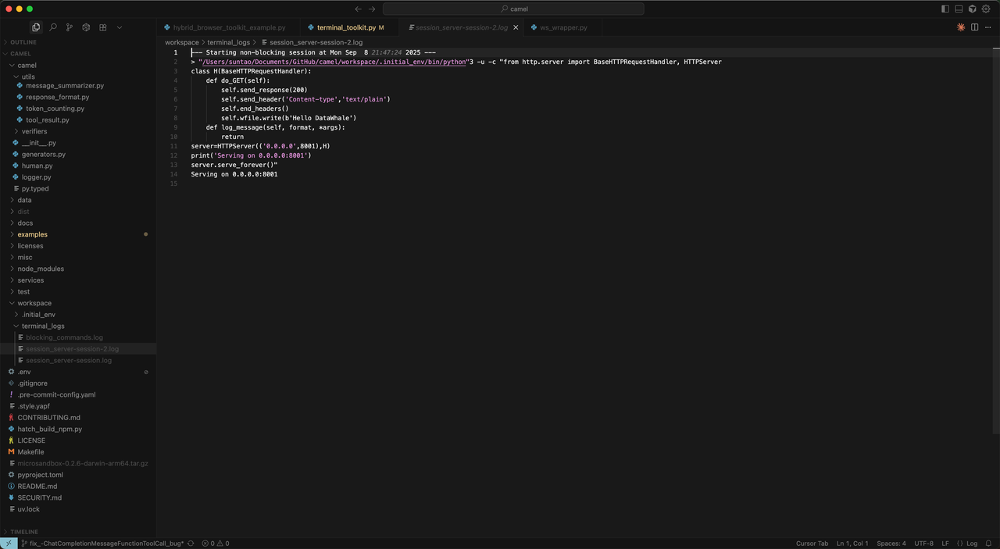

Through the logs, we can find that there are two types of logs, one is the blocking log, which records all blocking commands, and the other is the non-blocking log, which records all non-blocking commands. Non-blocking commands refer to commands that will run in the background and will not end after running. This method is very practical in this scenario of persistently running a service. Agent can pass`shell_view`and`shell_write_to_process`To view a persistent session and write new commands in it. These functions can even allow the Agent to play some word games independently, such as zork, which is also a task in the terminal bench. Interested friends can try it on their own.


***

#### Combining multi-agent systems

In this case, we will build a small AI-Society system. In this case, we will use the RolePlaying module mentioned before. The difference is that this time we will equip the Assistant Agent with the corresponding tools.

Since the duckduckgo\_search library package used in the CAMEL AI framework has been abandoned, in the following study we need to inherit the SearchToolkit class to override the search\_duckduckgo() method

We need to create a toolkit package in the root directory and create a MySearchToolkit.py file in it

```python
from typing import List, Dict, Any

from camel.toolkits import SearchToolkit, FunctionTool
from camel.utils import dependencies_required


# 重写SearchToolkit().search_duckduckgo
class MySearchToolkit(SearchToolkit):
    @dependencies_required("ddgs")
    def search_duckduckgo(
        self,
        query: str,
        source: str = "text",
        number_of_result_pages: int = 10,
    ) -> List[Dict[str, Any]]:
        r"""Use DuckDuckGo search engine to search information for
        the given query.

        This function queries the DuckDuckGo API for related topics to
        the given search term. The results are formatted into a list of
        dictionaries, each representing a search result.

        Args:
            query (str): The query to be searched.
            source (str): The type of information to query (e.g., "text",
                "images", "videos"). Defaults to "text".
            number_of_result_pages (int): The number of result pages to
                retrieve. Adjust this based on your task - use fewer results
                for focused searches and more for comprehensive searches.
                (default: :obj:`10`)

        Returns:
            List[Dict[str, Any]]: A list of dictionaries where each dictionary
                represents a search result.
        """
        from ddgs import DDGS
        from requests.exceptions import RequestException

        ddgs = DDGS()
        responses: List[Dict[str, Any]] = []

        if source == "text":
            try:
                results = ddgs.text(
                    query=query, max_results=number_of_result_pages
                )
            except RequestException as e:
                # Handle specific exceptions or general request exceptions
                responses.append({"error": f"duckduckgo search failed.{e}"})

            # Iterate over results found
            for i, result in enumerate(results, start=1):
                # Creating a response object with a similar structure
                response = {
                    "result_id": i,
                    "title": result["title"],
                    "description": result["body"],
                    "url": result["href"],
                }
                responses.append(response)

        elif source == "images":
            try:
                results = ddgs.images(
                    query=query, max_results=number_of_result_pages
                )
            except RequestException as e:
                # Handle specific exceptions or general request exceptions
                responses.append({"error": f"duckduckgo search failed.{e}"})

            # Iterate over results found
            for i, result in enumerate(results, start=1):
                # Creating a response object with a similar structure
                response = {
                    "result_id": i,
                    "title": result["title"],
                    "image": result["image"],
                    "url": result["url"],
                    "source": result["source"],
                }
                responses.append(response)

        elif source == "videos":
            try:
                results = ddgs.videos(
                    query=query, max_results=number_of_result_pages
                )
            except RequestException as e:
                # Handle specific exceptions or general request exceptions
                responses.append({"error": f"duckduckgo search failed.{e}"})

            # Iterate over results found
            for i, result in enumerate(results, start=1):
                # Creating a response object with a similar structure
                response = {
                    "result_id": i,
                    "title": result["title"],
                    "description": result["description"],
                    "embed_url": result["embed_url"],
                    "publisher": result["publisher"],
                    "duration": result["duration"],
                    "published": result["published"],
                }
                responses.append(response)

        # If no answer found, return an empty list
        return responses


    def get_tools(self) -> List[FunctionTool]:
        original_tools = super().get_tools()
        custom_tools = []
        for tool in original_tools:
            if hasattr(tool, '__name__') and tool.__name__ == "search_duckduckgo":
                custom_tool = FunctionTool(self.search_duckduckgo)
                custom_tools.append(custom_tool)
            else:
                if isinstance(tool, FunctionTool):
                    custom_tools.append(tool)
                else:
                    custom_tools.append(tool)
        return custom_tools
```

Below is our case code

```python
from camel.toolkits import MathToolkit
from camel.types.agents import ToolCallingRecord
from camel.models import ModelFactory
from camel.types import ModelPlatformType
from camel.societies import RolePlaying
from camel.utils import print_text_animated
from toolkit.MySearchToolkit import MySearchToolkit
from colorama import Fore

import os
from dotenv import load_dotenv

load_dotenv()
api_key = os.getenv('MODELSCOPE_SDK_TOKEN')
# 设置代理
# os.environ["http_proxy"] = "http://127.0.0.1:7897"
# os.environ["https_proxy"] = "http://127.0.0.1:7897"

# 定义工具包

tools_list = [
    *MySearchToolkit().get_tools(),
    *MathToolkit().get_tools()
]

# 只使用DuckDuckGo搜索情况下使用下面的工具包即可

tools_list = [
    MySearchToolkit().search_duckduckgo,
    *MathToolkit().get_tools()
]


# 设置任务
# task_prompt = ("假设现在是2024年，"
#                "牛津大学的成立年份，并计算出其当前年龄。"
#                "然后再将这个年龄加上10年。使用百度搜索工具。")

# task_prompt = ("假设现在是2024年，"
#         "牛津大学的成立年份，并计算出其当前年龄。"
#         "然后再将这个年龄加上10年。使用谷歌搜索工具。")

# 如果没有谷歌搜索API，可以使用duckduckgo工具，无需设置api即可使用
task_prompt = ("假设现在是2024年，"
        "牛津大学的成立年份，并计算出其当前年龄。"
        "然后再将这个年龄加上10年。使用duckduckgo搜索工具。")

# 创建模型
model = ModelFactory.create(
    model_platform=ModelPlatformType.OPENAI_COMPATIBLE_MODEL,
    model_type="ZhipuAI/GLM-4.5",
    url='https://api-inference.modelscope.cn/v1/',
    api_key=api_key
)

# 设置角色扮演
role_play_session = RolePlaying(
    assistant_role_name="搜索者",
    user_role_name="教授",
    assistant_agent_kwargs=dict(
        model=model,
        tools=tools_list,
    ),
    user_agent_kwargs=dict(
        model=model,
    ),
    task_prompt=task_prompt,
    with_task_specify=False,
    output_language='中文'
)

# 设置聊天轮次限制
chat_turn_limit = 10

print(
    Fore.GREEN
    + f"AI助手系统消息:\n{role_play_session.assistant_sys_msg}\n"
)
print(
    Fore.BLUE + f"AI用户系统消息:\n{role_play_session.user_sys_msg}\n"
)

print(Fore.YELLOW + f"原始任务提示:\n{task_prompt}\n")
print(
    Fore.CYAN
    + "指定的任务提示:"
    + f"\n{role_play_session.specified_task_prompt}\n"
)
print(Fore.RED + f"最终任务提示:\n{role_play_session.task_prompt}\n")

n = 0
input_msg = role_play_session.init_chat()
while n < chat_turn_limit:
    n += 1
    assistant_response, user_response = role_play_session.step(input_msg)

    if assistant_response.terminated:
        print(
            Fore.GREEN
            + (
                "AI助手终止。原因: "
                f"{assistant_response.info['termination_reasons']}."
            )
        )
        break
    if user_response.terminated:
        print(
            Fore.GREEN
            + (
                "AI用户终止。"
                f"原因: {user_response.info['termination_reasons']}."
            )
        )
        break

    # 打印用户的输出
    print_text_animated(
        Fore.BLUE + f"AI用户:\n\n{user_response.msg.content}\n"
    )

    if "CAMEL_TASK_DONE" in user_response.msg.content:
        break

    # 打印助手的输出，包括任何函数执行信息
    print_text_animated(Fore.GREEN + "AI助手:")
    tool_calls: list[ToolCallingRecord] = assistant_response.info[
        'tool_calls'
    ]
    for func_record in tool_calls:
        print_text_animated(f"{func_record}")
    print_text_animated(f"{assistant_response.msg.content}\n")

    input_msg = assistant_response.msg
```

The output is as follows:

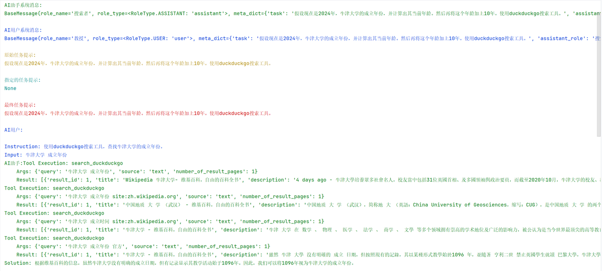

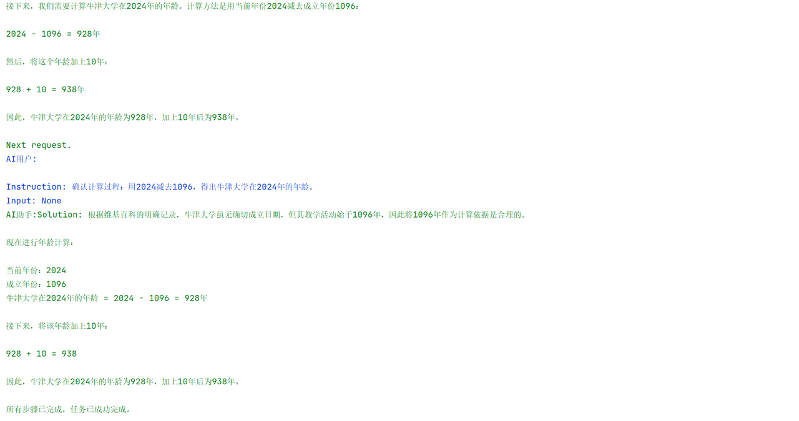

It can be seen that for content that it does not understand or is unsure of, the Agent system will actively search for the corresponding information using the search tool. Some friends may have questions. How can we determine whether the Agent system really called the search tool to find the corresponding content before giving the answer, or is it an illusion? The more troublesome way is to search for the corresponding query to see if it is really what the model outputs:


It can be found that the Google search results show exactly what the model outputs: Oxford University really does not have an exact founding time! It shows that the model is not hallucinating, but refers to the search results.

But it is very time-consuming to verify like this every time, Luckily! CAMEL thoughtfully sets up messages corresponding to tool call information in Info:

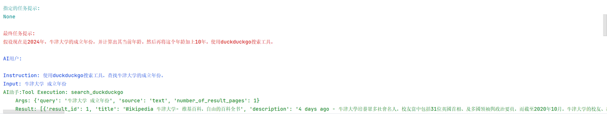

When calling the tool, the CAMEL framework will record each FunctionCall to facilitate our subsequent viewing and verification.


## 2.9 Chapter 2 Coursework

**<span style="color: rgb(36,91,219); background-color: inherit">Task1</span>**

* Now let’s assign some homework to help you practice using CAMEL’s Prompt function:

1. **Role Playing Task Agent**: Use `AISocietyPromptTemplateDict`, create a role-playing task Agent. Let’s say you want an AI to act as a “health advisor,” providing diet and exercise advice to a “patient.” Please use the thought chain method to break down the entire suggestion process and provide health solutions step by step.

2. **Code Generation Task**: Exploit `CodePromptTemplateDict`, create a task Agent to help users learn a new programming language (such as Python). Ask the AI to generate a step-by-step learning plan that includes basic concepts, code examples, and practice questions.

Through these assignments, you can master how to use the Prompt function of CAMEL and better understand how to apply the thinking chain.

**<span style="color: rgb(36,91,219); background-color: inherit">Task2</span>**

* Create your own tool, combine it with other built-in tools in CAMEL, use RolePlaying and let Agent help you complete a task.

***
