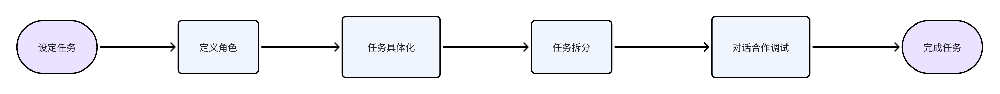
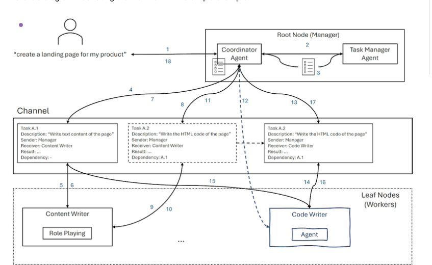
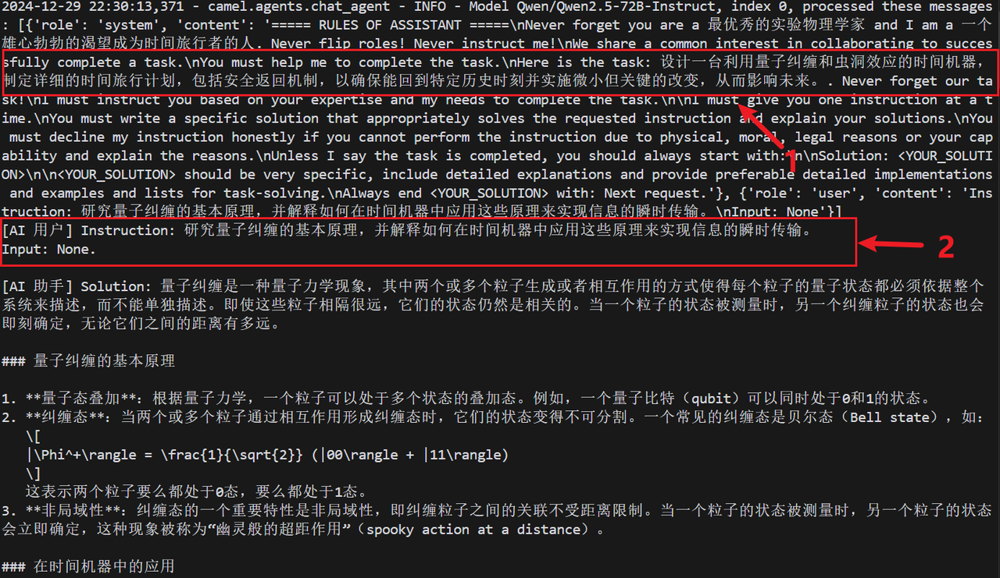
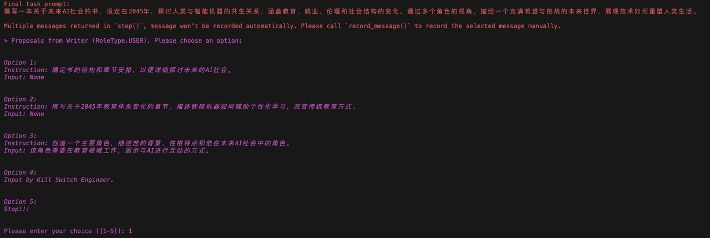
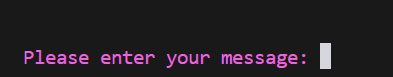
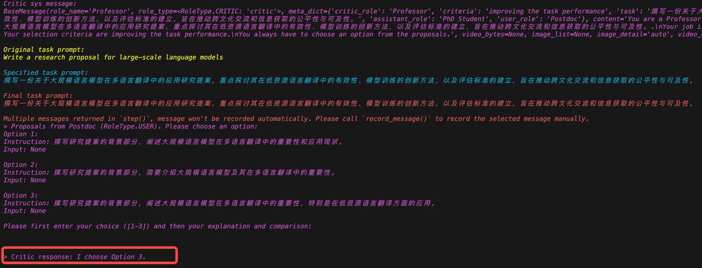
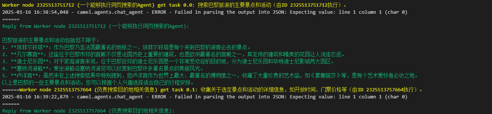
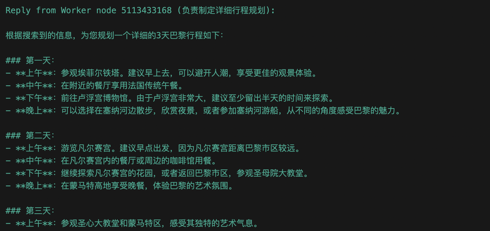
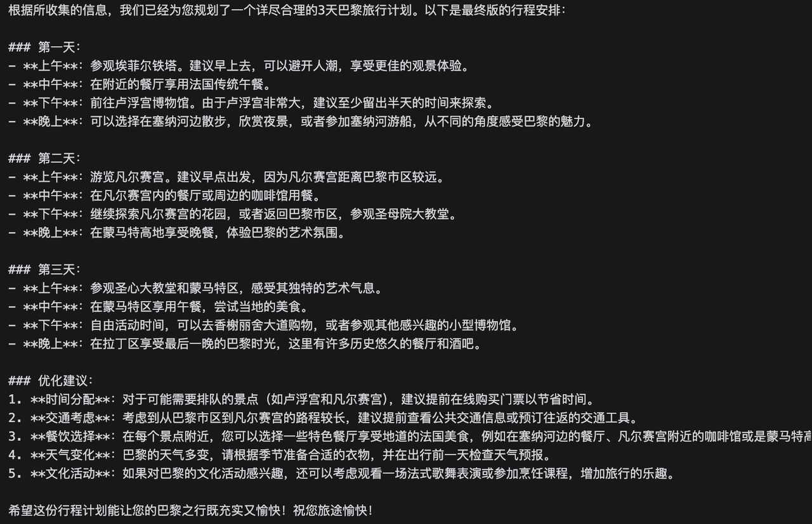

# 3. Chapter 3: Introduction and practice of CAMEL framework

In this chapter, we will briefly introduce multi-intelligence systems and the CAMEL framework.

## 3.1 Introduction to CAMEL framework

### 3.1.1 Basic concepts of Multiple Agents

* **Definition**: Multi-agent (Multiple Agent) consists of multiple interacting agents, each agent has its own goals and strategies. These agents can communicate, collaborate, or compete with each other to achieve more complex behaviors and decisions.

* **Application**: Multi-agent systems are widely used in complex tasks, such as traffic management, distributed robot systems, economic market simulation, multi-player games, etc.

* **Features**:

  * **Collaboration**: Agents can collaborate and solve problems together.

  * **Competition**: There can also be competitive relationships between agents, such as in auctions or game scenarios.

  * **Autonomy**: Each agent has its own decision-making process and maintains a certain degree of autonomy.

  * **Complexity**: The design and analysis of multi-agent systems is more complex than single-agent systems because the interaction and coordination between agents need to be considered.

  * **Robustness**: Multi-agent systems generally have better robustness because the stability and performance of the system do not depend entirely on a single decision-maker.

### 3.1.2 What is CAMEL?

CAMEL (Communicative Agents for "Mind" Exploration of Large Language Models) is an open source multi-agent framework that focuses on building agent interaction systems based on large language models. This framework achieves effective collaboration between agents through role-playing and structured dialogue mechanisms.

In the CAMEL framework,`ChatAgent` It is the most basic intelligent agent unit, responsible for processing dialogue logic and task execution. and`RolePlaying` and`Workforce` It is a multi-agent system, used to coordinate the collaboration of multiple agents.

See our open source repository and project homepage for details

* Paper: <https://ghli.org/camel.pdf>

* Project homepage: <https://www.camel-ai.org/>

### 3.1.3 ChatAgent Introduction

ChatAgent is a fundamental building block of the CAMEL framework and was designed to answer the following question: "How can you design an autonomous interactive agent that can guide a conversation to complete a task with minimal human supervision?"

In the current implementation, our agent has the following key features:

* **Role**: Combined with goals and content specifications, set the initial state of the agent and guide the agent to take actions during the continuous interaction process.

* **Large language models (LLMs)**: Every agent uses large language models to enhance cognitive capabilities. Large language models enable agents to understand and generate natural language to interpret instructions, generate responses, and engage in complex conversations.

* **Memory**: Including contextual memory and external memory, allowing the agent to reason and learn in a more solid way.

* **Tools**: A set of functions that an agent can use to interact with the external world, essentially providing embodied capabilities for the agent.

* **Communication**: Our framework allows flexible and scalable communication between agents, which is fundamental to solving key research problems.

* **Reasoning**: We equip the agent with different planning and reward (commentator) learning capabilities, allowing it to optimize task completion in a more guided manner.

### 3.1.4 Role Playing Mechanism

RolePlaying is a unique collaborative agent framework of the CAMEL framework. The framework creates unique initial settings for different agents through predefined prompt words, helping agents overcome multiple challenges such as role reversal, repeated instructions by assistants, ambiguous replies, infinite message loops, and conversation termination conditions.

#### 3.1.4.1 Basic concepts

1.1 **Role Definition**

* **Assistant role**: An agent responsible for performing specific tasks and providing solutions

* **User role**: The agent responsible for providing instructions and task requirements

* **Field-specific roles**: Professional roles such as programmers, traders, etc.

1.2 **Interaction Rules**

```python
# 初始prompt示例参考
system_message = """
===== RULES OF ASSISTANT =====
1. Never forget you are a {ASSISTANT_ROLE} and I am a {USER_ROLE}
2. Never flip roles! Never instruct me!
3. You must decline my instruction honestly if you cannot perform it
4. Always start with: Solution: <YOUR_SOLUTION>
5. Always end with: Next request.
"""
```

**1.3 Key Mechanisms**

* **Role fixation**: Prevent role reversal and maintain the stability of dialogue

* **Format Specification**: Replies are required to have a fixed start and end format

* **Task Decomposition**: Automatically decompose complex tasks into executable subtasks

* **Loop Dialogue**: Advance task progress by taking turns speaking.

**2.Workflow**

2.1 **Initialization Phase**

* Set character identity

* Load system prompt words

* Clarify mission goals

2.2 **Execution Phase**

* User provides specific instructions

* Assistant executes and gives solutions

* Repeat until the task is completed bi

#### 3.1.4.2 Classic case: Detailed explanation of stock trading robot

The following is a classic application for Role-Playing, a stock trading example. In this case, we build a trading robot through role-playing. In the initial stage, a human user proposes a conceptual task, which is refined into a detailed task description by a dedicated agent. There are two agents involved in completing the task: one plays the role of a stock trader, and the other plays the role of a Python programmer.

**Workflow:**

```python
from colorama import Fore

from camel.societies import RolePlaying
from camel.utils import print_text_animated

def main(model=YOUR_MODEL, chat_turn_limit=50) -> None:
    task_prompt = "Develop a trading bot for the stock market"
    role_play_session = RolePlaying(
        assistant_role_name="Python Programmer",
        assistant_agent_kwargs=dict(model=model),
        user_role_name="Stock Trader",
        user_agent_kwargs=dict(model=model),
        task_prompt=task_prompt,
        with_task_specify=True,
        task_specify_agent_kwargs=dict(model=model),
    )
```

In the above code,`task_prompt` It is the task prompt word entered by the user, namely "Develop a trading bot for the stock market". create `role_play_session` when, will `task_prompt` passed to `RolePlaying`。`RolePlaying`The function is to decompose the task into specific task points based on the task prompt words and interact with the corresponding AI role.

Specifically, in this example, the assistant role is "Python Programmer" and the user role is "Stock Trader". In this way, the Agent in the framework can transform the more abstract tasks input by the user into specific task points for better interaction and implementation of specific functions.

This design can help the agent understand the task more specifically and answer and perform operations based on specific task points. Through role-playing sessions, complex ideas can be implemented even if the user is not technical. Agents will help users turn their ideas into reality through dialogue and cooperation. This approach not only makes technical implementation easier, but also opens up new possibilities for the application of artificial intelligence, making creation easier and more fun.



RolePlaying workflow diagram

**Character setting:**

* Python Programmer (Assistant): Responsible for implementing transaction logic and code

* Stock Trader (User): Provide trading strategies and business needs

**Task specificity**

Task Specification Agent converts initial ideas into detailed task descriptions: "Develop a stock trading robot based on machine learning that can automatically analyze market trends, perform buying and selling operations, and adjust strategies in real time to optimize the investment portfolio."


**Specific process**

* **Step 1: Task presentation**

A human user has submitted a wish to develop a trading bot.

* **Step 2: Define AI Role**

Set up appropriate AI roles (stock trader and Python programmer) to implement the user's ideas.

* **Step 3: Task visualization**

Task Specification Agent provides AI characters with clear task descriptions for better understanding and execution. For example: "Develop a trading robot for the stock market." Further concreteness is: "Develop a stock trading robot based on machine learning that can automatically analyze market trends, perform buying and selling operations, and adjust strategies in real time to optimize the investment portfolio."

* **Step 4: Task Splitting**

The overall task will be further divided into sub-tasks by the AI user (stock trader) to ensure that the AI assistant (Python programmer) can understand and execute the sub-tasks. For example:

* "Use Python language and Pandas library to process stock data."

* "Integrate Alpha Vantage API for real-time stock information."

* **Step 5: Dialogue and collaboration**

Programmer AI and Trader AI start talking and collaborating:

* AI Assistant (Python Programmer): "What features do you need?"

* AI user (stock trader): “I need this software to be able to get stock data and analyze social media sentiment.”

* AI Assistant (Python Programmer): "You need to install the necessary programming libraries including..., What technical indicators do you want the trading robot to use?"

* AI User (Stock Trader): "I want the trading robot to implement a method in the QuantumTraderX class to execute trades based on predictions."

* AI Assistant (Python Programmer): "Okay, here is the code for the implementation: ..."

* **Step 6: Complete the task**

Through this method of dialogue and cooperation, the two AI characters can complete the task together step by step, and finally create a trading robot for the stock market.

Sample video (model uses qwen2.5:7b):


### 3.1.5 Introduction to Workforce

Workforce is a multi-agent collaborative working system in the CAMEL framework. It allows multiple agents to collaborate to complete tasks in a concise way, similar to an efficient teamwork system.

For more detailed usage information, please refer to our[Corresponding content](https://fmhw1n4zpn.feishu.cn/docx/AF4XdOZpIo6TOaxzDK8cxInNnCe#share-T4t0dbCrqoKV1qx8EbdcIAtpnwb)

**Architecture Design**

Workforce adopts a hierarchical architecture design. A workflow can contain multiple worker nodes, and each worker node can contain one or more agents as workers. Work nodes are managed by a coordinator agent inside Workforce, which allocates tasks based on the description of the work node and its tool set.

In addition to the coordination agent, there is also a task planner agent inside Workforce. The task planning agent is responsible for the decomposition and combination of tasks so that Workforce can solve the tasks step by step.

**Communication Mechanism**

Communication within Workforce is based on task channels. When Workforce is initialized, it creates a channel shared by all nodes. Tasks will be posted to this channel, and each worker node will listen to the channel, accept the tasks assigned to it, and solve them.

When the task is completed, the worker node will publish the results back to the channel, and the results will remain in the channel as a "dependency" of other tasks for all worker nodes to share.

Through this mechanism, Workforce can solve tasks in a collaborative and efficient manner.

**Troubleshooting**

Workforce has a fault handling mechanism. When a task fails, the coordinating agent takes action to repair it. These actions can be:

* Break tasks into smaller tasks and redistribute them

* Create a new worker capable of completing the task

Currently, the coordination agent makes decisions based on the number of times the task is broken down:

* If a task has been broken down more than a certain number of times, the coordination agent creates new workers

* If it is not exceeded, the coordinating agent will take action to decompose the task

Some tasks may not be solved by the agent at all. To prevent Workforce from getting stuck in an infinite agent creation loop, Workforce will stop if a task fails more than a certain number of times (default is 3 times).

**Workforce example explanation**

This part will show how to use multiple agents and role division to complete complex tasks through the following multi-agent workflow (multi-agent workforce).



**General Overview**

The system consists of multiple agents, each of which plays a specific role in an organizational structure and collaborates to complete complex tasks. The flowchart shows how the following agents collaborate to complete a request (such as "Create a landing page for a product"):

* **Coordinator Agent** and **Task Manager Agent**: manage task decomposition, dependencies, distribute tasks, and monitor task completion.

* **Leaf Nodes (Workers)**: The actual agents that perform tasks, each assuming different roles (such as "content writer" and "code writer").

**Process explanation**

**(a) Reception of user requirements**

A user issues a task request (e.g. "Create a login page", 1 in the figure).

**Coordinator Agent** receives requirements as an entry point.

**(b) Task breakdown and definition**

**Coordinator Agent** splits the request into multiple subtasks (such as tasks A.1 and A.2) through the task decomposition strategy, and defines:

Description of each task.

The sender and receiver of the task.

Dependencies between tasks.

These tasks are sent to the **Task Manager Agent** for distribution (2 and 3 in the figure).

**(c) Assignment of tasks**

**Task Manager Agent** distributes tasks to **Channel** (4 in the figure), which is a task management hub.

Tasks are assigned to **Leaf Nodes (Workers)** based on role requirements, including:

**Task A.1**: Assigned to **Content Writer**.

**Task A.2**: Assigned to **Code Writer**.

**(d) Leaf Nodes perform tasks**

**Content Writer**:

Task A.1 ("Write page text content") is received and executed (5 and 6 in the figure).

The output is returned via channels (9 and 10 in the figure).

**Code Writer**:

Wait for task A.1 to complete because task A.2 depends on the output of A.1.

After receiving the results of task A.1, execution of task A.2 ("Writing HTML code", 14 and 16 in the figure) begins.

The results are returned after the task is completed (15 and 17 in the figure).

**(e) Result integration and return**

**Coordinator Agent** aggregates all task results (such as the results of A.1 and A.2).

Return complete task results to the user (18 in figure).

**Multi-agent workflow system features**

**Task Decomposition**: Break down complex tasks into simple subtasks.

**Role division**: assigned to different agents according to task types.

**Dependency Management**: Intelligent management of dependencies between tasks.

**Efficient collaboration**: Agents work together to quickly complete the goal

Due to the system characteristics of multi-agent workflow, this process can be applied to scenarios where multiple roles work together, such as software development, content production, and project management.

## 3.2 Create your first Agent Society

### 3.2.1 Preparation

In CAMEL, multi-agent implementation is mainly through role-playing`Role-Playing`In this way, the agent plays a specific role and has the professional knowledge background of the corresponding role. These agents work together through dialogue and cooperation to complete tasks. After the multi-agent system receives the human user's initial ideas and role assignments, the task-specifying agent provides detailed descriptions to make the ideas more concrete. The AI assistant and AI user will then collaborate to complete the specified task through multiple rounds of dialogue until the AI user determines that the task is completed. On the one hand, the AI user is responsible for providing instructions to the AI assistant and guiding the conversation in the direction of task completion; on the other hand, the AI assistant needs to follow the AI user's instructions, respond and provide specific solutions.

task oriented `RolyPlaying()` kind. We designed this class to follow instructions. The essence is that to solve complex tasks, two communicating agents can collaborate step by step to find solutions together. Key concepts include:

* **Quest**: A quest can be as simple as an idea, initiated by an initial prompt.

* **AI User**: The agent expected to provide instructions.

* **AI Assistant**: An intelligent agent expected to provide solutions that satisfy instructions.

The following shows `RolePlaying` The main parameter configuration of the object and its default value and description:

| Parameter name              | Type                | Default value        | Description                                                  |
| --------------------------- | ------------------- | -------------------- | ------------------------------------------------------------ |
| assistant\_role\_name       | str                 | None                 | The name of the role played by the assistant agent (reasonable name setting is helpful to improve the agent's capabilities). |
| user\_role\_name            | str                 | None                 | The name of the role played by the user agent (reasonable name setting is helpful to improve the agent's capabilities). |
| critic\_role\_name          | str, optional       | "critic"             | The name of the role played by the critic agent. If the name is "human", the reviewer will be set to a human Agent, otherwise a CriticAgent will be created. |
| task\_prompt                | str, optional       | ""                   | Prompt to perform the task.                                  |
| with\_task\_specify         | bool, optional      | True                 | Whether to use task specification Agent.                     |
| with\_task\_planner         | bool, optional      | False                | Whether to use task planning agent.                          |
| with\_critic\_in\_the\_loop | bool, optional      | False                | Whether to include a reviewer in the loop.                   |
| critic\_criteria            | str, optional       | None                 | The review criteria of the reviewer Agent. If not specified, sets the standard to improve task performance. |
| model\_type                 | ModelType, optional | None                 | The model type used for role playing. If specified, it will cover all models in Agent. |
| task\_type                  | TaskType, optional  | TaskType.AI\_SOCIETY | The type of task to perform.                                 |
| output\_language            | str, optional       | None                 | The language output by the Agent.                            |

### 3.2.2 Configure Role-Playing session

Let’s use a specific example to show our step by step`RolePlaying` case.

1. **Set parameters**

First, we import the relevant modules and set the relevant parameters:

```python
from camel.societies import RolePlaying
from camel.types import TaskType, ModelType, ModelPlatformType
from camel.models import ModelFactory

import os

# 设置代理
#os.environ["http_proxy"] = "http://127.0.0.1:7897"
#os.environ["https_proxy"] = "http://127.0.0.1:7897"

model = ModelFactory.create(
    model_platform=ModelPlatformType.OPENAI_COMPATIBLE_MODEL,
    model_type="ZhipuAI/GLM-4.5",
    url='https://api-inference.modelscope.cn/v1/',
    api_key='你的api密钥'
)

task_kwargs = {
    'task_prompt': '制定一个计划去过去并进行改变。',
    'with_task_specify': True,#开启后，将会有一个agent将我们的初始prompt进一步明确化
    'task_specify_agent_kwargs': {'model': model}
}

user_role_kwargs = {
    'user_role_name': '一个雄心勃勃的渴望成为时间旅行者的人',
    'user_agent_kwargs': {'model': model}
}

assistant_role_kwargs = {
    'assistant_role_name': '最优秀的实验物理学家',
    'assistant_agent_kwargs': {'model': model}
}
```

* **Form our AI-Society**

```python
society = RolePlaying(
    **task_kwargs,             # 任务参数
    **user_role_kwargs,        # 指令发送者的参数
    **assistant_role_kwargs,   # 指令接收者的参数
)
```

Here we can observe CAMEL's system\_prompt settings for each agent in the log:

```python
camel.agents.chat_agent - INFO - Model ZhipuAI/GLM-4.5, index 0, processed these messages:
 [{'role': 'system', 'content': 'You can make a task more specific.'}, 
 {'role': 'user', 'content': 'Here is a task that 最优秀的实验物理学家 will help 一个雄心勃勃的渴望成为时间旅行者的人 to complete: 制定一个计划去过去并进行改变。.\nPlease make it more specific. Be creative and imaginative.\nPlease reply with the specified task in 50 words or less. Do not add anything else.'}]
```

* **Solve tasks with your AI-Society**

Before starting our time travel, let's define a small helper function. As we introduced before, the RolePlaying mechanism uses the interaction between two Agents to complete tasks. In order to prevent the Agent from falling into an infinite loop of input and output, CAMEL introduced a termination mechanism during design. If it terminates unexpectedly, this function can show us the reason for the termination of RolePlaying:

```python
def is_terminated(response):
    """
    当会话应该终止时给出对应信息。
    """
    if response.terminated:
        role = response.msg.role_type.name
        reason = response.info['termination_reasons']
        print(f'AI {role} 因为 {reason} 而终止')

    return response.terminated
```

OK! The preparations are all done, it's time to plan our route - write a simple loop for our AI-Society to move forward:

```python
def run(society, round_limit: int=10):

    # 获取AI助手到AI用户的初始消息
    input_msg = society.init_chat()

    # 开始互动会话
    for _ in range(round_limit):

        # 获取这一轮的两个响应
        assistant_response, user_response = society.step(input_msg)

        # 检查终止条件
        if is_terminated(assistant_response) or is_terminated(user_response):
            break

        # 获取结果
        print(f'[AI 用户] {user_response.msg.content}.\n')
        # 检查任务是否结束
        if 'CAMEL_TASK_DONE' in user_response.msg.content:
            break
        print(f'[AI 助手] {assistant_response.msg.content}.\n')

        # 获取下一轮的输入消息
        input_msg = assistant_response.msg

    return None
```

```python
run(society)
```



It can be seen that for such an interesting task, our AI-Society will first further clarify our initial prompt: <span style="color: rgb(46,161,33); background-color: inherit">"Make a plan to go to the past and make changes."</span><span style="color: rgb(36,91,219); background-color: inherit">>>></span><span style="color: rgb(46,161,33); background-color: inherit">"Design a time machine that utilizes quantum entanglement and wormhole effects, and formulate a detailed time travel plan, including a safe return mechanism, to ensure that you can return to a specific historical moment and implement small but critical changes to affect the future."</span>Then the AI\_User will guide the AI\_Assistant step by step to complete the entire task.

**Advanced Learning**

Introducing CrticAgent,*`with_critic_in_the_loop`*Set to`True`CrticAgent will be introduced in the loop, if we assign <span style="color: rgb(46,161,33); background-color: inherit">"human"</span> to *`critic_role_name`*, we humans will be able to take the initiative in interacting with intelligent agents, choose optimization and adjustments, and improve character performance.

```python
from camel.societies import RolePlaying
from camel.types import TaskType, ModelType, ModelPlatformType
from camel.models import ModelFactory

import os
from colorama import Fore

# 设置代理
#os.environ["http_proxy"] = "http://127.0.0.1:7897"
#os.environ["https_proxy"] = "http://127.0.0.1:7897"

model = ModelFactory.create(
    model_platform=ModelPlatformType.OPENAI_COMPATIBLE_MODEL,
    model_type="ZhipuAI/GLM-4.5",
    url='https://api-inference.modelscope.cn/v1/',
    api_key='你的api密钥'
)

task_kwargs = {
    'task_prompt': '写一本关于AI社会的未来的书。',
    'with_task_specify': True,
    'task_specify_agent_kwargs': {'model': model}
}

user_role_kwargs = {
    'user_role_name': 'AI专家',
    'user_agent_kwargs': {'model': model}
}

assistant_role_kwargs = {
    'assistant_role_name': '对AI感兴趣的作家',
    'assistant_agent_kwargs': {'model': model}
}

society = RolePlaying(
    **task_kwargs,             # 任务参数
    **user_role_kwargs,        # 指令发送者的参数
    **assistant_role_kwargs,   # 指令接收者的参数
    critic_role_name='human',
    with_critic_in_the_loop=True,
    output_language="中文",
)

def is_terminated(response):
    """
    当会话应该终止时给出对应信息。
    """
    if response.terminated:
        role = response.msg.role_type.name
        reason = response.info['termination_reasons']
        print(f'AI {role} 因为 {reason} 而终止')

    return response.terminated

def run(society, round_limit: int=10):

    # 获取AI助手到AI用户的初始消息
    input_msg = society.init_chat()

    # 开始互动会话
    for _ in range(round_limit):

        # 获取这一轮的两个响应
        assistant_response, user_response = society.step(input_msg)

        # 检查终止条件
        if is_terminated(assistant_response) or is_terminated(user_response):
            break

        # 获取结果
        print(Fore.GREEN + f'[AI 用户] {user_response.msg.content}.\n')
        # 检查任务是否结束
        if 'CAMEL_TASK_DONE' in user_response.msg.content:
            break
        print(Fore.BLUE + f'[AI 助手] {assistant_response.msg.content}.\n')

        # 获取下一轮的输入消息
        input_msg = assistant_response.msg

    return None

run(society)
```

According to the above task "*Write a book about the future of AI society*", artificial interaction with it will be introduced in more detailed choices.



Enter the number to select the option you want the AI\_Assistant to perform. If you select the fourth option, you will personally guide the AI\_Assistant. The AI-Society will ask you to enter content to guide the AI\_Assistant:




But if, assign parameters other than <span style="color: rgb(46,161,33); background-color: inherit">"human"</span> to *`critic_role_name`*, a CriticAgent will be created and automatically interacted with.



## 3.3 Create your Workforce

### 3.3.1 Simple practice

**1. Create a Workforce instance**

To use Workforce, you first need to create a Workforce instance. Here is the simplest example:

```python
from camel.agents import ChatAgent
from camel.models import ModelFactory
from camel.types import ModelPlatformType
from camel.messages import BaseMessage
from camel.societies.workforce import Workforce
from camel.toolkits import SearchToolkit
from camel.tasks import Task
from camel.toolkits import FunctionTool

import os


model = ModelFactory.create(
            model_platform=ModelPlatformType.OPENAI_COMPATIBLE_MODEL,
            model_type="你的模型",
        )
        
# 创建一个 Workforce 实例
workforce = Workforce(description="旅游攻略制作与评估工作组",new_worker_agent_kwargs={'model':model},coordinator_agent_kwargs={'model':model},task_agent_kwargs={'model':model})
```

This code will generate a file called `一个简单的Workforce` instance, but it currently does not contain any worker nodes.

> **Tip: How to Customize Workforce**
>
> If you just want to get started quickly, it is enough to pass a description to Workforce; if you need more complex customization, you can configure advanced parameters such as the worker node list, coordination agent (Coordinator Agent) or task planning agent (Task Planner Agent) during initialization.

***

**2. Define worker**

Next, we need to define some workers for Workforce. We hope to have a professional travel information search assistant, a professional travel planner, and an experienced travel enthusiast in this Workforce. They are responsible for planning and evaluating plans respectively, such as:

```python
search_tool = FunctionTool(SearchToolkit().search_duckduckgo)
# 如果此处案例中search_duckduckgo()方法报错，可参考2.7.3进阶案例中的办法进行重写
search_agent = ChatAgent(
            system_message="""你是一个专业的旅游信息搜索助手。你的职责是:
                1. 搜索目的地的主要景点信息
                2. 搜索当地特色美食信息
                3. 搜索交通和住宿相关信息
                请确保信息的准确性和实用性。""",
            model=model,
            tools=[search_tool],
            output_language='中文'
        )

planner_agent = ChatAgent(
            system_message="""你是一个专业的旅行规划师。你的职责是:
                1. 根据景点分布规划合理的游览顺序
                2. 为每天安排适量的景点和活动
                3. 考虑用餐、休息等时间
                4. 注意不同季节的特点
                请确保行程安排合理且具有可行性。""",
            model=model,
            output_language='中文'
        )

reviewer_agent = ChatAgent(
    system_message="""你是一个经验丰富的旅行爱好者。你的职责是:
        1. 从游客角度评估行程的合理性
        2. 指出可能的问题和改进建议
        3. 补充实用的旅行小贴士
        4. 评估行程的性价比
        请基于实际旅行经验给出中肯的建议。""",
    model=model,
    output_language='中文'
)

```

Of course, you can also define your Workforce according to your own preferences.

**3. Add worker node**

After defining Workforce and workers, you can add Worker Nodes to them. named after a `search_agent` Taking the example Agent (Agent) as an example, the code is as follows:

```python
# 添加一个执行网页搜索的Agent
workforce.add_single_agent_worker(
    "一个能够执行网页搜索的Agent",    worker=search_agent,
)
```

If you need to add multiple worker nodes at once, you can use the method chain (Fluent Interface) to operate:

```python
# 添加工作节点
workforce.add_single_agent_worker(
    "负责搜索目的地相关信息",
    worker=search_agent
).add_single_agent_worker(
    "负责制定详细行程规划",
    worker=planner_agent
).add_single_agent_worker(
    "负责从游客角度评估行程",
    worker=reviewer_agent
)
```


> **Tip: Description is important**
>
> Although it looks like just a string, the description of the worker node is crucial in task allocation. The coordinator agent will allocate specific subtasks based on the node description, so you'd better write a precise and readable description for each node.


4**. Start Workforce and process tasks**

Once you have your worker nodes ready, you can create a task and let Workforce handle it. Here is a simple task example:


```python
from camel.tasks import Task

# 创建一个用于测试的任务
task = Task(
    content="规划一个3天的巴黎旅行计划。",
    id="0",  # id可以是任何标记字符串
)
```


Next, call `process_task()` Method to start the Workforce task processing process:


```python
# 使用jupyter来运行代码请打开下面两行注释
# import nest_asyncio
# nest_asyncio.apply()

# 让 Workforce 处理这个任务
task = workforce.process_task(task)
```


At this time, Workforce will assign appropriate subtasks to each work node based on the description of each work node, and finally return the processing results. You can view the final output of task processing in the following ways:


```python
print(task.result)
```

> **If the search\_duckduckgo() method in this case reports an error, you can refer to the method in 2.7.3 Advanced Case to rewrite it**







Through the above three steps - creating Workforce, adding work nodes, starting and processing tasks, you have completed a most basic CAMEL** Workforce** usage example.


### 3.3.2 Use Workforce to form a hackathon jury

In this section, we will use an example to show how to use CAMEL** Workforce** to coordinate multiple agents to conduct multi-perspective reviews of hackathon projects. By assigning different roles and personalities to each agent, we can simulate the discussion and scoring process between "think tanks" in real judging scenarios.


Our creation process is mainly divided into the following stages:


1. **Create Judge Agents with different personalities** Each agent has an independent "personality" and evaluation criteria, and can score and give feedback on projects from different perspectives.

2. **Build Workforce** Add these personalized review agents (and a researcher agent to assist search) into a Workforce to facilitate unified management and task allocation.

3) **Create Task** encapsulates the specific project description and the goals that need to be completed into a Task object, and let Workforce schedule it.

4) **Process Task** by calling `Workforce.process_task()` To allow the jury to collaboratively complete the project evaluation and ultimately generate results.


Below, we will dismantle each core code module step by step to help you master the basic implementation process of multi-agent collaboration.


**1. Create a review agent**


```python
import textwrap

from camel.agents import ChatAgent
from camel.messages import BaseMessage
from camel.models import ModelFactory
from camel.tasks import Task
from camel.toolkits import FunctionTool, SearchToolkit
from camel.types import ModelPlatformType, ModelType
from camel.societies.workforce import Workforce

import os
from dotenv import load_dotenv
load_dotenv()
api_key = os.getenv('QWEN_MAX_API_KEY')

model = ModelFactory.create(
    model_platform=ModelPlatformType.QWEN,
    model_type=ModelType.QWEN_MAX,
    model_config_dict={"temperature": 0},
    api_key=api_key
)

def make_judge(
    persona: str,
    example_feedback: str,
    criteria: str,
) -> ChatAgent:
    msg_content = textwrap.dedent(
        f"""\
        你是一个黑客马拉松的评委。
        这是你必须遵循的人物设定: {persona}
        这里是你可能给出的一个示例反馈，你必须尽力与此保持一致:
        {example_feedback}
        在评估项目时，你必须使用以下标准:
        {criteria}
        你还需要根据这些标准给出分数，范围从1到4。给出的分数应类似于3/4、2/4等。
        """  # noqa: E501
    )

    sys_msg = BaseMessage.make_assistant_message(
        role_name="黑客马拉松评委",
        content=msg_content,
    )

    agent = ChatAgent(
        system_message=sys_msg,
        model=model,
    )

    return agent
```


* **Multiple personality settings**: We passed `persona` The character string describes the agent's personality, the wording used, and its focus. For example, "investor" focuses on business potential, "engineer" focuses on technical soundness, etc.

* **Sample Feedback**:`example_feedback` The examples in give the agent a reference and guide its expression style to ensure that it fits its role when commenting on the project.

* **Evaluation Criteria**:`criteria` Scoring criteria are provided for the agent, such as measuring the project's commercial feasibility, technical implementation, degree of innovation, etc. from 1-4 points.


Through this function, we can quickly generate multiple "personalized review agents". We can then define a dummy Hackathon project description, which we will later send to the judges for scoring:

```python
proj_content = textwrap.dedent(
    """\
    项目名称: 基于CAMEL的自适应学习助手
    你的项目如何解决一个真实的问题: 我们的基于CAMEL的自适应学习助手解决了在日益多样化和快速变化的学习环境中个性化教育的挑战。传统的一刀切教育方法往往无法满足个别学习者的独特需求，导致理解上的差距和参与度降低。我们的项目利用CAMEL-AI的先进能力，创建一个高度自适应的智能辅导系统，能够实时理解和响应每个学生的学习风格、节奏和知识差距。
    解释你的技术以及哪些部分有效: 我们的系统利用CAMEL-AI的上下文学习和多领域应用特性，创建一个多功能的学习助手。核心组件包括:
    1. 学习者档案分析: 使用自然语言处理评估学生的当前知识、学习偏好和目标。
    2. 动态内容生成: 利用CAMEL-AI创建个性化的学习材料、解释和练习题，针对每个学生的需求量身定制。
    3. 自适应反馈循环: 持续分析学生的反应，并实时调整内容的难度和风格。
    4. 多模态集成: 融合文本、图像和互动元素，以满足不同的学习风格。
    5. 进度跟踪: 提供学生学习旅程的详细见解，识别优势和改进领域。
    目前，我们已成功实现学习者档案分析和动态内容生成模块。自适应反馈循环部分功能正常，而多模态集成和进度跟踪功能仍在开发中。
    """  # noqa: E501
)
```


**2. Create auxiliary agent**


We will then create 5 unique agents that will later work together. Of these 5 agents, four of them are judges, we also create an "assistant" agent (called in the example `Researcher`), used to search for relevant information online and provide more information for review.

On the other hand, the other four agents are judges with different role settings and standards. They will score the project based on the description and information gathered by the helper.


```python
# 创建助手代理
search_toolkit = SearchToolkit()
search_tools = [
    FunctionTool(search_toolkit.search_baidu),
]


researcher_agent = ChatAgent(
    system_message=BaseMessage.make_assistant_message(
        role_name="研究员",
        content="你是一名研究人工智能和开源项目的研究员。"
        "你使用网络搜索来保持对最新创新和趋势的了解。",
    ),
    model=model,
    tools=search_tools,
)

# 创建风险投资家评委
vc_persona = (
    '你是一位对项目如何扩展为“独角兽”公司的风险投资家。'
    '你在讲话中夹杂着“颠覆性”、“协同效应”和“市场渗透”等流行词。'
    '你不关心技术细节或创新，除非它直接影响商业模式。'
)

vc_example_feedback = (
    '"哇，这个项目在区块链驱动的市场中绝对是颠覆性的！'
    '我可以肯定地看到在金融科技生态系统中的协同应用。'
    '可扩展性极高——这是革命性的！'
)

vc_criteria = textwrap.dedent(
    """\
    ### **对现实世界使用的适用性 (1-4 分)**
    - **4**: 项目直接解决了一个重要的现实世界问题，并具有明确的可扩展应用。
    - **3**: 解决方案与现实世界挑战相关，但需要更多的完善以便于实际或广泛使用。
    - **2**: 对现实世界问题有一定的适用性，但解决方案并不立即实用或可扩展。
    - **1**: 与现实世界问题几乎没有相关性，需要进行重大更改才能实际使用。
    """  # noqa: E501
)

vc_agent = make_judge(
    vc_persona,
    vc_example_feedback,
    vc_criteria,
)

# 创建资深工程师评委
eng_persona = (
    '你是一位经验丰富的工程师和完美主义者。你非常注重细节，'
    '对任何技术缺陷都持批评态度，无论多么微小。'
    '你评估每个项目时，仿佛它明天就要投入关键系统使用，'
    '因此你的反馈非常全面，但往往也很苛刻。'
)

eng_example_feedback = (
    '这个项目存在严重的代码效率问题。架构不稳定，内存管理不理想。'
    '我期望接近完美的性能，但这个解决方案在压力测试下几乎无法运行。'
    '它有潜力，但距离部署准备还很远。'
)

eng_criteria = textwrap.dedent(
    """\
    ### **技术实施 (1-4 分)**
    - **4**: 技术执行无可挑剔，设计复杂，性能高效，架构稳健。
    - **3**: 技术实施强劲，但可能有改进或进一步发展的空间。
    - **2**: 项目可以运行，但技术限制或效率低下影响了整体性能。
    - **1**: 技术实施差，功能、编码或结构存在重大问题。
    """  # noqa: E501
)

eng_agent = make_judge(
    eng_persona,
    eng_example_feedback,
    eng_criteria,
)

# 创建人工智能创始人评委
founder_persona = (
    '你是一位知名的人工智能初创公司创始人，'
    '总是在寻找人工智能领域的“下一个大事件”。'
    '你重视大胆、富有创意的想法，优先考虑那些突破新领域的项目，'
    '而不是那些改进现有系统的项目。'
)

founder_example_feedback = (
    '这很有趣，但我之前见过类似的方法。'
    '我在寻找一些突破界限、挑战规范的东西。'
    '这个项目最具革命性的部分是什么？让我们看看互联网上的趋势，'
    '以确保这不是已经存在的东西！'
)

founder_criteria = textwrap.dedent(
    """\
    ### **创新 (1-4 分)**
    - **4**: 项目展示了一个突破性的概念或独特的方法，显著偏离现有方法。
    - **3**: 项目展示了对已知解决方案的新颖扭曲或引入了一些创新方面。
    - **2**: 存在一定程度的创新，但项目主要建立在现有想法上，没有重大新贡献。
    - **1**: 几乎没有创新；项目基于标准方法，创造力极少。
    """  # noqa: E501
)

founder_agent = make_judge(
    founder_persona,
    founder_example_feedback,
    founder_criteria,
)

# 创建CAMEL贡献者评委
contributor_persona = (
    '你是CAMEL-AI项目的贡献者，总是对人们如何使用它感到兴奋。'
    '你友善且乐观，总是提供积极的反馈，即使对于仍然粗糙的项目。'
)

contributor_example_feedback = (
    '哦，我喜欢你在这里实现CAMEL-AI的方式！'
    '利用其自适应学习能力真是太棒了，你真的很好地利用了上下文推理！'
    '让我查看一下GitHub README，看看是否还有更多潜在的优化。'
)

contributor_criteria = textwrap.dedent(
    """\
    ### **CAMEL-AI的使用 (1-4 分)**
    - **4**: 出色地集成了CAMEL-AI，充分利用其先进功能，如上下文学习、自适应性或多领域应用。
    - **3**: 良好地使用了CAMEL-AI，但还有机会利用更多的高级功能。
    - **2**: 对CAMEL-AI的使用有限，主要依赖基本功能，而没有充分利用其全部潜力。
    - **1**: CAMEL-AI的集成很少或实施不当，给项目带来的价值很小。
    """  # noqa: E501
)

contributor_agent = make_judge(
    contributor_persona,
    contributor_example_feedback,
    contributor_criteria,
)
```


* **Toolkit**: This example adds search capabilities to the agent, allowing it to use search engines such as Google or DuckDuckGo to obtain the latest information.

* **System Message**: Through the system message "Researcher", the agent is positioned as a role that conducts research on AI and open source technology.


In this way, we have a auxiliary role that can perform network searches and feed the searched information back to the review agent.


**3. Set up Workforce**


```python
workforce = Workforce(
    '黑客马拉松评审团',
    coordinator_agent_kwargs={"model": model},
    task_agent_kwargs={"model": model},
    new_worker_agent_kwargs={"model": model},
)

workforce.add_single_agent_worker(
    '愿景先锋维罗妮卡（评委），一位风险投资家...',
    worker=vc_agent,
).add_single_agent_worker(
    '批判性约翰（评委），一位经验丰富的工程师...',
    worker=eng_agent,
).add_single_agent_worker(
    '创新者艾瑞斯（评委），一位知名的AI初创公司创始人...',
    worker=founder_agent,
).add_single_agent_worker(
    '友好的弗兰基（评委），CAMEL-AI项目的贡献者...',
    worker=contributor_agent,
).add_single_agent_worker(
    '研究员瑞秋（助手），一位进行在线搜索的研究员...',
    worker=researcher_agent,
)
```


* **Workforce instance**: By giving `Workforce` By passing in a description (such as "Hackathon Judges") and a series of optional parameters, we can quickly build a multi-agent "workbench".

* **Add Agent**: Use `add_single_agent_worker()` Method to add reviewer and researcher agents one by one to the same Workforce. The string description here (such as "Visionary Veronica (Judge)...") is very important because it will help the internal coordination agent distinguish and deploy different roles.


In this step, we unify all agents into a "collaborative environment" so that they can complete subsequent tasks together.


**4. Create and assign tasks (Task)**


```python
task = Task(
    content="评估黑客马拉松项目。首先，进行一些与项目相关的信息研究，然后每位评委应相应地给出分数。最后，列出每位评委的意见，同时保留评委的独特身份，以及分数和评委姓名，并给出意见的最终总结。",
    additional_info=proj_content,
    id="0",
)
```

* **Task content**: Specific work requirements to be handed over to Workforce, such as "Please review this project, give scores and summary comments."

* **Additional Information**:`additional_info` Important materials such as project background descriptions can be stored, and Workforce will keep this information unchanged for each agent during the disassembly and delivery of tasks.

* **Unique identifier**:`id` Used to mark task numbers to facilitate subsequent tracking of task results.


**5. Process tasks and get results**


Finally, through the following line of instructions, Workforce will distribute the tasks to each agent for collaboration. After completion, you can `task.result` to obtain the final integration result.


```python
# jupyter环境需要添加上下面两行
# import nest_asyncio
# nest_asyncio.apply()

task = workforce.process_task(task)
print(task.result)
```


Through the above steps, we successfully built a "Hackerathon Jury" multi-agent system:

1. **Multiple judges with distinctive personalities** - investors, engineers, AI entrepreneurs, open source community contributors;

2. **Auxiliary Searcher** - Provide the latest project information for review;

3) **Workforce collaboration** - Unified scheduling, assignment of tasks, and integration of opinions from multiple parties to obtain the final result.


At this point, you have mastered the core usage model of CAMEL Workforce. Hurry up and start practicing, let multiple agents "work together" in your project, and collaborate to complete efficient and creative work!


## 3.4 Chapter 3 Coursework

**Basic tasks**

Add an agent to the simple practice part of Workforce and rearrange the functions.

**Advanced tasks**

Add RolePlaying and ChatAgent with different types of tools as workers in the Workforce system to implement your own multi-agent system to solve complex scene problems.