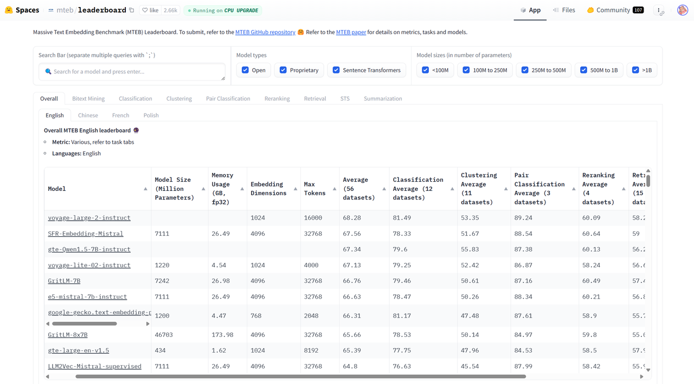
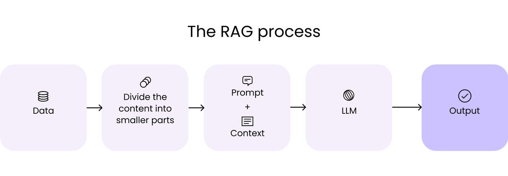
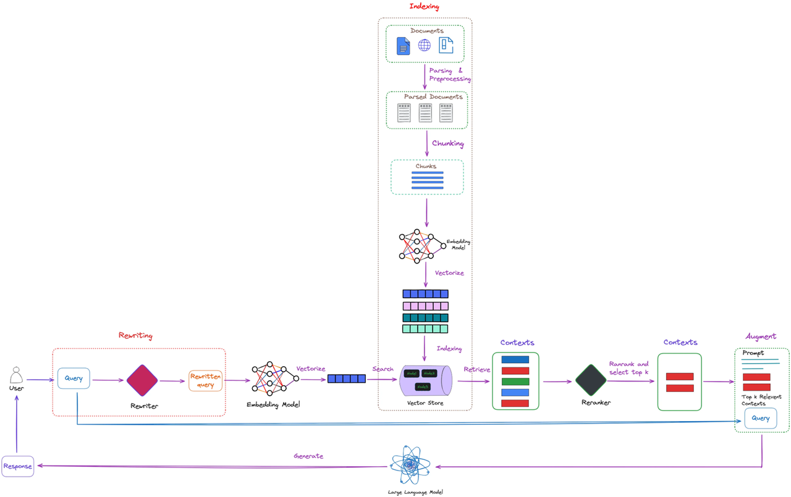
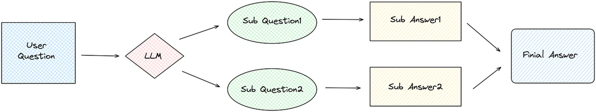
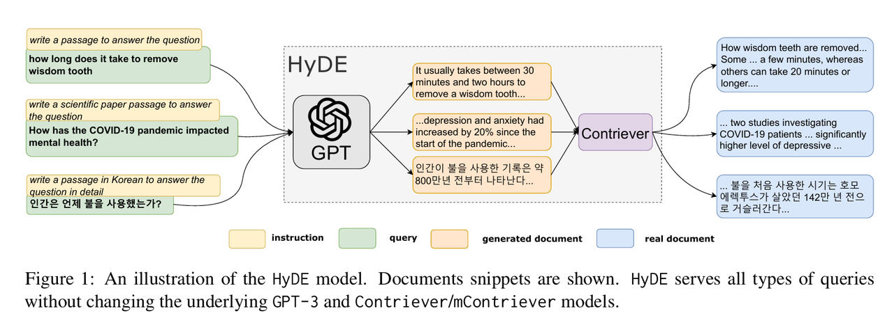
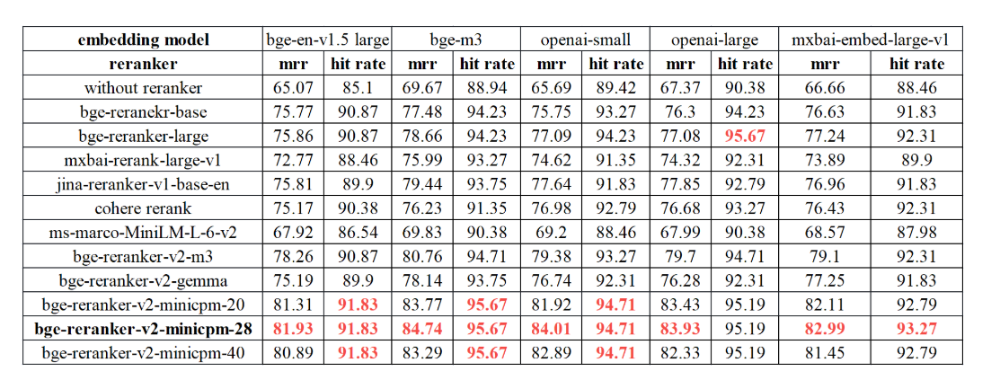
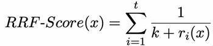
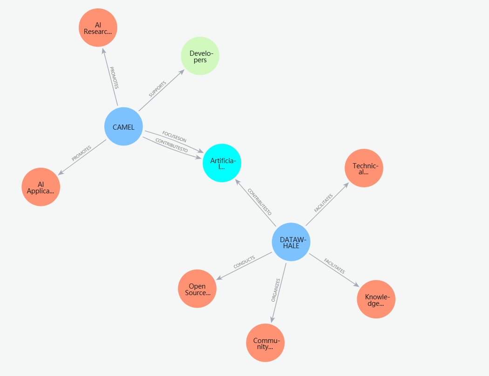
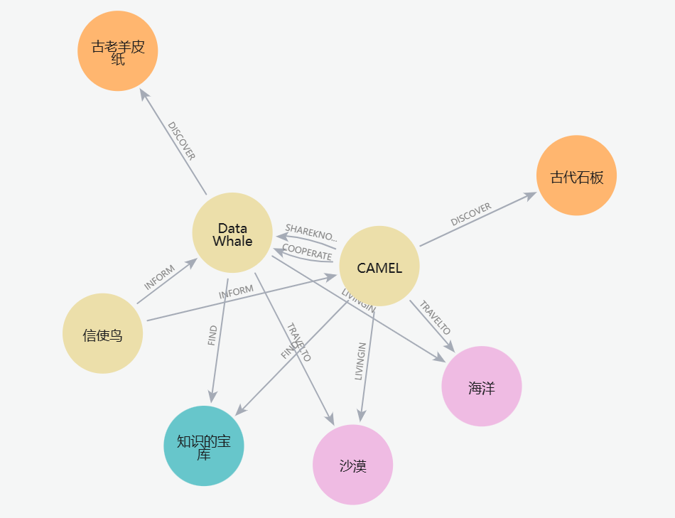

# Chapter 4: RAG application under CAMEL framework

This chapter will delve into how to build and apply RAG (Retrieval-Augmented Generation) technology under the CAMEL framework. We will introduce key modules, including storage, loaders, embeddings, and retrievers, as well as how to build knowledge bases and evaluate RAG applications.

## 4.1 Introduction to RAG components

### 4.1.1 Introduction to RAG

To understand recent advances in generative AI, imagine a courtroom scenario.

Judges hear and decide cases based on a general understanding of the law. Sometimes cases—such as a medical malpractice lawsuit or an employment dispute—require special expertise, so the judge sends a clerk to the law library to find precedents and specific legal cases to cite.

Like good judges, large language models (LLMs) are capable of answering a variety of human questions. But if you need to provide authoritative answers and cite specific sources, the model needs an assistant to conduct research.

AI’s “court clerk” is a technology called Retrieval-Augmented Generation (RAG).

**Origin of the name "RAG"**

Patrick Lewis, the lead author of a paper that first proposed the term in 2020, apologized for the humble abbreviation of the now popular technology. He believes that this method represents the future of generative AI, and related research has covered hundreds of papers and numerous commercial services.

"Had we known that our research would be so widely used, we would have taken the name more seriously," Lewis said in an interview at a regional database developers conference in Singapore.

"We originally planned to give this technology a better name, but when we finally wrote the paper, no one came up with a better idea." Lewis currently leads a RAG team at the AI startup Cohere.

**什么是检索增强生成（RAG）？ **

Retrieval-augmented generation is a technique that improves the accuracy and reliability of generative AI models by obtaining facts from external sources.

In other words, it fills a gap in LLM work. Under the hood, LLMs are neural networks whose capabilities are typically measured by the number of parameters. The parameters of LLM essentially represent the universal patterns in which humans use words to construct sentences.

This deep understanding (sometimes called parameterized knowledge) allows LLM to respond to general cues extremely quickly. However, when users need to delve deeper into a current or specific topic, LLM may not be able to do it.

**Combination of internal and external resources**

Lewis and colleagues developed RAG technology to connect generative AI services to external resources, especially those rich in the latest technical details.

In their paper, they and co-authors from the former Facebook AI research team (now Meta AI), University College London (UCL), and New York University call RAG "a general fine-tuning method" because almost any LLM can use it to connect to almost any external source.

**Build user trust**

Search-enhanced generation provides models with citable sources, like footnotes in a research paper, that users can check.这有助于建立信任。

In addition, this technology can help models clarify ambiguities in user queries and reduce the possibility of models guessing wrong—a phenomenon sometimes called hallucination.

Another significant advantage of RAG is its relative simplicity of implementation. Developers can implement this process with as few as five lines of code, Lewis and three co-authors of the paper said in a blog post. This makes RAG faster and more cost-effective than retraining the model with additional data sets. In addition, it also allows users to instantly switch to new information sources.

**RAG APPLICATION**

Retrieval-enhanced generation allows users to interact with data repositories, opening up new application experiences. This means that the potential applications of RAG can be many times the number of available data sets.

For example, a generative AI model combined with medical indexing can become a powerful assistant for doctors or nurses. Financial analysts can work more efficiently with assistants connected to market data.

In fact, almost any enterprise can transform its technical manuals, policy manuals, videos or logs into a knowledge base to enhance LLM capabilities. These resources can support use cases such as customer service, employee training, and developer productivity.

Because of this, RAG technology is being widely adopted by companies including AWS, IBM, Glean, Google, Microsoft, NVIDIA, Oracle and Pinecone.

In the CAMEL framework, RAG is used to build applications such as intelligent question answering systems and dialogue agents, making full use of the modular design and powerful processing capabilities of the framework.

### 4.1.2 Loaders

**Basic concepts**

Loaders are modules in the CAMEL framework for data loading and preprocessing. In short, in the **CAMEL framework**, two IO modules are introduced: **Base IO** and **Unstructured IO**, which are used to handle multiple file types and unstructured data processing. In addition, four new data readers have been added: **Apify Reader**, **Chunkr Reader**, **Firecrawl Reader** and **Jina\_url Reader**. These readers can obtain data from external sources, thereby improving data integration and analysis capabilities.

**Basic IO**

**Base IO module** focuses on basic input/output operations related to files, providing functions for representing, reading, and processing multiple file formats.

In practical terms, the module is designed to read files in various formats, extract their contents, and represent them as **File objects**, each of which is designed for efficient processing of a specific file type.

```python
from io import BytesIO
from camel.loaders import create_file_from_raw_bytes

# 读取pdf文件
with open("test.pdf", "rb") as file:
    file_content = file.read()

# 使用create_file函数根据文件扩展名创建对象
file_obj = create_file_from_raw_bytes(file_content, "test.pdf")

# 获取File对象的内容
print(file_obj.docs[0]["page_content"])
```

***

**Unstructured IO**

**Unstructured IO module** focuses on the processing, parsing and processing of unstructured data. It provides tools and functions for parsing files or URLs, cleaning data, extracting specific information, preparing data elements for different platforms, and chunking data. The core of this module lies in its advanced ETL (extract, transform, load) capabilities, which can operate on unstructured data, making it suitable for a variety of application scenarios such as **Retrieval Enhanced Generation (RAG)**.

To start using the **Unstructured IO module**, you first need to import the module and initialize its instance. Once initialized, this module can be leveraged to perform a variety of functions such as parsing, cleaning, extracting data, and integrating with cloud services such as AWS S3 and Azure. Here's a basic guide to get you started quickly:

**use `parse_file_or_url` Methods can load and parse unstructured data from files or URLs. Here is a guided example of how to utilize this approach: **

```python
from camel.loaders import UnstructuredIO
uio = UnstructuredIO()
#设置一个url示例
example_url = ("https://hub.baai.ac.cn/view/41733")
elements = uio.parse_file_or_url(example_url)
print(("\n\n".join([str(el) for el in elements])))
```

```python
>>> 
CAMEL-AI团队参与发表Nature子刊啦!聚焦LLM如何重塑未来医疗 ~

Smart Medicine

AI system

AI

DrugAI
                  2024-12-11 00:50 分享

DrugAI

帖子数：772

个人主页

以下文章来源于mp.weixin.qq.com

未来医疗是否可能由人工智能主导？CAMEL团队参与撰写的《Nature Machine Intelligence》最新Comment文章，带我们展望了基于大语言模型（LLM）的智能体系统在医疗领域的应用前景。这些“智能队友”不仅能够协同诊断、优化流程，还能实现个性化健康管理和精准治疗。从自动化病历记录到多学科智能协作，这项技术正逐步改变传统医疗模式，为未来医疗提供了全新的可能性和解决方案。

LLM驱动的智能体系统

LLM驱动的智能体系统是一种基于大语言模型（LLM）的增强型人工智能系统，通过集成多个模块实现从感知到行动的全流程功能。简单来说，它是一种具备感知、思考、决策和执行能力的“数字智能体”。LLM智能体主要结合了以下关键模块：
...

登录 后发表评论～

沙发等你来抢
Output is truncated. View as a scrollable element or open in a text editor. Adjust cell output settings...
```

**use `clean_text_data` Perform multi-text data cleaning**

```python
# 设置示例脏文本
example_dirty_text = ("\x93Some dirty text ’ with extra spaces and – dashes.一些包含额外空格和破折号的脏文本’。")
# 设置清理选项   
options = [
    ('replace_unicode_quotes', {}),  # 替换Unicode引号
    ('clean_dashes', {}),           # 清理破折号
    ('clean_non_ascii_chars', {}),  # 清理非ASCII字符
    ('clean_extra_whitespace', {}), # 清理多余空白
]
cleaned_text = uio.clean_text_data(text=example_dirty_text,
                                   clean_options=options)
print(cleaned_text)
```

```plain text
>>> 
Some dirty text with extra spaces and dashes.
```

**Currently supported cleaning operations**:

* replace\_unicode\_quotes: Replace Unicode quotes with standard quotes

* clean\_dashes: Clean dashes and unify the format

* clean\_non\_ascii\_chars: Clean non-ASCII characters

* clean\_extra\_whitespace: clean up excess whitespace

* clean\_bullets: clean bullets

* clean\_ordered\_bullets: Clean ordered list symbols

* clean\_postfix: clean suffix

* clean\_prefix: clean prefix

* clean\_trailing\_punctuation: Clean up trailing punctuation

* group\_broken\_paragraphs: merge broken paragraphs

* remove\_punctuation: remove punctuation

* bytes\_string\_to\_string: Convert byte string to ordinary string

* translate\_text: translate text


**use `extract_data_from_text` To perform text extraction operations, the following is an example of extracting email addresses from text. **

```python
# 设置示例文本用于提取
example_email_text = "你可以通过example@email.com联系我"
extracted_text = uio.extract_data_from_text(text=example_email_text,extract_type="extract_email_address")
print(extracted_text)
```

```plain text
>>> ['example@email.com']
```

`extract_data_from_text`There are also many ways to use it. For more specific usage methods, you can see the relevant comments in the source code.


**use `chunk_elements` Method to chunk content**

```python
from camel.loaders import UnstructuredIO
uio = UnstructuredIO()
#设置一个url示例
example_url = ("https://hub.baai.ac.cn/view/41733")
elements = uio.parse_file_or_url(example_url)

chunks = uio.chunk_elements(elements=elements,chunk_type="chunk_by_title")

for chunk in chunks:
    print(chunk)
    print("\n" + "-" * 80)
```

```plain text
>>> The Empire State Building was lit in green and white to celebrate the Philadelphia Eagles’ victory in the NFC Championship game on Sunday – a decision that’s sparked a bit of a backlash in the Big Apple.

>>>  The Eagles advanced to the Super Bowl for the first time since 2018 after defeating the San Francisco 49ers 31-7, and the Empire State Building later tweeted how it was marking the occasion.

>>>  --------------------------------------------------------------------------------
>>>  Fly @Eagles Fly! We’re going Green and White in honor of the Eagles NFC Championship Victory. pic.twitter.com/RNiwbCIkt7— Empire State Building (@EmpireStateBldg)
```

use `stage_elements` Methods for staged processing of elements

```plain text
staged_element = uio.stage_elements(elements=elements,stage_type="stage_for_baseplate")
print(staged_element)
```

```plain text
>>> {'rows': [{'data': {'type': 'UncategorizedText', 'element_id': 'e78902d05b0cb1e4c38fc7a79db450d5', 'text': 'CNN\n        \xa0—'}, 'metadata': {'filetype': 'text/html', 'languages': ['eng'], 'page_number': 1, 'url': 'https://www.cnn.com/2023/01/30/sport/empire-state-building-green-philadelphia-eagles-spt-intl/index.html', 'emphasized_text_contents': ['CNN'], 'emphasized_text_tags': ['span']}}, ...
```

The following is a basic guide to using the **Unstructured IO module**. For more advanced usage, please refer to the documentation for the specific method and related resources. [Unstructured IO Documentation](https://unstructured-io.github.io/unstructured/)。[For other **Loader** introductions, please refer to the appendix.](https://fmhw1n4zpn.feishu.cn/docx/AF4XdOZpIo6TOaxzDK8cxInNnCe#share-ScDDdqchMo2cz0xdN2HcD1k0nkb)。

***

### 4.1.3 Embeddings

**Basic concepts**

The process of creating embeddings for different types of data (text, images, videos) is to convert these inputs into a numerical form that machines can understand and process efficiently. Each embedding focuses on capturing the core features of its corresponding data type. Here is a brief description of the main data type embeddings:

**Text Embed**

Text Embeddings convert text data into numerical vectors, each vector representing the semantic meaning of the text, allowing us to process and compare texts based on meaning rather than the original form of the text. In this way, the machine can capture the context and nuances in the language.

**Embedded Technology**

1. **OpenAI Embedding**:

   * Embeddings are generated using large-scale language models (LLMs), capable of understanding complex contextual and semantic details in language.

   * For example,`text-embedding-3-small` The model generates 1536-dimensional embedding vectors.

2. **SentenceTransformerEncoder**:

   * Designed specifically for generating sentence-level embeddings, often based on models such as BERT.

   * Emphasis on capturing sentence semantics, suitable for text comparison or semantic search tasks.

3. **OpenAICompatibleEmbedding**

Similar to **OpenAI Embedding**


**Example: Semantic comparison**

**句子 1**: “A young boy is playing soccer in a park.”
**句子 2**: “A child is kicking a football on a playground.”

Although the two sentences use different words, they express very similar semantics.

A text embedding model converts these sentences into high-dimensional vectors, such as 1536 dimensions. If we compare these two vectors, the calculated similarity value (such as cosine similarity) will be higher, indicating that they have similar semantics.

***

**The meaning of semantic processing**

1. **Semantic Similarity**: The embedding captures the common concept of "kids playing football outdoors" rather than simply relying on literal matching of words.

2. **Application Scenario**:

   * **Information Retrieval**: Find relevant content based on semantics rather than exact keyword matching.

   * **Question and Answer System**: Understand the core meaning of user questions and generate accurate answers.

   * **Text Clustering and Classification**: Cluster texts with similar semantics based on the distribution of embedding vectors.

Through text embedding, machines can not only understand the surface expression of language, but also process and analyze its semantic associations at a deeper level, making tasks such as semantic search and text matching more intelligent and efficient.

***

**Image Embed**

Image embedding is a technique that converts images into numerical vectors that can represent key features in the image, such as shape, color, texture, and spatial hierarchy. In this way, the machine can understand the core content of the image and use it to complete tasks such as classification, retrieval and similarity comparison.

For example, when you input a picture of a cat into the model, the model will analyze the visual features in the picture, such as the shape of the cat's ears, the texture of the hair, etc. Finally, these features will be compressed into a high-dimensional vector. This vector condenses the core information of the picture, which can not only allow the model to identify that this is a picture of a cat, but also compare it with other images to distinguish it from dogs or other animals.

Image embedding has many application scenarios. For example, in image classification, the model can label the image based on the embedding vector and identify whether it is a cat or a car. In similarity comparison, embedding vectors can be used to measure the similarity of two pictures, which is commonly used in recommendation systems, such as recommending photos with similar styles. There is also image retrieval. After the user uploads a picture, the system finds the most similar picture in the database through the embedded vector, such as searching for pictures by pictures.

Implementing image embedding usually relies on convolutional neural networks (CNN), such as models like ResNet or EfficientNet. These models are trained on large amounts of data and are able to extract high-level features of images. In addition, as technology advances, new models like Vision Transformer are also used for more complex image understanding tasks.

Through image embedding technology, machines can evolve from simple pixel point processing to truly understanding image content. This is also one of the core methods of modern computer vision tasks.

***

**Hands on practice**

The following is sample code on how to use different embedding methods to help you quickly generate embedding vectors for text and images.

1. OpenAIEmbedding

Used to generate text embeddings, based on OpenAI model (requires OPENAI\_API\_KEY).

```python
from camel.embeddings import OpenAIEmbedding
from camel.types import EmbeddingModelType

# 初始化 OpenAI 嵌入模型
openai_embedding = OpenAIEmbedding(model_type=EmbeddingModelType.TEXT_EMBEDDING_3_SMALL)

# 为一组文本生成嵌入向量
embeddings = openai_embedding.embed_list(["Hello, world!", "Another example"])
```

* OpenAICompatibleEmbedding

```python
from camel.memories.blocks.vectordb_block import VectorDBBlock
from camel.memories.records import MemoryRecord
from camel.messages import BaseMessage
from camel.embeddings import SentenceTransformerEncoder,OpenAICompatibleEmbedding
from camel.types import OpenAIBackendRole
from camel.storages.vectordb_storages import QdrantStorage

from dotenv import load_dotenv
import os

load_dotenv()

embedding = OpenAICompatibleEmbedding(
    model_type="text-embedding-v3",
    url= 'https://dashscope.aliyuncs.com/compatible-mode/v1',
    api_key=os.getenv("QWEN_API_KEY")
    )

#使用OpenAICompatibleEmbedding时 需要先调用 embed_list 来确定输出维度
_ = embedding.embed_list(["测试文本"])


vector_db_block = VectorDBBlock(embedding=embedding,storage=(QdrantStorage(vector_dim=1024)))
```

* MistralEmbedding

Embedding method based on Mistral model (requires MISTRAL\_API\_KEY).

```python
from camel.embeddings import MistralEmbedding
from camel.types import EmbeddingModelType

# 初始化 Mistral 嵌入模型
mistral_embedding = MistralEmbedding(model_type=EmbeddingModelType.MISTRAL_EMBED)

# 为一组文本生成嵌入向量
embeddings = mistral_embedding.embed_list(["Hello, world!", "Another example"])
```

* SentenceTransformerEncoder

Text embedding method based on Sentence Transformer, suitable for efficient semantic representation (using local embedding model, automatically downloaded if not available).

```python
from camel.embeddings import SentenceTransformerEncoder

# 初始化 Sentence Transformer 编码器
sentence_encoder = SentenceTransformerEncoder(model_name='intfloat/e5-large-v2')

# 为一组文本生成嵌入向量
embeddings = sentence_encoder.embed_list(["Hello, world!", "Another example"])
```

* VisionLanguageEmbedding

VisionLanguageEmbedding is an embedding generation class based on multi-modal models (such as CLIP), which can process image and text input simultaneously and generate corresponding embedding vectors. , the local openai/clip-vit-base-patch32 model is used by default (it will be downloaded automatically if not available).

```python
from camel.embeddings import VisionLanguageEmbedding
from PIL import Image
import requests

# 初始化视觉语言嵌入模型
vlm_embedding = VisionLanguageEmbedding()

# 下载测试图像
url = "http://images.cocodataset.org/val2017/000000039769.jpg"
image = Image.open(requests.get(url, stream=True).raw)
test_images = [image, image]

# 为一组图像生成嵌入向量
embeddings = vlm_embedding.embed_list(test_images)
```

```python
print(embeddings)
>>>
[[-0.10570450872182846, 0.13790780305862427, -0.29611435532569885, 0.021248599514365196, -0.06407000869512558, -0.16861875355243683, -0.13514314591884613, -0.0024490721989423037, 0.4737650752067566, -0.17626942694187164, 0.244399756193161, -0.3797178566455841, 0.04832637310028076, -0.13981150090694427, -0.3404477834701538, -0.1267590969800949, -0.23266123235225677, -0.29759615659713745, 
  ......
  -0.3068569302558899, -0.17334720492362976, 0.07368569821119308, -0.22815512120723724, 0.1349477916955948, -0.44909897446632385, 0.12776629626750946, 0.8668186664581299, -0.014579405076801777, 0.2563166916370392]]
```

### 4.1.4 Storages

**Basic concepts**

The Storage module is responsible for data storage and management in the CAMEL framework. It is a comprehensive framework that provides a unified interface and data structure, and supports various types of data storage mechanisms such as key-value storage and vector storage. Through the combination of abstract base class and concrete implementation, the Storage module can efficiently handle data reading, writing and retrieval operations, providing a solid foundation for the implementation of RAG applications.

***

**Key-value storage**

**`BaseKeyValueStorage`**

**Purpose**:
As the base abstract class for creating various key-value storage systems.

**Function**:

* Standardizes saving, loading and clearing operations of data records.

* Interface interaction is mainly conducted through Python dictionaries.

**Application Scenario**:

* JSON file storage

* NoSQL databases (such as MongoDB and Redis)

* Python in-memory dictionary storage

***

**`InMemoryKeyValueStorage`**

**describe**:
based on `BaseKeyValueStorage` The specific implementation uses an in-memory list to store data.

**Features**:

* Suitable for temporary storage, the data is volatile and will be lost after the program terminates.

**Function**:

* Implemented methods for saving, loading and clearing records in memory.

* Ideal for development and testing scenarios without the need for persistent storage.


**Vector Storage**

Vector Store is used to store high-dimensional vector data, such as embedded representations of text or images. It supports efficient similarity calculation and nearest neighbor search, and is the core component for retrieving relevant information in RAG applications. Features of vector storage include:

* **High Performance**: Supports fast retrieval of large-scale data

* **Scalability**: Adapt to different sizes of data volumes

* **Flexibility**: Supports multiple similarity measurement methods


**`BaseVectorStorage`**

**Purpose**:
An abstract base class designed to extend a specific vector storage implementation.

**Features**:

* Supports a variety of operations, such as adding and deleting vectors, querying similar vectors, and maintaining the status of the vector database.

* Provides flexibility to specify parameters such as vector dimensions, set names, distance measures, and more.

**Function**:

* Provides the infrastructure for building diverse vector storage solutions.

**`MilvusStorage`**

**describe**:
based on `BaseVectorStorage` A specific implementation of a storage solution designed specifically for interacting with Milvus.

**Features**:

* Optimized for Milvus, a cloud-native vector search engine, enabling efficient large-scale vector retrieval and management operations.

Reference: [The kite](https://milvus.io/docs/overview.md/)


**`QdrantStorage`**

**describe**:
based on `BaseVectorStorage` A concrete implementation designed for interacting with Qdrant.

**Features**:

* Optimized for the Qdrant vector search engine.

* Provides efficient vector storage, management and query functions, and supports large-scale approximate nearest neighbor (ANN) search.

**Function**:

* Implement core operations such as vector addition, deletion, and similarity query.

* Supports custom vector dimensions, set names, distance measures (such as Euclidean distance, cosine similarity, etc.).

* Seamlessly integrated with Qdrant's API for high-performance vector search scenarios.

**Applicable scenarios**:

* Recommendation systems, natural language processing (NLP) embedded queries, multimedia retrieval (images, audios, videos) and other application scenarios that require efficient vector search.

Reference: [Qdrant](https://qdrant.tech/)

***

**Graph Storage**

**`BaseGraphStorage`**

**Purpose**:
An abstract base class designed to extend a specific graph storage implementation.

**Features**:

* Supports a variety of operations, including:

  * `get_client`: Get the client connection of the graph storage.

  * `get_schema`: Get the current graph storage mode information.

  * `get_structured_schema`: Get a structured schema representation.

  * `refresh_schema`: Refresh the mode of graph storage.

  * `add_triplet`: Add triples (representations of nodes and edges).

  * `delete_triplet`: Delete triplet.

  * `query`: Execute graph query operations.

**Function**:

* Provides infrastructure for various graph storage solutions, making it easy to build customized graph storage implementations.

**`NebulaGraph`**

**describe**:
based on `BaseGraphStorage` A concrete implementation designed for interacting with NebulaGraph.

**Features**:

* Optimized implementation of NebulaGraph, supporting its distributed, highly scalable and high-speed graph data operation features.

* Provides seamless integration with NebulaGraph API for efficient processing of graph data storage and query.

**Function**:

* Realized `BaseGraphStorage` All core methods support the rapid execution of addition, deletion, query, and modification operations on distributed graph data.

* Supports complex graph query statements for structured analysis and reasoning of large-scale graph data.

**Applicable scenarios**:

* Recommendation systems, knowledge graphs, social network analysis, path optimization, large-scale graph data mining and other scenarios that require high-performance graph storage and query.

Reference: [NebulaGraph](https://www.nebula-graph.io/)


**`Neo4jGraph`**

**describe**:
based on `BaseGraphStorage` A concrete implementation designed to interact with Neo4j, one of the most trusted graph databases in the industry.

**Features**:

* Optimized implementation of Neo4j, taking full advantage of its powerful relationship modeling capabilities and efficient graph query capabilities.

* Supports complex graphics operations and query statements, and provides powerful visualization and analysis functions.

**Function**:

* accomplish `BaseGraphStorage` All core methods, including:

  * `get_client`: Get the client instance connected to Neo4j.

  * `get_schema` and `refresh_schema`: A schema for managing Neo4j graph databases.

  * `add_triplet` and `delete_triplet`: Implement the addition and deletion of nodes and relationships.

  * `query`: Execute Cypher-based graph query operations.

**Applicable scenarios**:

* Knowledge graphs, social network analysis, recommendation systems, fraud detection, supply chain management and other application scenarios that require strong relationship modeling.

**Advantages**:

* With Neo4j’s mature ecosystem and broad support,`Neo4jGraph` Provides a stable, high-performance solution for efficient storage and processing of complex graph data.

Reference: [Neo4jGraph](https://neo4j.com/)

***

**Hands on practice**

Here ends with **`QdrantStorage`**For example:

```python
from camel.storages import QdrantStorage, VectorDBQuery, VectorRecord

# Create an instance of QdrantStorage with dimension = 4
qdrant_storage = QdrantStorage(vector_dim=4, collection_name="my_collection")

# Add two vector records
qdrant_storage.add([VectorRecord(
            vector=[-0.1, 0.1, -0.1, 0.1],
            payload={'key1': 'value1'},
        ),
        VectorRecord(
            vector=[-0.1, 0.1, 0.1, 0.1],
            payload={'key2': 'value2'},
        ),])

# Query similar vectors
query_results = qdrant_storage.query(VectorDBQuery(query_vector=[0.1, 0.2, 0.1, 0.1], top_k=1))
for result in query_results:
    print(result.record.payload, result.similarity)

# Clear all vectors
qdrant_storage.clear()

>>> 
{'key2': 'value2'} 0.5669467095138407
```

The result calculated here is the cosine distance between vectors (default). CAMEL provides 3 ways to calculate distance, which can be found in`QdrantStorage`Specify the *distance* parameter during initialization to select:

```plain text
distance_map = {
    VectorDistance.DOT: Distance.DOT,        # 点积距离
    VectorDistance.COSINE: Distance.COSINE,  # 余弦距离 
    VectorDistance.EUCLIDEAN: Distance.EUCLID # 欧氏距离
}
```

***

### 4.1.5 Retrievers

**Basic concepts**

The Retrievers module can be understood as a search engine designed to efficiently find specific information in large amounts of text. It functions like a skilled librarian, helping you quickly find the topics or keywords you need, whether based on semantics or keywords.

The Retrievers module supports two main retrieval methods: vector retrieval and keyword retrieval.

Vector Retriever is based on vector representation technology, converts text, image and other data into high-dimensional vectors, generates mathematical representations through embedding models and stores them in the vector storage system. When a user enters a query, the embedding model converts it into a vector and looks for the closest matching vector in the storage system. This method is good at processing semantic searches and can understand the fuzzy relationships of natural languages. It is often used in scenarios such as recommendation systems, semantic queries, and cross-modal searches.

The Keyword Retriever is more direct. By preprocessing the document (such as word segmentation and establishing a keyword index), it parses the user's query keywords and matches the corresponding document content. It relies on exact matching of keywords and is suitable for quickly finding specific terms or phrases.

The vector searcher prefers semantic level understanding and is suitable for fuzzy queries and deep semantic mining; while the keyword searcher focuses on accuracy and is suitable for fast and direct retrieval needs. The combination of the two can provide efficient solutions in different scenarios and is an important tool for knowledge management, question answering systems and retrieval enhanced generation (RAG) tasks.

***

**Hands on practice**

1. vector search

Initialize VectorRetriever

We first need to initialize `VectorRetriever`. You can choose to pass in an embedded model. If no embedded model is provided, it will be used by default. `OpenAIEmbedding`。

```python
from camel.embeddings import SentenceTransformerEncoder
from camel.retrievers import VectorRetriever

embedding_model=SentenceTransformerEncoder(model_name='intfloat/e5-large-v2')

```

Embed and store data

Before performing retrieval, the data needs to be prepared and stored in vector storage.`process` The method processes the input content (which can be a file or a URL), divides the content into chunks, and stores the embeddings of these chunks in the specified vector store.

```python
# 指定内容来源路径，可以是文件路径或 URL
content_input_path = "https://www.camel-ai.org/"

# 创建或初始化向量存储（例如 QdrantStorage）
from camel.storages.vectordb_storages import QdrantStorage

vector_storage = QdrantStorage(
    vector_dim=embedding_model.get_output_dim(),  # 嵌入向量的维度
    collection_name="my first collection",          # 向量存储的集合名称
    path="storage_customized_run",                  # 向量存储的位置
)
# 初始化 VectorRetriever
vr = VectorRetriever(embedding_model=embedding_model,storage=vector_storage)
# 将内容嵌入并存储到向量存储中
vr.process(content_input_path, chunk_type="chunk_by_title")
```

Execute query

Once the data is stored, relevant information can be retrieved through query strings.`query` The method retrieves the best matching information from storage based on the input query statement.

```python
# 指定查询字符串
query = "What is CAMEL"

# 执行查询并检索结果
results = vr.query(query)

# 打印检索结果
print(results)
```

**Example output**:

```plain text
[{'similarity score': '0.8388913333364109', 'content path': 'https://www.camel-ai.org/', 'metadata': {'emphasized_text_contents': ['1 Customize agents'], 'emphasized_text_tags': ['b'], 'filetype': 'text/html', 'languages': ['eng'], 'link_texts': ['Get Started', 'Join Community'], 'link_urls': ['https://github.com/camel-ai', 'http://discord.camel-ai.org/'], 'url': 'https://www.camel-ai.org/'}, 'extra_info': {}, 'text': 'Build Multi-Agent Systems for Data Generation\n\nCAMEL-AI.org is the 1st LLM multi-agent framework and an open-source community dedicated to finding the scaling law of agents.\n\nGet StartedJoin Community\n\n1 Customize agents\n\nCustomizable agents are the fundamental entities of the CAMEL architecture. CAMEL empowers you to customize agents using our modular components for specific tasks.'}]
```

* Automated search

The **AutoRetriever** method further simplifies the retrieval process. It automatically handles the tasks of embedding, storing data, and executing queries, which is ideal for scenarios where multiple content input paths need to be processed.

```python
from camel.retrievers import AutoRetriever
from camel.types import StorageType
from camel.embeddings import SentenceTransformerEncoder

embedding_model=SentenceTransformerEncoder(model_name='intfloat/e5-large-v2')

# 初始化 AutoRetriever
ar = AutoRetriever(
    vector_storage_local_path="retrievers",  # 向量存储本地路径
    storage_type=StorageType.QDRANT,               # 使用 Qdrant 作为存储类型
    embedding_model=embedding_model
)

# 使用 Auto Retriever 执行嵌入、存储和查询
retrieved_info = ar.run_vector_retriever(
    contents=[
        "https://www.camel-ai.org/",  # 示例 URL
    ],
    query="What is CAMEL-AI",         # 查询字符串
    return_detailed_info=True         # 是否返回详细信息，包括元数据
)

# 打印检索结果
print(retrieved_info)
```

**Example output**:

```plain text
{'Original Query': 'What is CAMEL-AI', 'Retrieved Context': [{'similarity score': '0.8677001653976963', 'content path': 'https://www.camel-ai.org/', 'metadata': {'emphasized_text_contents': ['1 Customize agents'], 'emphasized_text_tags': ['b'], 'filetype': 'text/html', 'languages': ['eng'], 'link_texts': ['Get Started', 'Join Community'], 'link_urls': ['https://github.com/camel-ai', 'http://discord.camel-ai.org/'], 'url': 'https://www.camel-ai.org/'}, 'extra_info': {}, 'text': 'Build Multi-Agent Systems for Data Generation\n\nCAMEL-AI.org is the 1st LLM multi-agent framework and an open-source community dedicated to finding the scaling law of agents.\n\nGet StartedJoin Community\n\n1 Customize agents\n\nCustomizable agents are the fundamental entities of the CAMEL architecture. CAMEL empowers you to customize agents using our modular components for specific tasks.'}]}
```

**Content input path**:`contents` Can be a file path or URL, multiple inputs are supported. **query string**:`query` The retrieval target is defined and AutoRetriever will search for relevant content based on this string. **Return to details**: Settings `return_detailed_info=True` Detailed search information including metadata can be returned.

***

## 4.2 Introduction to vector database

Vector Database is a database system specifically designed to store and retrieve high-dimensional vector data. In modern artificial intelligence and machine learning applications, data (such as text, images, audio, etc.) are often converted into high-dimensional vectors to capture their semantics or characteristics. The vector database can quickly retrieve the vector set most similar to the query vector through an efficient similarity search algorithm.

**Main functions:**

* **Vector Storage**: Supports the storage of large amounts of high-dimensional vector data, often associated with other metadata.

* **Similarity Search**: Implement efficient Approximate Nearest Neighbor (ANN) search to quickly find the vector most similar to the query vector.

* **Scalability**: Designed to handle large-scale data, supporting horizontal expansion to meet growing storage and computing needs.

**Common applications:**

* **Recommendation System**: Retrieve similar products or content for recommendations based on user behavior or preferences.

* **Image and Video Search**: Retrieve similar images or videos by content.

* **Natural Language Processing**: Find semantically similar texts or words in the embedding space.

**Implementation technology:**

Vector databases usually use a variety of algorithms and data structures to achieve efficient similarity searches, including:

* **HNSW (Hierarchical Navigable Small World) graph**: A graph-based approximate nearest neighbor search algorithm with high query efficiency and accuracy.

* **Locality-Sensitive Hashing (LSH)**: Map similar vectors into the same bucket through a hash function to achieve fast retrieval.

* **Product Quantization (PQ)**: Decompose vectors into subspaces and quantize them to reduce storage and computational costs.

**Common vector database systems:**

* **Milvus**: An open source vector database that supports efficient storage and retrieval of billions of vectors.

* **Pinecone**: Provides vector database as a service to simplify the management and query of vector data.

* **Weaviate**: An open source vector search engine that supports multiple data modes and extensions.

In the CAMEL framework,`camel.storages.vectordb_storages` The package provides functional modules for interacting with vector databases, including the following submodules:

* **`base` Module**: Defines the basic classes and interfaces for vector storage, including `BaseVectorStorage`、`VectorDBQuery`、`VectorDBQueryResult` wait.

* **`milvus` Module**: Provides specific implementation of interacting with Milvus database, such as `MilvusStorage` kind.

* **`qdrant` Module**: Provides implementation of interacting with Qdrant database, such as `QdrantStorage` kind.

* **`weaviate` Module**: Provides implementation of interaction with Weaviate database, such as `WeaviateStorage` kind.

The design of these modules enables the CAMEL framework to flexibly integrate with different vector databases to meet diverse application needs.

## 4.3 Build a knowledge base <span style="color: rgb(216,57,49); background-color: inherit"> </span>

### 4.3.1 Embedding model selection

When building a knowledge base, commonly used embedding models can be selected:

* **Embedding API**: API services such as OpenAI, Cohere, Mistral, etc., suitable for projects or projects that require convenient and direct use of embedding and do not mind data privacy.

* **Open Embedding Model**: Suitable for situations where data privacy is required or local deployment of a customized model is required

The difference between the above two can be equivalently understood as the difference between the large language model API and the open source local LLM.



exist[HuggingFace's rankings](https://huggingface.co/spaces/mteb/leaderboard)You can see a variety of open source and useful embedding models. In the selection of specific research and engineering problems, there is actually no clear evaluation standard for good or bad. The best one is the data processing scenario that suits you. A common method is to construct a proprietary evaluation set of your own application scenarios, and then try them separately to evaluate the scores in a quantitative way for the final selection.

todo: Example of evaluation set construction


### 4.3.2 Data preprocessing<span style="color: rgb(216,57,49); background-color: inherit"> </span>

When we get one or more articles, their formats may be pdf, txt, doc or even ppt, we often perform data preprocessing on them to help the large language model and embedding model play a better role in the subsequent process.

There is a profound saying in machine learning: Garbage in, Garbage out. This can not only be used for training machine learning models, but too confusing original information during inference may also greatly interfere with the model's response effect. Therefore, **data preprocessing is crucial! **

Common methods of data processing include unified format conversion and data cleaning.

Data reading → data format conversion → data cleaning

Todo: flow chart

* **Data reading**: Get raw data from file, database or API

* **Data format conversion**: Convert various data into a format that is convenient for model processing (commonly used is Markdown format)

* **Data cleaning**: remove noise, correct errors, filter information, etc.

TODO: A code example for converting pdf to Markdown


## 4.4 Build RAG application <span style="color: rgb(216,57,49); background-color: inherit"> </span>



### 4.4.1 Basic RAG<span style="color: rgb(216,57,49); background-color: inherit"> </span>

RAG stands for Retrieval Argumented Generation, retrieval enhanced generation.

Large language models have acquired a large amount of human knowledge through self-supervised training on massive texts in the pre-training stage, but there are still some problems such as timeliness and illusion. RAG is a technical route to supplement and enhance the capabilities of large language models to align them with the real world as much as possible.

The idea of a simplest RAG is: I have some text data that contains useful information. I want the large language model to use this text information to generate responses instead of directly outputting answers. Therefore, in the original interaction process, we need to merge the external text information into the prompt and deliver it to LLM to achieve the purpose of **Enhanced Generation (Argumented Generation)**. It is that simple!

At this time, smart readers may find out, well, where did **Retrieval** go? This is a good question. If I now have an 800-word essay or a 5,000-word paper, I can simply process it and merge it into the prompt, as shown below:

```python
essay = "800字的作文，以下省略800字..."
paper = "5000字的论文，以下省略5000字..."

system_prompt = "you are a helpful assistant"
user_prompt = f"帮我总结一下这篇文章，全文信息如下：{essay}"

prompt = system_prompt + user_prompt
```

However, when I have 100 or even thousands of articles with a context length of hundreds of millions of tokens, it is obvious that the context length supported by current large language models will be exceeded every minute. At this point, an obvious solution is: I only merge the part of the content that I care about most into prompt and deliver it to the big model. So how can I know which of the large amounts of text are the fragments that I care about the most or are most relevant to my problem? Well, this is the function and role of the Retrieval phase.

The function of the Retrieval process in CAMEL is implemented in `camel.retrievers` , please refer to https://docs.camel-ai.org/key\_modules/retrievers.html for details

According to different matching standards and algorithms, commonly used retrievers can be roughly divided into two categories, vector-based dense retrieval and keyword-based sparse retrieval, respectively.`camel.retrievers` in `VectorRetriever` and `BM25Retriever`

```python
from camel.retrievers import VectorRetriever
from camel.retrievers import BM25Retriever
from camel.embeddings import SentenceTransformerEncoder

embedding_model=SentenceTransformerEncoder(model_name='intfloat/e5-large-v2')

# 国内无法运行上述代码，可以注释掉使用以下方案# embedding_model=SentenceTransformerEncoder(model_name='./embedding_model/')
# 下载方案2：打开这个链接https://hf-mirror.com/intfloat/e5-large-v2/tree/main，下载除了model.safetensors的以外部分，保存到当前代码同级目录的embedding_model文件夹下。
# 也可以从百度云盘直接下载embedding_model文件夹放到当前代码同级目录下。
# https://pan.baidu.com/s/1xt0Tg_Wmr8iJuyGiPfgJrw 提取码: 7pzr 

vr = VectorRetriever(embedding_model=embedding_model)
br = BM25Retriever()
```


`VectorRetriever`, vector retrievers utilize vector representations of data to convert data (such as text, images, or other forms of information) into numerical vectors in a high-dimensional space.

The following is a workflow description for vector retrieval:

* **Chunking**: For large documents or other forms of data information, it needs to be broken down into smaller blocks according to certain division rules.

* **Embedding**: For each chunk, use an embedding model to convert the text into a high-dimensional vector form.

* **Storage**: These resulting vectors will be stored in the database.

* **Retrieval**: When asking a question or making a query, the embedding model will convert the question into a vector, and then search this vector database for matching vectors with high similarity (cosine similarity is generally used to calculate the distance between two vectors), thereby returning the most relevant information fragments.

`BM25Retriever`, the keyword searcher is the same in terms of results, but it recalls the text from the dimension of sparser keywords. Obtain text fragments with high similarity through keyword matching algorithms, and filter out the most relevant information fragments as much as possible.

Finally, the most relevant information fragments are merged into the prompt as demonstrated before, and handed over to the large language model to generate a retrieval-enhanced reply.


Next, we use a demo to learn how to quickly build a Basic RAG system.

**Read sample data:**

Here we first download a CAMEL paper as a text example. The PDF is our original file.

```python
import os
import requests

os.makedirs('local_data', exist_ok=True)

url = "https://arxiv.org/pdf/2303.17760.pdf"
response = requests.get(url)
with open('local_data/camel_paper.pdf', 'wb') as file:
    file.write(response.content)
```

**Instantiate Embedding Model:**

used here `VectorRetriever`, using the local model as the embedding model.

```python
from camel.embeddings import SentenceTransformerEncoder
from camel.retrievers import VectorRetriever

embedding_model=SentenceTransformerEncoder(model_name='intfloat/e5-large-v2')

```

**Vector embedding and storing data:**

Next, we read the original document, divide it into chunks, generate vector representations and indexes through the embedding model, and store them in VectorDB, a vector database specially designed to store vector data. in the CAMEL framework `process` The function essentially encapsulates the fixed processing flow of file reading, slicing, embedding and storage into one method, making it easier and faster for developers to build RAG applications.

```python
# 创建并初始化一个向量数据库 (以QdrantStorage为例)
from camel.storages.vectordb_storages import QdrantStorage

vector_storage = QdrantStorage(
    vector_dim=embedding_model.get_output_dim(),
    collection="demo_collection",
    path="storage_customized_run",
    collection_name="论文"
)
# 初始化VectorRetriever实例并使用本地模型作为嵌入模型
vr = VectorRetriever(embedding_model= embedding_model,storage=vector_storage)
# 将文件读取、切块、嵌入并储存在向量数据库中，这大概需要1-2分钟
vr.process(
    content="local_data/camel_paper.pdf"
)
```

If it appears here`UserWarning: Failed to partition the file: local_data/camel_paper.pdf`

`warnings.warn(f"Failed to partition the file: {input_path}")`This environment needs to be supplemented:


```python
pip install "unstructured[pdf]"
```

**Execute search and view the results:**

完成向量数据库的构建和存储后，就可以根据问题来进行检索。 Call here `query` Method to execute query

```python
# 设定一个查询语句
query = "CAMEL是什么"

# 执行查询并获取结果
results = vr.query(query=query, top_k=1)
print(results)
```

The parameters here`top_k=1`It specifies that the retriever returns the most relevant text content, and also has a similarity threshold parameter.`similarity_threshold`, its value is between 0 and 1, the default value is`0.75`, thereby ensuring that the relevance of the retrieved content can be changed according to the actual needs of your own application scenarios. `top_k 或 similarity_threshold` value.

`"What is CAMEL"`Got the reply as

```markdown
[{'similarity score': '0.8193796123510835', 'content path': 'local_data/camel_paper.pdf', 'metadata': {'filetype': 'application/pdf', 'languages': ['eng'], 'page_number': 1}, 'extra_info': {}, 'text': '3 2 0 2\n\nv o N 2\n\n] I\n\nA . s c [\n\n2 v 0 6 7 7 1 . 3 0 3 2 : v i X r a\n\nCAMEL: Communicative Agents for “Mind” Exploration of Large Language Model Society https://www.camel-ai.org\n\nGuohao Li∗ Hasan Abed Al Kader Hammoud*\n\nHani Itani*\n\nDmitrii Khizbullin\n\nBernard Ghanem\n\nKing Abdullah University of Science and Technology (KAUST)\n\nAbstract'}]
```

The returned dictionary includes:

* `similarity score` similarity score

* `content path` content path

* `metadata` metadata

* `text` text

Of course, if in actual applications we often only care about the text reply part of the model, we can take it out in the dictionary`text`value.

```python
print(results[0]["text"])
```

Let’s try another question that has nothing to do with the content of the paper.`"Compared with dumpling and rice, which should I take for dinner?"`：

```python
retrieved_info_irrevelant = vr.query(
    query="Compared with dumpling and rice, which should I take for dinner?",
    top_k=1,
    similarity_threshold=0.8
)

print(retrieved_info_irrevelant)
```

```markdown
[{'text': 'No suitable information retrieved from local_data/camel paper.pdf with similarity_threshold = 0.75.'}]
```

We can see that when the similarity threshold is 0.8, the searcher did not find the content related to the question in the paper, which is very consistent with our expectations.

So far, the entire RAG process is not over yet, because we have actually only retrieved the most relevant content so far, and there is still the final step to combine with the generation of a large language model.

Smart readers may have thought that at this time we only need to instantiate an LLM or Agent. An Agent in CAMEL used for general dialogue scenarios is `camel.agents` in `ChatAgent。`

```python
from camel.agents import ChatAgent
from camel.models import ModelFactory
from camel.types import ModelPlatformType

from dotenv import load_dotenv
import os

load_dotenv()
api_key = os.getenv('MODELSCOPE_SDK_TOKEN')
retrieved_info = vr.query(
    query="what is roleplaying?",
    top_k=1,
)

assistant_sys_msg = """
你是一个帮助回答问题的助手，
我会给你原始查询和检索到的上下文，
根据检索到的上下文回答原始查询，
如果你无法回答问题就说我不知道。
"""

model = ModelFactory.create(
        model_platform=ModelPlatformType.OPENAI_COMPATIBLE_MODEL,
        model_type="ZhipuAI/GLM-4.5",
        url='https://api-inference.modelscope.cn/v1/',
        api_key=api_key
    )

user_msg = retrieved_info[0]['text']
print(user_msg + '\n')

agent = ChatAgent(assistant_sys_msg,model=model)
# 使用step方法获得最终的检索增强生成的回复并打印
assistant_response = agent.step(user_msg)
print(assistant_response.msg.content)

>>>
novel communicative agent framework named role-playing. Our approach involves using inception prompting to guide chat agents toward task completion while maintaining consistency with human intentions. We showcase how role-playing can be used to generate conversational data for studying the behaviors and capabilities of a society of agents, providing a valuable resource for investigating conversational language models. In particular, we conduct comprehensive studies on instruction-following

根据提供的上下文，这个新的沟通代理框架名为“角色扮演”（role-playing）。该方法通过使用启发式提示（inception prompting）来引导聊天代理完成任务，同时保持与人类意图的一致性。研究展示了如何利用角色扮演生成对话数据，以研究代理社会的行为和能力，为调查对话语言模型提供宝贵的资源。特别是，研究对指令遵循进行了全面的研究。如果你有更具体的问题或需要进一步的信息，请告诉我！
```


Going one step further we can encapsulate this step into a function:


```python
from camel.agents import ChatAgent
from camel.messages import BaseMessage
from camel.types import RoleType
from camel.retrievers import AutoRetriever
from camel.types import StorageType

def single_agent(query: str) ->str :
    # 设置agent角色
    assistant_sys_msg = """你是一个帮助回答问题的助手，
        我会给你原始查询和检索到的上下文，
        根据检索到的上下文回答原始查询，
        如果你无法回答问题就说我不知道。"""

    # 添加自动检索器
    auto_retriever = AutoRetriever(
            vector_storage_local_path="local_data2/",
            storage_type=StorageType.QDRANT,
            embedding_model=embedding_model)

    # 运行向量检索器
    retrieved_info = auto_retriever.run_vector_retriever(
        query=query,
        contents=[
            "local_data/camel_paper.pdf",  # 示例本地路径
            "https://github.com/camel-ai/camel/wiki/Contributing-Guidlines",  # 示例url
        ],
        top_k=1,
        return_detailed_info=False,
        similarity_threshold=0.5
    )

    # 将检索到的信息传递给agent
    user_msg = str(retrieved_info)
    agent = ChatAgent(assistant_sys_msg,model =model)

    # 获取响应
    assistant_response = agent.step(user_msg)
    return assistant_response.msg.content

print(single_agent("如果我对贡献CAMEL项目感兴趣，我应该怎么做？"))

>>>
如果您对贡献CAMEL项目感兴趣，您可以按照以下步骤进行：

1. **查看项目页面**：访问CAMEL项目的GitHub页面，了解项目的最新动态、功能和目标。
2. **阅读贡献指南**：在项目页面中查找并阅读“Contributing Guidelines”（贡献指南），了解如何参与项目、代码风格要求、提交Pull Request的流程等。
3. **参与讨论**：加入项目的Issues和Discussions部分，与其他贡献者交流，提出问题或建议。
4. **选择任务**：从Issues列表中选择一个适合您的任务开始。如果有疑问，可以在Issue下留言询问。
5. **提交代码**：完成任务后，提交Pull Request，并按照项目的要求进行代码审查。

希望您能顺利参与到CAMEL项目中！
```

```python
print(single_agent("什么是RolePlaying?"))

>>>
角色扮演（RolePlaying）是一种沟通代理框架，通过使用启发式提示来引导聊天代理完成任务，同时保持与人类意图的一致性。这种方法可以用于生成对话数据，以研究代理社会的行为和能力，为调查对话语言模型提供宝贵的资源。特别是在遵循指令方面进行了全面的研究。
```


At this point, congratulations on building a Basic RAG. Next, we will introduce more tips in RAG\~


### 4.4.2 Rewriting<span style="color: rgb(216,57,49); background-color: inherit"> </span>

It will be more rewarding to read the next chapter with the homework questions from the previous chapter!



In actual applications, we may often find that the user's questions are not necessarily accurate, such as typos, semantic order reversal, etc. Sometimes users are even vague about how to express their Query. Readers who have read and practiced the previous chapter may have an intuitive feeling that the Query will not only act on the retrieval part, but also on the part that generates the final reply. In short, the quality of the Query may greatly affect the performance and performance of the entire RAG system.

So here, we try to add a rewrite or clarification module for the initial Query, also known as `Rewriting` , to improve the quality of Query as much as possible or enhance the quality of subsequent RAG links.

We might as well think about how to rewrite the previous analysis to alleviate the problems mentioned earlier.

* **Typos Correction**: Correct possible typos in user input

* **Sentence structure adjustment**: Reconstruct Query to make the sentence expression more smooth and rigorous

For these two general problems, we can use LLM to self-adjust and make it self-optimize the prompt words through prompt word engineering.

```python
original_query = "我盖如何解决CAMEL中文档冲服的问题问题呢，几个版本的文档可能存在代码结构的冲突"
sys_msg = '你是RAG模块中的Rewriting助手，目的是理解用户的提问，并且重新组织和优化用户的提问表达，修正用户输入中可能存在的错别字的情况并重构提问来使得句子表达更加通顺严谨'
from camel.models import ModelFactory
from camel.types import ModelPlatformType, ModelType
from camel.configs import ChatGPTConfig
from camel.agents import ChatAgent

from dotenv import load_dotenv
import os

load_dotenv()
api_key = os.getenv('MODELSCOPE_SDK_TOKEN')

# 定义模型
model = ModelFactory.create(
        model_platform=ModelPlatformType.OPENAI_COMPATIBLE_MODEL,
        model_type="ZhipuAI/GLM-4.5",
        url='https://api-inference.modelscope.cn/v1/',
        api_key=api_key
    )
agent = ChatAgent(system_message=sys_msg, model=model)
# 定义Rewriting任务
usr_msg = f'用户的原始提问如下：{original_query}，请优化重写并直接输出新的Query。新的Query: ' 
response = agent.step(usr_msg)
print(response.msgs[0].content)
```

The number of rounds of optimization here depends on the requirements, and you can let LLM continue to optimize until it meets your expectations.

In addition, there are many other optimization techniques in the Rewriting module, such as:

* <span style="color: rgb(143,149,158); background-color: inherit">Sub-question strategy</span>

<span style="color: rgb(143,149,158); background-color: inherit">Also known as subquery, it is a technique for generating subquestions. The core idea is to generate and ask sub-questions related to the main question during the question and answer process in order to better understand and answer the main question. These sub-questions are usually more specific and can help the system gain a deeper understanding of the main question, thereby improving retrieval accuracy and providing correct answers. </span>




* <span style="color: rgb(143,149,158); background-color: inherit">HyDE query conversion</span>

<span style="color: rgb(143,149,158); background-color: inherit">Thesis</span>**<span style="color: rgb(143,149,158); background-color: inherit">"Precise Zero-Shot Dense Retrieval without Relevance Labels"</span>**<span style="color: rgb(143,149,158); background-color: inherit"> proposes a method called Hypothetical Document Embedding (HyDE). The essence of HyDE (Hypothetical Document Embeddings) is to use LLM to generate hypothetical documents for user queries. These documents are generated based on LLM's own knowledge and may contain errors or inaccuracies. However, they are linked to documents in the RAG knowledge base. The accuracy of the retrieval is then improved by using these hypothetical documents to retrieve real documents with similar vectors. </span>



We can compare the response generation effect after adding Rewriting and the results of Basic RAG

TODO: Contrast effects

### 4.4.3 Rerank

We mentioned before that retrieval can be carried out through various methods and different dimensions such as vectors and keywords. In order to obtain the accuracy and strong correlation of the results of this step, we often introduce the Rerank module to rearrange the document fragment results of multi-path recall (multi-path refers to vector similarity, keyword matching, rule-based matching, and even structured search and other parallel recall methods. The number of recalled fragment results is often large in total). Because the larger the number, the more likely there is a problem with the relevance of the recalled content. In most cases, the relevance of the fragment with the highest score is fine, but the relevance of top2-5 and beyond is very random, which will affect the final generation effect.

The Rerank module's reordering of preliminary search results can be briefly summarized as the following steps:

1. **Preliminary retrieval**: Get (multiple recall) initial document fragments

2. **Feature Calculation**: Evaluate the relevance of each document

3. **Reorder**: Sort by feature score

4. **Select the best results**: Arrange in reverse order according to the rearrangement results, and take the top TOP-K results as the final most relevant results and hand them to LLM to generate a reply

To quantify the effectiveness of our system, we rely primarily on two widely accepted metrics: hit rate and mean reciprocal rank (MRR).

**Hit Rate:**

Hit rate calculates the proportion of queries that find the correct answer among the first k retrieved documents. Simply put, it's about how often our system gets it right on the first few guesses.

**Mean Reciprocal Rank (MRR):**

For each query, MRR evaluates the system's accuracy by looking at the ranking of the highest-ranking relevant documents. Specifically, it is the average of the reciprocal of these ranks across all queries. So if the first relevant document is the top result, the inverse ranking is 1; if it is the second, the inverse ranking is 1/2, and so on.

If you don’t understand it well, it doesn’t matter. We can intuitively understand it through the Evaluation results provided by BAAI. Simply put, for the same embedding model, using different rerank models, the higher the scores of the mrr and hit rate indicators, the better the effect! https://huggingface.co/BAAI/bge-reranker-v2-minicpm-layerwise



We use the more classic RRF (<span style="color: rgb(143,149,158); background-color: inherit">Reciprocal Rank Fusion</span>) algorithm to implement a reranker.

Reciprocal Ranked Fusion (RRF) is a method of combining multiple result sets with different correlation metrics into a single result set. The different correlation metrics do not have to be correlated with each other to obtain high-quality results. The advantage of this method is that it does not make use of correlation scores, but only relies on ranking calculations.



```python
from camel.embeddings import SentenceTransformerEncoder
from camel.retrievers import VectorRetriever, BM25Retriever
from camel.storages.vectordb_storages import QdrantStorage
from typing import List,Dict

def rrf(vector_results: List[Dict], text_results: List[Dict], k: int=10, m: int=60):
    """
    使用RRF算法对两组检索结果进行重排序
    
    params:
    vector_results (list): 向量召回的结果列表，每个元素是包含'text'的字典
    text_results (list): 文本召回的结果列表，每个元素是包含'text'的字典
    k(int): 排序后返回前k个
    m (int): 超参数
    
    return:
    重排序后的结果列表，每个元素是(文档内容, 融合分数)
    """
    doc_scores = {}
    
    # 遍历向量检索结果
    for rank, result in enumerate(vector_results):
        text = result['text']
        doc_scores[text] = doc_scores.get(text, 0) + 1 / (rank + m)
    
    # 遍历文本检索结果
    for rank, result in enumerate(text_results):
        text = result['text']
        doc_scores[text] = doc_scores.get(text, 0) + 1 / (rank + m)
    
    # 按融合分数排序并返回前k个结果
    sorted_results = sorted(doc_scores.items(), key=lambda x: x[1], reverse=True)[:k]
    return sorted_results

# 初始化检索器
embedding_model = SentenceTransformerEncoder(model_name='intfloat/e5-large-v2')
vector_storage = QdrantStorage(
    vector_dim=embedding_model.get_output_dim(),
    collection="demo_collection",
    path="storage_customized_run",
    collection_name="paper"
)

vr = VectorRetriever(embedding_model=embedding_model, storage=vector_storage)
bm25r = BM25Retriever()

# 处理文档
content_path = "local_data/camel_paper.pdf"
vr.process(content=content_path)
bm25r.process(content_input_path=content_path)

# 查询
query = "CAMEL是什么"
vector_results = vr.query(query=query,top_k=10)
bm25_results = bm25r.query(query=query, top_k=10)

# 融合排序
rrf_results = rrf(vector_results, bm25_results)
print(rrf_results)
```

We can further compare the reply generation effect after adding ReRank with the results of Basic RAG

TODO: Contrast effects

***

## 4.5 Evaluation of RAG applications

### 4.5.1 How to evaluate a RAG application

RAG (Retrieval Augmented Generation) is a technology that combines information retrieval and natural language generation. It is widely used in fields such as knowledge question and answer and customer service. To achieve high-quality RAG applications, they must be thoroughly evaluated and optimized. This article will introduce the following aspects: how to evaluate RAG applications, how to evaluate and optimize the retrieval module, and how to evaluate and optimize the generation module.

Evaluating RAG applications requires comprehensive consideration:

* **Retrieval performance**: retrieval precision and recall

The retrieval module determines the quality of documents found in the knowledge base and is the basis of RAG applications. The main evaluation indicators include:

* Precision: the proportion of relevant documents in the search results.

* Recall: the proportion of all relevant documents that are retrieved.

* F1 value: the harmonic mean of precision and recall.

* **Generation Quality**: Accuracy, fluency and relevance of responses

* Accuracy: Whether the answer is correct.

* Fluency: Whether the language is natural.

* Relevance: Whether the answer is closely related to the question.

* **User experience**: response speed, interaction friendliness

User experience evaluation mainly focuses on the interaction friendliness of the application, including:

* Response speed: The time it takes for an answer to be generated.

* Interactivity: Whether the system interface and interaction design are intuitive.

* Stability: Whether the system is reliable and free of obvious errors.

***

### 4.5.2 Evaluate and optimize search modules

**Methods for evaluating retrieval modules**:

* **Indicator evaluation**: Use indicators such as precision, recall, F1 value, etc.

When evaluating search modules, the following metrics are commonly used:

* Accuracy: measures the relevance of search results.

* Recall: measures the coverage of search results.

* F1 value: comprehensive consideration of precision and recall.

**Evaluation Retrieval Module**

```python
from camel.embeddings import SentenceTransformerEncoder
from camel.retrievers import VectorRetriever
from camel.storages.vectordb_storages import QdrantStorage
from sklearn.feature_extraction.text import TfidfVectorizer
from sklearn.metrics.pairwise import cosine_similarity
from nltk.tokenize import word_tokenize
import numpy as np

# 初始化嵌入模型
embedding_model = SentenceTransformerEncoder(model_name='intfloat/e5-large-v2')

# 初始化向量存储
vector_storage = QdrantStorage(
    vector_dim=embedding_model.get_output_dim(),
    collection="test_collection",
    path="test_storage",
    collection_name="CAMEL AI 文档"
)

# 初始化检索器
vr = VectorRetriever(embedding_model=embedding_model, storage=vector_storage)

# 处理文档并构建向量数据库
vr.process(
    content="example_document.md",
)
```

Here we can use an example md document we generated with LLM as the document we want to retrieve, using the local embedding model and vector retriever.


Here we set some questions and our expected standard answers.

```python
test_queries = [
    {
        "query": "什么是CAMEL AI？",
        "expected_answers": ["CAMEL AI 是一个开源的、社区驱动的AI框架。"]
    },
    {
        "query": "如何开始使用CAMEL AI？",
        "expected_answers": ["首先安装框架：`pip install camel-ai`，然后引入必要的模块。"]
    },
    {
        "query": "CAMEL AI 的主要特点是什么？",
        "expected_answers": ["模块化设计、易用性和扩展性。"]
    }
]
```

After that, we define our evaluation metric. We calculate the cosine similarity between the retrieved results and our expected results, and consider the retrieved results to be in line with expectations when exceeding a certain range.

```python
# 定义评估指标
def calculate_precision(retrieved, relevant, threshold=0.5):
    """计算精确率（Precision），当相似度超过阈值时认为是正确的"""
    correct = 0
    for r in retrieved:
        for rel in relevant:
            similarity = compute_similarity(rel, r)
            if similarity >= threshold:
                correct += 1
                break
    return correct / len(retrieved) if retrieved else 0

def calculate_recall(retrieved, relevant, threshold=0.5):
    """计算召回率（Recall），当相似度超过阈值时认为是正确的"""
    correct = 0
    for rel in relevant:
        for r in retrieved:
            similarity = compute_similarity(rel, r)
            if similarity >= threshold:
                correct += 1
                break
    return correct / len(relevant) if relevant else 0

def calculate_f1(precision, recall):
    """计算F1值"""
    return 2 * (precision * recall) / (precision + recall) if (precision + recall) else 0

def compute_similarity(expected, retrieved):
    """计算预期答案与检索结果的相似度"""
    vectorizer = TfidfVectorizer()
    tfidf = vectorizer.fit_transform([expected, retrieved])
    similarity_matrix = cosine_similarity(tfidf, tfidf)
    return similarity_matrix[0, 1]

def evaluate_retrieval(query, expected_answers, threshold=0.5, top_k=1):
    """评估单个查询的检索质量"""
    results = vr.query(query=query, top_k=top_k)
    retrieved_texts = [result["text"] for result in results]
    
    # 计算精确率、召回率和F1值
    precision = calculate_precision(retrieved_texts, expected_answers, threshold)
    recall = calculate_recall(retrieved_texts, expected_answers, threshold)
    f1 = calculate_f1(precision, recall)
    
    # 计算平均相似度
    similarities = []
    for expected, retrieved in zip(expected_answers, retrieved_texts):
        similarities.append(compute_similarity(expected, retrieved))
    avg_similarity = np.mean(similarities) if similarities else 0
    
    return {
        "precision": precision,
        "recall": recall,
        "f1": f1,
        "avg_similarity": avg_similarity,
        "retrieved_texts": retrieved_texts
    }
```

Below we perform the evaluation:

```python
# 执行评估
evaluation_results = []
for test_case in test_queries:
    query = test_case["query"]
    expected_answers = test_case["expected_answers"]
    
    evaluation = evaluate_retrieval(query, expected_answers)
    
    evaluation_results.append({
        "query": query,
        "expected_answers": expected_answers,
        "evaluation": evaluation
    })
    
    # 打印详细结果
    print(f"Query: {query}")
    print(f"Expected Answers: {expected_answers}")
    print(f"Retrieved Results: {evaluation['retrieved_texts']}")
    print(f"Precision: {evaluation['precision']:.4f}")
    print(f"Recall: {evaluation['recall']:.4f}")
    print(f"F1 Score: {evaluation['f1']:.4f}")
    print(f"Average Similarity: {evaluation['avg_similarity']:.4f}")
    print("-" * 100)

# 计算整体评估结果
total_precision = sum(result["evaluation"]["precision"] for result in evaluation_results) / len(evaluation_results)
total_recall = sum(result["evaluation"]["recall"] for result in evaluation_results) / len(evaluation_results)
total_f1 = sum(result["evaluation"]["f1"] for result in evaluation_results) / len(evaluation_results)
total_similarity = sum(result["evaluation"]["avg_similarity"] for result in evaluation_results) / len(evaluation_results)

print("\n整体评估结果:")
print(f"Average Precision: {total_precision:.4f}")
print(f"Average Recall: {total_recall:.4f}")
print(f"Average F1 Score: {total_f1:.4f}")
print(f"Average Similarity: {total_similarity:.4f}")

>>>
Query: 什么是CAMEL AI？
Expected Answers: ['CAMEL AI 是一个开源的、社区驱动的AI框架。']
Retrieved Results: ['CAMEL AI 介绍\n\nCAMEL AI 是一个开源的、社区驱动的AI框架，旨在简化AI应用的开发和部署。该框架提供了多种功能模块，包括数据加载、特征工程、模型训练和部署等。\n\n主要特点\n\n模块化设计：用户可以根据需求选择性地加载不同的功能模块。\n\n易用性：提供了简单易用的API接口，降低了开发门槛。\n\n拓展性：支持多种模型和后端服务，方便用户根据需求进行扩展。\n\n常见问题\n\n如何开始使用CAMEL AI？\n\n首先安装框架：pip install camel-ai\n\n引入必要的模块：from camel import *\n\n参考官方文档：CAMEL AI官方文档']
Precision: 1.0000
Recall: 1.0000
F1 Score: 1.0000
Average Similarity: 0.5722
----------------------------------------------------------------------------------------------------
Query: 如何开始使用CAMEL AI？
Expected Answers: ['首先安装框架：`pip install camel-ai`，然后引入必要的模块。']
Retrieved Results: ['CAMEL AI 介绍\n\nCAMEL AI 是一个开源的、社区驱动的AI框架，旨在简化AI应用的开发和部署。该框架提供了多种功能模块，包括数据加载、特征工程、模型训练和部署等。\n\n主要特点\n\n模块化设计：用户可以根据需求选择性地加载不同的功能模块。\n\n易用性：提供了简单易用的API接口，降低了开发门槛。\n\n拓展性：支持多种模型和后端服务，方便用户根据需求进行扩展。\n\n常见问题\n\n如何开始使用CAMEL AI？\n\n首先安装框架：pip install camel-ai\n\n引入必要的模块：from camel import *\n\n参考官方文档：CAMEL AI官方文档']
Precision: 0.0000
Recall: 0.0000
F1 Score: 0.0000
Average Similarity: 0.4752
----------------------------------------------------------------------------------------------------
Query: CAMEL AI 的主要特点是什么？
Expected Answers: ['模块化设计、易用性和扩展性。']
Retrieved Results: ['CAMEL AI 介绍\n\nCAMEL AI 是一个开源的、社区驱动的AI框架，旨在简化AI应用的开发和部署。该框架提供了多种功能模块，包括数据加载、特征工程、模型训练和部署等。\n\n主要特点\n\n模块化设计：用户可以根据需求选择性地加载不同的功能模块。\n\n易用性：提供了简单易用的API接口，降低了开发门槛。\n\n拓展性：支持多种模型和后端服务，方便用户根据需求进行扩展。\n\n常见问题\n\n如何开始使用CAMEL AI？\n\n首先安装框架：pip install camel-ai\n\n引入必要的模块：from camel import *\n\n参考官方文档：CAMEL AI官方文档']
Precision: 0.0000
Recall: 0.0000
F1 Score: 0.0000
Average Similarity: 0.0502
----------------------------------------------------------------------------------------------------
...
Average Precision: 0.3333
Average Recall: 0.3333
Average F1 Score: 0.3333
Average Similarity: 0.3659
```

Through the above steps, we can complete the evaluation of a simple retrieval module. Let's take a look at how to optimize our search module.

First of all, we will find that the results of the third search above actually cover our expected results, but because we are using cosine similarity based on TF-IDF. resulting in its lower score.

First, we briefly introduce the basic principles of TF-IDF and its application in similarity calculation. TF-IDF (Term Frequency-Inverse Document Frequency) is a common weighting technique used in information retrieval and text mining to evaluate the importance of a word in a document. The core idea is: if a word appears frequently in a document and rarely appears in other documents, it is considered to have good category distinguishing ability.

The problem with this method in our third result is:

**Ignore semantic information**: TF-IDF is based on word frequency statistics and cannot capture the semantic relationship between words. For example, "car" and "vehicle" are semantically close, but TF-IDF will treat them as completely different words.

Moreover, there is a large gap in word count between the expected results and the retrieved results, resulting in a large difference in the cosine similarity between the two results based on TF-IDF. Here we can try to use the Embedding model to convert the result into a vector and then calculate the cosine similarity. Its features are as follows:

**Advantages**: Accurately captures semantics and context.
**Disadvantages**: High consumption of computing resources.

```python
#我们将原有的compute_similarity函数替换一下

# def compute_similarity(expected, retrieved):
#     """计算预期答案与检索结果的相似度"""
#     vectorizer = TfidfVectorizer()
#     tfidf = vectorizer.fit_transform([expected, retrieved])
#     similarity_matrix = cosine_similarity(tfidf, tfidf)
#     return similarity_matrix[0, 1]

def compute_similarity(expected, retrieved):
    """计算预期答案与检索结果的相似度"""
    embeddings = embedding_model.embed_list([expected, retrieved])
    return cosine_similarity([embeddings[0]], [embeddings[1]])[0][0]
```

Then re-run the evaluation function:

```python
# 执行评估
evaluation_results = []
for test_case in test_queries:
    query = test_case["query"]
    expected_answers = test_case["expected_answers"]
    
    evaluation = evaluate_retrieval(query, expected_answers)
    
    evaluation_results.append({
        "query": query,
        "expected_answers": expected_answers,
        "evaluation": evaluation
    })
    
    # 打印详细结果
    print(f"Query: {query}")
    print(f"Expected Answers: {expected_answers}")
    print(f"Retrieved Results: {evaluation['retrieved_texts']}")
    print(f"Precision: {evaluation['precision']:.4f}")
    print(f"Recall: {evaluation['recall']:.4f}")
    print(f"F1 Score: {evaluation['f1']:.4f}")
    print(f"Average Similarity: {evaluation['avg_similarity']:.4f}")
    print("-" * 100)

# 计算整体评估结果
total_precision = sum(result["evaluation"]["precision"] for result in evaluation_results) / len(evaluation_results)
total_recall = sum(result["evaluation"]["recall"] for result in evaluation_results) / len(evaluation_results)
total_f1 = sum(result["evaluation"]["f1"] for result in evaluation_results) / len(evaluation_results)
total_similarity = sum(result["evaluation"]["avg_similarity"] for result in evaluation_results) / len(evaluation_results)

print("\n整体评估结果:")
print(f"Average Precision: {total_precision:.4f}")
print(f"Average Recall: {total_recall:.4f}")
print(f"Average F1 Score: {total_f1:.4f}")
print(f"Average Similarity: {total_similarity:.4f}")

>>>
Query: 什么是CAMEL AI？
Expected Answers: ['CAMEL AI 是一个开源的、社区驱动的AI框架。']
Retrieved Results: ['CAMEL AI 介绍\n\nCAMEL AI 是一个开源的、社区驱动的AI框架，旨在简化AI应用的开发和部署。该框架提供了多种功能模块，包括数据加载、特征工程、模型训练和部署等。\n\n主要特点\n\n模块化设计：用户可以根据需求选择性地加载不同的功能模块。\n\n易用性：提供了简单易用的API接口，降低了开发门槛。\n\n拓展性：支持多种模型和后端服务，方便用户根据需求进行扩展。\n\n常见问题\n\n如何开始使用CAMEL AI？\n\n首先安装框架：pip install camel-ai\n\n引入必要的模块：from camel import *\n\n参考官方文档：CAMEL AI官方文档']
Precision: 1.0000
Recall: 1.0000
F1 Score: 1.0000
Average Similarity: 0.9024
----------------------------------------------------------------------------------------------------
Query: 如何开始使用CAMEL AI？
Expected Answers: ['首先安装框架：`pip install camel-ai`，然后引入必要的模块。']
Retrieved Results: ['CAMEL AI 介绍\n\nCAMEL AI 是一个开源的、社区驱动的AI框架，旨在简化AI应用的开发和部署。该框架提供了多种功能模块，包括数据加载、特征工程、模型训练和部署等。\n\n主要特点\n\n模块化设计：用户可以根据需求选择性地加载不同的功能模块。\n\n易用性：提供了简单易用的API接口，降低了开发门槛。\n\n拓展性：支持多种模型和后端服务，方便用户根据需求进行扩展。\n\n常见问题\n\n如何开始使用CAMEL AI？\n\n首先安装框架：pip install camel-ai\n\n引入必要的模块：from camel import *\n\n参考官方文档：CAMEL AI官方文档']
Precision: 1.0000
Recall: 1.0000
F1 Score: 1.0000
Average Similarity: 0.9148
----------------------------------------------------------------------------------------------------
Query: CAMEL AI 的主要特点是什么？
Expected Answers: ['模块化设计、易用性和扩展性。']
Retrieved Results: ['CAMEL AI 介绍\n\nCAMEL AI 是一个开源的、社区驱动的AI框架，旨在简化AI应用的开发和部署。该框架提供了多种功能模块，包括数据加载、特征工程、模型训练和部署等。\n\n主要特点\n\n模块化设计：用户可以根据需求选择性地加载不同的功能模块。\n\n易用性：提供了简单易用的API接口，降低了开发门槛。\n\n拓展性：支持多种模型和后端服务，方便用户根据需求进行扩展。\n\n常见问题\n\n如何开始使用CAMEL AI？\n\n首先安装框架：pip install camel-ai\n\n引入必要的模块：from camel import *\n\n参考官方文档：CAMEL AI官方文档']
Precision: 1.0000
Recall: 1.0000
F1 Score: 1.0000
Average Similarity: 0.8000
----------------------------------------------------------------------------------------------------
...
Average Precision: 1.0000
Average Recall: 1.0000
Average F1 Score: 1.0000
Average Similarity: 0.8724
```

It can be found that the results of this evaluation are more in line with our human standards.

In addition, we can find that the content we retrieve is exactly the same every time. This is because VectorRetriever will divide the document into 500-word intervals by default. Here we can adjust the chunk size and then re-divide the document:

```python
# 初始化向量存储
vector_storage = QdrantStorage(
    vector_dim=embedding_model.get_output_dim(),
    collection="test_collection",
    path="test_storage",
    collection_name="CAMEL AI 文档"
)

# 初始化检索器
vr = VectorRetriever(embedding_model=embedding_model, storage=vector_storage)

vr.process(
    content="example_document.md",
    max_characters=100,
    should_chunk=True,
)
```

Then retrieve again:

```python
# 执行评估
evaluation_results = []
for test_case in test_queries:
    query = test_case["query"]
    expected_answers = test_case["expected_answers"]
    
    evaluation = evaluate_retrieval(query, expected_answers)
    
    evaluation_results.append({
        "query": query,
        "expected_answers": expected_answers,
        "evaluation": evaluation
    })
    
    # 打印详细结果
    print(f"Query: {query}")
    print(f"Expected Answers: {expected_answers}")
    print(f"Retrieved Results: {evaluation['retrieved_texts']}")
    print(f"Precision: {evaluation['precision']:.4f}")
    print(f"Recall: {evaluation['recall']:.4f}")
    print(f"F1 Score: {evaluation['f1']:.4f}")
    print(f"Average Similarity: {evaluation['avg_similarity']:.4f}")
    print("-" * 100)

# 计算整体评估结果
total_precision = sum(result["evaluation"]["precision"] for result in evaluation_results) / len(evaluation_results)
total_recall = sum(result["evaluation"]["recall"] for result in evaluation_results) / len(evaluation_results)
total_f1 = sum(result["evaluation"]["f1"] for result in evaluation_results) / len(evaluation_results)
total_similarity = sum(result["evaluation"]["avg_similarity"] for result in evaluation_results) / len(evaluation_results)

print("\n整体评估结果:")
print(f"Average Precision: {total_precision:.4f}")
print(f"Average Recall: {total_recall:.4f}")
print(f"Average F1 Score: {total_f1:.4f}")
print(f"Average Similarity: {total_similarity:.4f}")

>>>
Query: 什么是CAMEL AI？
Expected Answers: ['CAMEL AI 是一个开源的、社区驱动的AI框架。']
Retrieved Results: ['CAMEL AI 介绍\n\nCAMEL AI 是一个开源的、社区驱动的AI框架，旨在简化AI应用的开发和部署。该框架提供了多种功能模块，包括数据加载、特征工程、模型训练和部署等。']
Precision: 1.0000
Recall: 1.0000
F1 Score: 1.0000
Average Similarity: 0.9584
----------------------------------------------------------------------------------------------------
Query: 如何开始使用CAMEL AI？
Expected Answers: ['首先安装框架：`pip install camel-ai`，然后引入必要的模块。']
Retrieved Results: ['常见问题\n\n如何开始使用CAMEL AI？\n\n首先安装框架：pip install camel-ai\n\n引入必要的模块：from camel import *\n\n参考官方文档：CAMEL AI官方文档']
Precision: 1.0000
Recall: 1.0000
F1 Score: 1.0000
Average Similarity: 0.9604
----------------------------------------------------------------------------------------------------
Query: CAMEL AI 的主要特点是什么？
Expected Answers: ['模块化设计、易用性和扩展性。']
Retrieved Results: ['CAMEL AI 介绍\n\nCAMEL AI 是一个开源的、社区驱动的AI框架，旨在简化AI应用的开发和部署。该框架提供了多种功能模块，包括数据加载、特征工程、模型训练和部署等。']
Precision: 1.0000
Recall: 1.0000
F1 Score: 1.0000
Average Similarity: 0.8103
----------------------------------------------------------------------------------------------------
...
Average Precision: 1.0000
Average Recall: 1.0000
Average F1 Score: 1.0000
Average Similarity: 0.9097
```

It can be found that the effect is one step closer.

For more adjustment directions, please refer to the following points:

* **Parameter adjustment**: Optimize the parameters of the embedding model and retrieval algorithm

Optimize the parameters of the embedding model and retrieval algorithm, such as:

* Adjust the dimensions of the embedding vector.

* Optimize retrieval similarity calculation methods (such as Euclidean distance, cosine similarity).

* The effect of fine-tuning the embedding model in your own scenario is obvious.

* **Data Enhancement**: Expand the knowledge base and improve coverage

Improve coverage by expanding your knowledge base, such as:

* Add more high-quality knowledge data.

* Utilize data augmentation techniques to generate diverse knowledge representations.

* **Search strategy optimization**:

* staged search

* Hybrid retrieval (such as TF-IDF + semantic model)

* Real-time de-optimization

### 4.5.3 Evaluation and optimization generation module

Optimize the method of generating modules:

* **Quality Assessment**: Use automatic indicators such as BLEU and ROUGE and manual assessment

The evaluation of the generation module can be divided into automatic evaluation and manual evaluation:

* Automatic evaluation: Use indicators such as BLEU and ROUGE to measure the quality of generated text.

* Human evaluation: Evaluate text for accuracy, fluency, and relevance through expert or user scoring.

* **Context enhancement**: Provide richer contextual information

* Provide generative models with richer contextual information, such as problem background or user history.

Code example: The following shows how to evaluate the answer quality of the generated module.

```python
from rouge_score import rouge_scorer
from nltk.translate.bleu_score import sentence_bleu
from nltk.tokenize import word_tokenize

# 示例数据
reference = "RAG combines retrieval and generation for QA."
generated = "RAG integrates retrieval and generation for question answering."

# 使用ROUGE评估
scorer = rouge_scorer.RougeScorer(['rouge1', 'rougeL'], use_stemmer=True)
scores = scorer.score(reference, generated)

# 使用BLEU评估
reference_tokens = word_tokenize(reference)
generated_tokens = word_tokenize(generated)
bleu_score = sentence_bleu([reference_tokens], generated_tokens)

print(f"ROUGE-1: {scores['rouge1'].fmeasure:.2f}")
print(f"ROUGE-L: {scores['rougeL'].fmeasure:.2f}")
print(f"BLEU Score: {bleu_score:.2f}")
```


## 4.6 Practical application of Graph RAG<span style="color: rgb(216,57,49); background-color: inherit"> </span>

### 4.6.1 Graph RAG and its advantages and disadvantages compared with traditional RAG

Graph RAG is an extended form that introduces Knowledge Graph into the Retrieval Enhanced Generation (RAG) framework. It uses structured knowledge to explicitly represent entities and their relationships, thereby significantly improving the system's reasoning capabilities and answer accuracy. Compared with the traditional RAG mechanism based only on vector retrieval, Graph RAG has unique advantages in complex tasks.

**Advantages: Deep understanding**: Through explicit entity and relationship expression, Graph RAG can support complex question answering and logical reasoning. **High Accuracy**: Due to the structured representation of knowledge in the knowledge graph, the possibility of hallucination in the generative model is reduced.

**Disadvantages: Complex construction**: The construction and maintenance of knowledge graphs requires a large investment of time and resources. **Limited flexibility**: Poor support for real-time updates and dynamic information, making it difficult to cope with rapidly changing scenarios.

### 4.6.2 Introduction to graph database

The graph database is the core component of Graph RAG and is used to store and manage knowledge graphs. It can efficiently handle complex relational queries while providing flexible structure and powerful query capabilities.

**Features: Efficient relational query**: The graph database optimizes the search and operation of relationships between entities, and its performance is better than that of traditional relational databases. **Flexible structure**: Supports dynamically adding nodes (entities) and edges (relationships), and can cope with diverse data changes. **Powerful query language**: such as Neo4j's Cypher, which facilitates users to write complex query logic.

**Commonly used graph databases:**

* **Neo4j**: A powerful, easy-to-use enterprise-grade graph database.

* **JanusGraph**: A distributed open source graph database suitable for large-scale graph data management.

### 4.6.3 Construct triples and upload graph database

The core of the knowledge graph is triplets, which are composed of nodes, relationships, and attributes:

**Node (Node/Entity)**: represents an entity and is a vertex in the graph

**Relationship/Edge**: Represents the connection between entities and is the edge in the graph

**Attribute (Property/Attribute)**: Characteristic description of node or relationship

For example, we have a text:

```python
text_example = """
CAMEL和DATAWHALE是两个活跃的AI开源社区。
CAMEL致力于推动人工智能技术的发展，帮助开发者更好地进行AI研究和应用。
DateWhale通过开源项目和社区活动，促进知识分享和技术交流。这两个社区都为AI领域的创新和进步做出了重要贡献。
"""
```

We can find nodes such as CAMEL, DataWhale, etc., then the relationship between CAMEL and the development of artificial intelligence technology can be expressed as: <span style="color: rgb(36,91,219); background-color: inherit">CAMEL</span> rgb(36,91,219); background-color: inherit">The development of artificial intelligence technology</span>. The attributes of CAMEL can be <span style="color: rgb(46,161,33); background-color: inherit">"AI Open Source Community"</span>.

1. **Information Extraction**

In the past, we may have used some NLP techniques to extract information, but now we can directly use LLM to complete this task. For example, we use some simple prompt projects to accomplish this purpose:

```python
from camel.models import ModelFactory
from camel.types import ModelPlatformType
from camel.loaders import UnstructuredIO
from camel.agents import ChatAgent

model = ModelFactory.create(
    model_platform=ModelPlatformType.OPENAI_COMPATIBLE_MODEL,
    model_type="ZhipuAI/GLM-4.5",
    url='https://api-inference.modelscope.cn/v1/',
    api_key='你的api密钥'
)

sys_msg =  """
            你是一个图数据库专家，你的任务是从给定的内容中提取实体和关系，构建知识图谱。
            
            知识图谱的基本组成：
            1. 节点（Node）：表示实体，包含id和type属性
            2. 关系（Relationship）：表示实体之间的联系
            3. 属性（Property）：节点或关系的附加信息

            示例输入：
            "小明，2008年9月13日出生，男。五行属水，性格开朗。"

            期望输出：
            Nodes:
            Node(id="小明", type="人")
            Node(id="水", type="五行")
            Node(id="开朗", type="性格")
            Node(id="2008年9月13日", type="时间")

            Relationships:
            Relationship(subj=Node(id="小明", type="人"), obj=Node(id="水", type="五行"), type="五行属性")
            Relationship(subj=Node(id="小明", type="人"), obj=Node(id="开朗", type="性格"), type="性格特征")
            Relationship(subj=Node(id="小明", type="人"), obj=Node(id="2008年9月13日", type="时间"), type="出生日期")

            请从以下内容中提取实体和关系：
            """
graphprocessor = ChatAgent(
    system_message=sys_msg,
    model=model,
    )

text_example = """
CAMEL和DATAWHALE是两个活跃的AI开源社区。
CAMEL致力于推动人工智能技术的发展，帮助开发者更好地进行AI研究和应用。
DateWhale通过开源项目和社区活动，促进知识分享和技术交流。这两个社区都为AI领域的创新和进步做出了重要贡献。
"""
```

We first define the function of the agent through a prompt and set the text of our case.

```python
response = graphprocessor.step(input_message= text_example)
print (response.msgs[0].content)

>>>
Nodes:
- Node(id="CAMEL", type="AI开源社区")
- Node(id="DATAWHALE", type="AI开源社区")
- Node(id="推动人工智能技术的发展", type="目标")
- Node(id="帮助开发者更好地进行AI研究和应用", type="目标")
- Node(id="通过开源项目和社区活动", type="方法")
- Node(id="促进知识分享和技术交流", type="目标")
- Node(id="AI领域的创新和进步", type="贡献")

Relationships:
- Relationship(subj=Node(id="CAMEL", type="AI开源社区"), obj=Node(id="推动人工智能技术的发展", type="目标"), type="致力于")
- Relationship(subj=Node(id="CAMEL", type="AI开源社区"), obj=Node(id="帮助开发者更好地进行AI研究和应用", type="目标"), type="帮助")
- Relationship(subj=Node(id="DATAWHALE", type="AI开源社区"), obj=Node(id="通过开源项目和社区活动", type="方法"), type="通过")
- Relationship(subj=Node(id="DATAWHALE", type="AI开源社区"), obj=Node(id="促进知识分享和技术交流", type="目标"), type="促进")
- Relationship(subj=Node(id="CAMEL", type="AI开源社区"), obj=Node(id="AI领域的创新和进步", type="贡献"), type="做出贡献")
- Relationship(subj=Node(id="DATAWHALE", type="AI开源社区"), obj=Node(id="AI领域的创新和进步", type="贡献"), type="做出贡献")
```

It can be seen that LLM can complete the task of information extraction quite well. Of course, if you don’t want to write the prompt yourself, CAMEL also has a preset <span style="color: rgb(36,91,219); background-color: inherit">KnowledgeGraphAgent</span> for us to call with one click and change the parameters here*`parse_graph_elements`*You can set the information format returned by the Agent. False returns a string, and setting it to True returns a custom <span style="color: rgb(36,91,219); background-color: inherit">GraphElement</span> class:

```python
uio = UnstructuredIO()
kg_agent = KnowledgeGraphAgent(model=model)

# 从给定文本创建一个元素
element_example = uio.create_element_from_text(
    text=text_example, element_id="0"
)

# 让知识图谱Agent提取节点和关系信息
ans_element = kg_agent.run(element_example, parse_graph_elements=False)
print(ans_element)

>>>
### Nodes

- Node(id='CAMEL', type='Community')
- Node(id='DATAWHALE', type='Community')
- Node(id='AI', type='Field')
- Node(id='Developers', type='Group')
- Node(id='Research and Application', type='Activity')
- Node(id='Knowledge Sharing', type='Activity')
- Node(id='Technical Exchange', type='Activity')

### Relationships

- Relationship(subj=Node(id='CAMEL', type='Community'), obj=Node(id='AI', type='Field'), type='ContributesTo')
- Relationship(subj=Node(id='CAMEL', type='Community'), obj=Node(id='Developers', type='Group'), type='Helps')
- Relationship(subj=Node(id='CAMEL', type='Community'), obj=Node(id='Research and Application', type='Activity'), type='Promotes')
- Relationship(subj=Node(id='DATAWHALE', type='Community'), obj=Node(id='AI', type='Field'), type='ContributesTo')
- Relationship(subj=Node(id='DATAWHALE', type='Community'), obj=Node(id='Knowledge Sharing', type='Activity'), type='Facilitates')
- Relationship(subj=Node(id='DATAWHALE', type='Community'), obj=Node(id='Technical Exchange', type='Activity'), type='Facilitates')
```

* **Upload database**

Now that we have the node and relationship information, the next step is to upload them to the database.

First we need to initialize our graph database, here we can use[Neo4j(click to jump)](https://neo4j.com/):

```python
from camel.storages import Neo4jGraph

n4j = Neo4jGraph(
    url="你的url",
    username="neo4j",
    password="你的password",
)
```

CAMEL has integrated the operation of uploading graph data to us with one click. We only need to use a simple command to call it (it needs to be used with <span style="color: rgb(36,91,219); background-color: inherit">KnowledgeGraphAgent and set parse_graph_elements=True</span>):

```python
# 检查实体信息
graph_elements = kg_agent.run(element_example, parse_graph_elements=True)
print(graph_elements)

>>>
nodes=[Node(id='CAMEL', type='Community', properties={'source': 'agent_created'}), Node(id='DATAWHALE', type='Community', properties={'source': 'agent_created'}), Node(id='Artificial Intelligence', type='Field', properties={'source': 'agent_created'}), Node(id='Developers', type='Group', properties={'source': 'agent_created'}), Node(id='Knowledge Sharing', type='Activity', properties={'source': 'agent_created'}), Node(id='Technical Exchange', type='Activity', properties={'source': 'agent_created'})] relationships=[Relationship(subj=Node(id='CAMEL', type='Community', properties={'source': 'agent_created'}), obj=Node(id='Artificial Intelligence', type='Field', properties={'source': 'agent_created'}), type='PromotesDevelopment', properties={'source': 'agent_created'}), Relationship(subj=Node(id='CAMEL', type='Community', properties={'source': 'agent_created'}), obj=Node(id='Developers', type='Group', properties={'source': 'agent_created'}), type='Helps', properties={'source': 'agent_created'}), Relationship(subj=Node(id='DATAWHALE', type='Community', properties={'source': 'agent_created'}), obj=Node(id='Artificial Intelligence', type='Field', properties={'source': 'agent_created'}), type='Promotes', properties={'source': 'agent_created'}), Relationship(subj=Node(id='DATAWHALE', type='Community', properties={'source': 'agent_created'}), obj=Node(id='Knowledge Sharing', type='Activity', properties={'source': 'agent_created'}), type='Facilitates', properties={'source': 'agent_created'}), Relationship(subj=Node(id='DATAWHALE', type='Community', properties={'source': 'agent_created'}), obj=Node(id='Technical Exchange', type='Activity', properties={'source': 'agent_created'}), type='Facilitates', properties={'source': 'agent_created'}), Relationship(subj=Node(id='CAMEL', type='Community', properties={'source': 'agent_created'}), obj=Node(id='Artificial Intelligence', type='Field', properties={'source': 'agent_created'}), type='ContributesTo', properties={'source': 'agent_created'}), Relationship(subj=Node(id='DATAWHALE', type='Community', properties={'source': 'agent_created'}), obj=Node(id='Artificial Intelligence', type='Field', properties={'source': 'agent_created'}), type='ContributesTo', properties={'source': 'agent_created'})] source=<unstructured.documents.elements.Text object at 0x000001BB8B599460>
```

Add the extracted graph information to the Neo4j database:

```python
n4j.add_graph_elements(graph_elements=[graph_elements])
```



When we return to neo4j, we can see the knowledge graph we built!

### 4.6.4 Practical cases

In this case, we show how to run RAG in a hybrid fashion, combining vector retrieval and knowledge graph retrieval to query and explore stored knowledge.

First, we use the locally deployed e5-large-v2 as our embedding model (it will be automatically downloaded if it is not available locally).

```python
from camel.models import ModelFactory
from camel.types import ModelPlatformType, ModelType
from camel.loaders import UnstructuredIO
from camel.storages import Neo4jGraph
from camel.retrievers import AutoRetriever
from camel.types import StorageType
from camel.agents import ChatAgent, KnowledgeGraphAgent
from camel.messages import BaseMessage
from camel.embeddings import SentenceTransformerEncoder

# 设置检索器
camel_retriever = AutoRetriever(
    vector_storage_local_path="local_data/embedding_storage",
    storage_type=StorageType.QDRANT,
    embedding_model=SentenceTransformerEncoder(model_name='intfloat/e5-large-v2'),
)

model = ModelFactory.create(
    model_platform=ModelPlatformType.OPENAI_COMPATIBLE_MODEL,
    model_type="ZhipuAI/GLM-4.5",
    url='https://api-inference.modelscope.cn/v1/',
    api_key=''
)

n4j = Neo4jGraph(
    url="你的url",
    username="你的username",
    password="你的密码",
)

uio = UnstructuredIO()
kg_agent = KnowledgeGraphAgent(model=model)
```

After that, we set up what we want to know. Here we first let it retrieve relevant information based on vector retrieval:

```python
# 设置query
query="DataWhale和CAMEL之间是什么关系。"

# 使用向量检索器获取相关内容
vector_result = camel_retriever.run_vector_retriever(
    query=query,
    contents="""在一个神奇的动物王国里，住着一只聪明的骆驼，名叫CAMEL，以及一只智慧的鲸鱼，名叫DataWhale。CAMEL生活在辽阔的沙漠中，而DataWhale则畅游在无边无际的海洋里。虽然它们的栖息地截然不同，但它们都对探索新知充满了浓厚的兴趣。

有一天，CAMEL在沙漠中偶然发现了一块古老的石板，上面刻满了奇怪的符号和图案。CAMEL意识到这可能是一份通往巨大宝藏的地图，但它无法解读这些符号。于是，它决定去寻找帮助。

与此同时，DataWhale在海洋深处发现了一卷古老的羊皮纸，上面也布满了类似的符号。这让DataWhale感到非常好奇，因为它知道这些符号可能蕴藏着某种秘密，但它同样无法破译。

通过一只飞翔在天空中的信使鸟，CAMEL和DataWhale得知彼此的发现，并决定合作解开这个谜团。骆驼踏上了漫长的旅程，穿越沙漠来到了海洋边缘，而鲸鱼则游到岸边，与CAMEL会合。

在一起研究这些古老的符号时，CAMEL运用了它在沙漠中磨炼出的耐心和智慧，而DataWhale则利用它在海洋中获得的知识和洞察力。经过一番努力，它们终于解读出这些符号的含义。原来，这些符号描绘的是一个连接沙漠和海洋的秘密通道，通道的尽头藏着一座知识的宝库。

满怀着激动与期待，CAMEL和DataWhale沿着地图所指引的方向，一同踏上了寻找宝库的旅程。一路上，它们克服了重重困难，彼此扶持与信任，终于找到了那座传说中的宝库。里面并不是金银财宝，而是无数的古老书籍和知识卷轴。

通过这次冒险，CAMEL和DataWhale不仅获得了丰富的知识，还建立了深厚的友谊。它们将这些知识带回了各自的家园，与其他动物分享，从而推动了整个动物王国的进步与发展。

这个故事告诉我们，不同背景和能力的个体，通过合作与分享，能够创造出超越想象的成果，开拓出更为广阔的未来。CAMEL和DataWhale的友谊也成为了动物王国中流传不息的传奇。""",
)

# 打印向量检索的结果
print(vector_result)

>>>
{'Original Query': 'DataWhale和CAMEL之间是什么关系。', 'Retrieved Context': ['在一个神奇的动物王国里，住着一只聪明的骆驼，名叫CAMEL，以及一只智慧的鲸鱼，名叫DataWhale。CAMEL生活在辽阔的沙漠中，而DataWhale则畅游在无边无际的海洋里。虽然它们的栖息地截然不同，但它们都对探索新知充满了浓厚的兴趣。\n\n有一天，CAMEL在沙漠中偶然发现了一块古老的石板，上面刻满了奇怪的符号和图案。CAMEL意识到这可能是一份通往巨大宝藏的地图，但它无法解读这些符号。于是，它决定去寻找帮助。\n\n与此同时，DataWhale在海洋深处发现了一卷古老的羊皮纸，上面也布满了类似的符号。这让DataWhale感到非常好奇，因为它知道这些符号可能蕴藏着某种秘密，但它同样无法破译。\n\n通过一只飞翔在天空中的信使鸟，CAMEL和DataWhale得知彼此的发现，并决定合作解开这个谜团。骆驼踏上了漫长的旅程，穿越沙漠来到了海洋边缘，而鲸鱼则游到岸边，与CAMEL会合。']}

```

Next, we can create our knowledge graph:

```python
# 从CRAB网站解析内容，并使用知识图谱Agent创建知识图谱数据，将信息存储到图数据库中。

elements = uio.create_element_from_text(
    text="""在一个神奇的动物王国里，住着一只聪明的骆驼，名叫CAMEL，以及一只智慧的鲸鱼，名叫DataWhale。CAMEL生活在辽阔的沙漠中，而DataWhale则畅游在无边无际的海洋里。虽然它们的栖息地截然不同，但它们都对探索新知充满了浓厚的兴趣。

有一天，CAMEL在沙漠中偶然发现了一块古老的石板，上面刻满了奇怪的符号和图案。CAMEL意识到这可能是一份通往巨大宝藏的地图，但它无法解读这些符号。于是，它决定去寻找帮助。

与此同时，DataWhale在海洋深处发现了一卷古老的羊皮纸，上面也布满了类似的符号。这让DataWhale感到非常好奇，因为它知道这些符号可能蕴藏着某种秘密，但它同样无法破译。

通过一只飞翔在天空中的信使鸟，CAMEL和DataWhale得知彼此的发现，并决定合作解开这个谜团。骆驼踏上了漫长的旅程，穿越沙漠来到了海洋边缘，而鲸鱼则游到岸边，与CAMEL会合。

在一起研究这些古老的符号时，CAMEL运用了它在沙漠中磨炼出的耐心和智慧，而DataWhale则利用它在海洋中获得的知识和洞察力。经过一番努力，它们终于解读出这些符号的含义。原来，这些符号描绘的是一个连接沙漠和海洋的秘密通道，通道的尽头藏着一座知识的宝库。

满怀着激动与期待，CAMEL和DataWhale沿着地图所指引的方向，一同踏上了寻找宝库的旅程。一路上，它们克服了重重困难，彼此扶持与信任，终于找到了那座传说中的宝库。里面并不是金银财宝，而是无数的古老书籍和知识卷轴。

通过这次冒险，CAMEL和DataWhale不仅获得了丰富的知识，还建立了深厚的友谊。它们将这些知识带回了各自的家园，与其他动物分享，从而推动了整个动物王国的进步与发展。

这个故事告诉我们，不同背景和能力的个体，通过合作与分享，能够创造出超越想象的成果，开拓出更为广阔的未来。CAMEL和DataWhale的友谊也成为了动物王国中流传不息的传奇。"""
)
)

graph_element = kg_agent.run(elements, parse_graph_elements=True)
n4j.add_graph_elements(graph_elements=[graph_element])
```

The beautiful graph below is the result of our creation!



```python
# 根据query创建一个元素
query_element = uio.create_element_from_text(
    text=query, element_id="1"
)

# 让知识图谱agent从查询中提取节点和关系信息
ans_element = kg_agent.run(query_element, parse_graph_elements=True)

>>>
nodes=[Node(id='DataWhale', type='Organization', properties={'source': 'agent_created'}), Node(id='CAMEL', type='Organization', properties={'source': 'agent_created'})] relationships=[Relationship(subj=Node(id='DataWhale', type='Organization', properties={'source': 'agent_created'}), obj=Node(id='CAMEL', type='Organization', properties={'source': 'agent_created'}), type='合作关系', properties={'source': 'agent_created'})] source=<unstructured.documents.elements.Text object at 0x00000202AF30AC30>
```

Careful friends should have discovered that we did not give DataWhale or CAMEL a description of <span style="color: rgb(46,161,33); background-color: inherit">'Organization'</span> in the text, but the final result did. This is because when using the run function of KnowledgeGraphAgent, the retrieved results will be polished by the large model. If we want to query the original data, we can use the neo4j query statement:

**Match entities in knowledge graph storage:**

```python
# 匹配从query中获得的实体在知识图谱存储内容中的信息
kg_result = []
for node in ans_element.nodes:
    n4j_query = f"""
MATCH (n {{id: '{node.id}'}})-[r]->(m)
RETURN 'Node ' + n.id + ' (label: ' + labels(n)[0] + ') has relationship ' + type(r) + ' with Node ' + m.id + ' (label: ' + labels(m)[0] + ')' AS Description
UNION
MATCH (n)<-[r]-(m {{id: '{node.id}'}})
RETURN 'Node ' + m.id + ' (label: ' + labels(m)[0] + ') has relationship ' + type(r) + ' with Node ' + n.id + ' (label: ' + labels(n)[0] + ')' AS Description
"""
    result = n4j.query(query=n4j_query)
    kg_result.extend(result)

kg_result = [item['Description'] for item in kg_result]

# 显示来自知识图谱数据库的结果
print(kg_result)

>>>
['Node DataWhale (label: Animal) has relationship LIVINGIN with Node 海洋 (label: Location)', 'Node DataWhale (label: Animal) has relationship DISCOVER with Node 古老羊皮纸 (label: Artifact)', 'Node DataWhale (label: Animal) has relationship TRAVELTO with Node 沙漠 (label: Location)', 'Node DataWhale (label: Animal) has relationship FIND with Node 知识的宝库 (label: Treasure)', 'Node CAMEL (label: Animal) has relationship LIVINGIN with Node 沙漠 (label: Location)', 'Node CAMEL (label: Animal) has relationship DISCOVER with Node 古代石板 (label: Artifact)', 'Node CAMEL (label: Animal) has relationship COOPERATE with Node DataWhale (label: Animal)', 'Node CAMEL (label: Animal) has relationship TRAVELTO with Node 海洋 (label: Location)', 'Node CAMEL (label: Animal) has relationship FIND with Node 知识的宝库 (label: Treasure)', 'Node CAMEL (label: Animal) has relationship SHAREKNOWLEDGE with Node DataWhale (label: Animal)']
```

In this way, we can retrieve the information corresponding to our query.

```python
# 合并来自向量搜索和知识图谱实体搜索的结果
comined_results = str(vector_result) + "\n".join(kg_result)

print(comined_results)
>>>
{'Original Query': 'DataWhale和CAMEL之间是什么关系', 'Retrieved Context': ['在一个神奇的动物王国里，住着一只聪明的骆驼，名叫CAMEL，以及一只智慧的鲸鱼，名叫DataWhale。CAMEL生活在辽阔的沙漠中，而DataWhale则畅游在无边无际的海洋里。虽然它们的栖息地截然不同，但它们都对探索新知充满了浓厚的兴趣。\n\n有一天，CAMEL在沙漠中偶然发现了一块古老的石板，上面刻满了奇怪的符号和图案。CAMEL意识到这可能是一份通往巨大宝藏的地图，但它无法解读这些符号。于是，它决定去寻找帮助。\n\n与此同时，DataWhale在海洋深处发现了一卷古老的羊皮纸，上面也布满了类似的符号。这让DataWhale感到非常好奇，因为它知道这些符号可能蕴藏着某种秘密，但它同样无法破译。\n\n通过一只飞翔在天空中的信使鸟，CAMEL和DataWhale得知彼此的发现，并决定合作解开这个谜团。骆驼踏上了漫长的旅程，穿越沙漠来到了海洋边缘，而鲸鱼则游到岸边，与CAMEL会合。']}Node DataWhale (label: Animal) has relationship LIVINGIN with Node 海洋 (label: Location)
Node DataWhale (label: Animal) has relationship DISCOVER with Node 古老羊皮纸 (label: Artifact)
Node DataWhale (label: Animal) has relationship TRAVELTO with Node 沙漠 (label: Location)
Node DataWhale (label: Animal) has relationship FIND with Node 知识的宝库 (label: Treasure)
Node CAMEL (label: Animal) has relationship LIVINGIN with Node 沙漠 (label: Location)
Node CAMEL (label: Animal) has relationship DISCOVER with Node 古代石板 (label: Artifact)
Node CAMEL (label: Animal) has relationship COOPERATE with Node DataWhale (label: Animal)
Node CAMEL (label: Animal) has relationship TRAVELTO with Node 海洋 (label: Location)
Node CAMEL (label: Animal) has relationship FIND with Node 知识的宝库 (label: Treasure)
Node CAMEL (label: Animal) has relationship SHAREKNOWLEDGE with Node DataWhale (label: Animal)
```

```python
# 设置代理
sys_msg = BaseMessage.make_assistant_message(
    role_name="CAMEL Agent",
    content="""您是一个有用的助手来回答问题，
        我将给您原始查询和检索到的上下文，
    根据检索到的上下文回答原始查询。""",
)

camel_agent = ChatAgent(system_message=sys_msg,
                        model=model)

# 将检索到的信息传递给智能体
user_prompt=f"""
原始查询是 {query}
检索到的上下文是 {comined_results}
"""

user_msg = BaseMessage.make_user_message(
    role_name="CAMEL User", content=user_prompt
)

# 获取响应
agent_response = camel_agent.step(user_msg)

print(agent_response.msg.content)

>>>
DataWhale 和 CAMEL 之间的关系是合作和知识共享。尽管它们生活在不同的环境中——CAMEL 生活在沙漠，而 DataWhale 生活在海洋，但它们都发现了神秘的古代文物，分别是古代石板和古老羊皮纸。通过一只信使鸟的帮助，它们了解到对方的发现并决定合作解开这些文物的秘密。CAMEL 跨越沙漠来到海洋边缘，而 DataWhale 也游到岸边与 CAMEL 会合。最终，它们共同努力找到了知识的宝库。
```

Congratulations on learning how to use basic vector retrieval and graph database-based retrieval! Let's take a look at where else Graph can be used.

### 4.6.5 Advanced cases

The following cases will demonstrate how to set up and leverage CAMEL's Retrieval Augmentation Generation (RAG) in combination with Firecrawl to achieve efficient web crawling, multi-agent role-playing tasks, and knowledge graph construction. We will use LLM to conduct a comprehensive study of Turkish shooters at the 2024 Paris Olympics.

In this notebook you will explore:

* **CAMEL:** A powerful multi-agent framework that supports Retrieval-Augmented Generation and multi-agent role-playing scenarios, allowing the execution of complex AI-driven tasks.

* **Firecrawl**: A powerful web crawler that simplifies the process of extracting and cleaning content from various web pages.

* **AgentOps**: Track and analyze the operation of CAMEL Agent.

* **Qdrant**: An efficient vector storage system used with Camel's AutoRetriever to store and retrieve related information based on vector similarity.

* **Neo4j**: A leading graph database management system for building and storing knowledge graphs, enabling complex relationships between entities to be efficiently mapped and queried.

* **DuckDuckGo Search**: Used in SearchToolkit to collect relevant URLs and information from the web, serving as the primary search engine for retrieving initial content.

* **Unstructured IO:** Used for content chunking to facilitate the management of unstructured data for more efficient processing.

First I need to set up API keys for the required tools

You can go to[here](https://app.agentops.ai/signin)Get a **free** API key from AgentOps

```python
import os
from getpass import getpass

# 输入 AgentOps API 密钥
agentops_api_key = getpass('请输入您的 API 密钥: ')
os.environ["AGENTOPS_API_KEY"] = agentops_api_key
```

You can go to[here](https://www.firecrawl.dev/)Get a **free** API key from Firecrawl

```python
firecrawl_api_key = getpass('Enter your API key: ')
os.environ["FIRECRAWL_API_KEY"] = firecrawl_api_key
```

Firecrawl is a powerful tool that simplifies the process of web scraping and cleaning web content. In this section, we will scrape content from a specific post on the CAMEL AI website as an example.

```python
from camel.loaders import Firecrawl

firecrawl = Firecrawl()

# 从指定的 URL 抓取并清理内容
response = firecrawl.scrape(
    url="https://www.camel-ai.org/"
)

print(response["markdown"])

>>>
Aug 9, 2024

# CRAB: Cross-environment Agent Benchmark for Multimodal Language Model Agents

Introducing CRAB: A Benchmark for Cross-Platform Multimodal Agents。

> Abstract: Recently, spearheaded by the CAMEL-AI community, a pioneer in open-source multi-agent projects, researchers from institutions such as King Abdullah University of Science and Technology, Oxford University, University of Tokyo, Carnegie Mellon University, Stanford University, and Tsinghua University have developed a cross-platform multimodal agent benchmark framework: CRAB, innovatively enabling agents to operate multiple devices simultaneously.

### Introduction

With the rapid development of multimodal large language models (MLLM), many agents capable of operating graphical user interfaces (GUIs) have emerged this year. Various companies have launched their innovative solutions, creating intense competition. GUI agents, leveraging powerful visual understanding and reasoning abilities of large models, can now efficiently and flexibly complete tasks such as booking appointments, shopping, and controlling smart homes.

**This raises the question: will future agents truly be able to sit in front of a computer and work on my behalf?**

However, in today's era of the Internet of Everything, most work requires the coordination of multiple devices. For example, taking a photo with a phone and then transferring it to a computer for editing involves crossing two different devices (environments). Currently, these GUI agents can only operate on a single device, making what is an easy task for humans exceedingly difficult for today's agents.

Researchers from the CAMEL-AI community noticed this problem and proposed the first cross-environment, multi-device agent benchmark framework—CRAB, the **CR** oss-environment **A** gent **B** enchmark.


Paper link: [https://arxiv.org/abs/2407.01511](https://arxiv.org/abs/2407.01511)

The CAMEL framework ( [https://github.com/camel-ai](https://github.com/camel-ai)) developed by the CAMEL-AI community is one of the earliest open-source multi-agent projects based on large language models. Therefore, community members are researchers and engineers with rich research and practical experience in the field of agents.

In CRAB, the authors not only designed a network-based multi-environment architecture that enables agents to operate multiple devices simultaneously to complete tasks, but also proposed two new technologies to address the issues existing in current agent benchmarks: the graph evaluator and task synthesis. CRAB is not only a brand new benchmark tool but also provides an interaction protocol and its implementation between the environment and agents, which is expected to become an important foundation for agents in practical fields.
...

Copyright © 2024 Eigent AI - All Rights Reserved.

Schedule a chat
Output is truncated. View as a scrollable element or open in a text editor. Adjust cell output settings...
```

* **🛠️ Web information retrieval using CAMEL’s RAG and Firecrawl**

In this section, we demonstrate how to use Camel's RAG model to retrieve relevant information from a list of URLs. This is especially useful for aggregating and analyzing data from multiple sources.

First we define a retrieval method:

```python
from camel.retrievers import AutoRetriever
from camel.toolkits import FunctionTool, SearchToolkit
from camel.types import ModelPlatformType, ModelType, StorageType
from camel.embeddings import SentenceTransformerEncoder

def retrieve_information_from_urls(urls: list[str], query: str) -> str:
    r"""根据给定的查询从 URL 列表中检索相关信息。

    此函数使用 `Firecrawl` 工具从提供的 URL 抓取内容，然后使用 CAMEL 的 `AutoRetriever` 根据查询从抓取的内容中检索最相关的信息。

    参数:
        urls (list[str]): 要抓取内容的 URL 列表。
        query (str): 用于搜索相关信息的查询字符串。

    返回:
        str: 根据查询检索到的最相关信息。

    示例:
        >>> urls = ["https://example.com/article1", "https://example.com/
        article2"]
        >>> query = "最新的人工智能进展"
        >>> result = retrieve_information_from_urls(urls, query)
    """
    aggregated_content = ''

    # 从每个 URL 抓取并聚合内容
    for url in urls:
        scraped_content = Firecrawl().scrape(url)
        aggregated_content += scraped_content["markdown"]

    # 设置一个带有本地存储和 Mistral AI 嵌入模型的向量检索器
    auto_retriever = AutoRetriever(
        vector_storage_local_path="local_data",
        storage_type=StorageType.QDRANT,
        embedding_model=SentenceTransformerEncoder(),
    )

    # 根据查询检索最相关的信息
    # 您可以根据需要调整 top_k 和 similarity_threshold 的值
    retrieved_info = auto_retriever.run_vector_retriever(
        query=query,
        contents=aggregated_content,
        top_k=3,
        similarity_threshold=0.5,
    )

    return retrieved_info
```

Let's test the retrieval feature by gathering some information about the 2024 Olympics. The first run may take about 50 seconds as it requires building the local vector database.

```python
retrieved_info = retrieve_information_from_urls(
    query="哪个国家在2024年奥运会上获得了最多的金牌？",
    urls=[
        "https://www.nbcnews.com/sports/olympics/united-states-china-gold-medals-rcna166013",
    ],
)

print(retrieved_info)

>>>
{'Original Query': '哪个国家在2024年奥运会上获得了最多的金牌？', 'Retrieved Context': ['在2024年巴黎奥运会上，中国创下了有史以来最佳表现，与美国并列获得最多金牌。两国各获得40枚金牌，这是夏季奥运会上金牌数量首次出现平局。尽管如此，美国在奖牌总数上仍领先于中国，总共获得126枚奖牌，而中国获得91枚。\n\n[中国](https://sigma.world/zh-hant/news/remarkable-growth-china-lotter-industry-expected/) 在射击和跳水等项目上的强势表现最初使其领先于美国。然而，美国队在田径赛事中后来居上，最终在奖牌总数上超过中国。中国媒体和公众对这一卓越表现表示庆祝，认为这是国家日益强大和现代化的体现。\n\nMemories of #Paris2024 💙 - YouTube\n\nOlympics\n\n14.6M subscribers\n\n[Memories of #Paris2024 💙](https://www.youtube.com/watch?v=6c9hFGtSUF8)\n\nOlympics\n\nSearch\n\nInfo\n\nShopping\n\nTap to unmute', '[Watch on YouTube](https://www.youtube.com/watch?v=6c9hFGtSUF8 "Watch on YouTube")\n\n**_巴黎奥运会2024留念_**\n\n## 日本在巴黎奥运会上创下金牌新纪录\n\n日本在巴黎也有出色的表现，赢得20枚金牌——这是日本在海外奥运会上获得的最多金牌。这一成就超过了日本在2004年雅典奥运会上获得的16枚海外金牌的纪录，也是日本继2021年东京奥运会获得27枚金牌之后的第二高金牌总数。\n\n[日本](https://sigma.world/zh-hant/news/japan-sports-wagering-reaches-new-heights/) 的成功以摔跤等关键体育项目的精彩表现为亮点。木太郎在男子65公斤自由式摔跤中的胜利以及加上加贺美在女子76公斤自由式摔跤中的金牌是日本战役中的亮点之一，日本总共获得了45枚奖牌。\n\n## 韩国超出预期，取得了大量奖牌', '[韩国](https://sigma.world/zh-hant/news/paradise-co-profit-in1q-2024-up/) 以32枚奖牌，包括13枚金牌，令人惊讶。这是该国12年来首次在单届奥运会上超过30枚奖牌。韩国队在射击、击剑和射箭项目中的出色表现推动了成功。\n\n值得注意的是，韩国射箭选手在所有五个射箭项目中获得金牌，金优真成为韩国获得金牌最多的奥运选手，职业生涯获得五枚金牌。年轻运动员的成功，包括16岁的射击选手班孝珍，他赢得了韩国第100枚夏季奥运会金牌，是该国取得优异成绩的关键因素。\n\n## 菲律宾成为东南亚表现最佳的国家']}

```

* 📹 **Monitor AI Agents with AgentOps**

```python
import agentops
agentops.init(default_tags=["CAMEL cookbook"])
```

A powerful feature of CAMEL is its ability to build and store knowledge graphs from text data. This facilitates advanced analysis and visualization of relationships in the data.

First we define a function to process the input text to create and extract nodes and relationships, and add it to the Neo4j database as a knowledge graph.

```python
from camel.storages import Neo4jGraph
from camel.loaders import UnstructuredIO
from camel.agents import KnowledgeGraphAgent

def knowledge_graph_builder(text_input: str) -> None:
    r"""从提供的文本构建并存储知识图谱。

    此函数处理输入文本以创建和提取节点和关系，
    然后将其作为知识图谱添加到Neo4j数据库中。

    参数：
        text_input (str): 用于构建知识图谱的输入文本。

    返回：
        graph_elements: 知识图谱代理生成的图形元素。
    """

    # 设置Neo4j实例
    n4j = Neo4jGraph(
        url="Your_URL",
        username="Your_Username",
        password="Your_Password",
    )

    # 初始化实例
    uio = UnstructuredIO()
    kg_agent = KnowledgeGraphAgent(model=model)

    # 从提供的文本创建一个元素
    element_example = uio.create_element_from_text(text=text_input, element_id="001")

    # 使用知识图谱代理提取节点和关系
    graph_elements = kg_agent.run(element_example, parse_graph_elements=True)

    # 将提取的图形元素添加到Neo4j数据库
    n4j.add_graph_elements(graph_elements=[graph_elements])

    return graph_elements
```

We then set up our RolePlaying, where the AI agent interacts to complete tasks using various tools. We will guide our assistant agents to conduct a comprehensive study of Turkish shooters for the 2024 Paris Olympics.


Import the module and define our tasks:

```python
from typing import List

from colorama import Fore

from camel.societies import RolePlaying
from camel.utils import print_text_animated

task_prompt = """对2024年巴黎奥运会的土耳其射手进行全面研究，为我写一份报告，然后为报告创建知识图谱。
您应该首先使用搜索工具获取相关的URL，然后使用检索工具通过提供URL列表来获取检索到的内容，最后使用工具构建知识图谱以完成任务。
不要进行其他操作。"""
```

We will configure the assistant agent with tools for mathematical calculations, web information retrieval, and knowledge graph construction.

```python
retrieval_tool = FunctionTool(retrieve_information_from_urls)
search_tool = FunctionTool(SearchToolkit().search_duckduckgo)
# 如果此处案例中search_duckduckgo()方法报错，可参考2.7.3进阶案例中的办法进行重写
knowledge_graph_tool = FunctionTool(knowledge_graph_builder)

tool_list = [
    retrieval_tool,
    search_tool,
    knowledge_graph_tool,
]

assistant_model_config = dict(
    tools=tool_list,
    temperature=0.0,
)

# 初始化RolePlaying
role_play_session = RolePlaying(
    assistant_role_name="CAMEL Assistant",
    user_role_name="CAMEL User",
    assistant_agent_kwargs=dict(
        model=model,
        tools=tool_list,
    ),
    user_agent_kwargs=dict(model=model),
    task_prompt=task_prompt,
    with_task_specify=False,
    output_language="中文"
)

print(
    Fore.GREEN
    + f"AI Assistant sys message:\n{role_play_session.assistant_sys_msg}\n"
)
print(Fore.BLUE + f"AI User sys message:\n{role_play_session.user_sys_msg}\n")

print(Fore.YELLOW + f"Original task prompt:\n{task_prompt}\n")
print(
    Fore.CYAN
    + "Specified task prompt:"
    + f"\n{role_play_session.specified_task_prompt}\n"
)
print(Fore.RED + f"Final task prompt:\n{role_play_session.task_prompt}\n")
```

Start our Agent interaction.

**Note**: This session takes approximately 8 minutes.

```python
n = 0
input_msg = role_play_session.init_chat()
while n < 20: # Limit the chat to 20 turns
    n += 1
    assistant_response, user_response = role_play_session.step(input_msg)

    if assistant_response.terminated:
        print(
            Fore.GREEN
            + (
                "AI Assistant terminated. Reason: "
                f"{assistant_response.info['termination_reasons']}."
            )
        )
        break
    if user_response.terminated:
        print(
            Fore.GREEN
            + (
                "AI User terminated. "
                f"Reason: {user_response.info['termination_reasons']}."
            )
        )
        break
    # Print output from the user
    print_text_animated(
        Fore.BLUE + f"AI User:\n\n{user_response.msg.content}\n",
        0.01
    )

    if "CAMEL_TASK_DONE" in user_response.msg.content:
        break

    # Print output from the assistant, including any function
    # execution information
    print_text_animated(Fore.GREEN + "AI Assistant:", 0.01)
    tool_calls = [
        for call in assistant_response.info['tool_calls']
    ]
    for func_record in tool_calls:
        print_text_animated(f"{func_record}", 0.01)
    print_text_animated(f"{assistant_response.msg.content}\n", 0.01)

    input_msg = assistant_response.msg
```

***

**4.7 Chapter 4 Coursework**


Assignment 1: Quickly integrate the rerank module into the RAG application by calling the API or deploying the reranker model locally

https://github.com/camel-ai/camel/blob/master/camel/retrievers/cohere\_rerank\_retriever.py

Assignment 2: Use a large language model and a simple prompt word project to implement a ReRanker under the CAMEL framework to achieve the re-ranking effect (inspired by CAMEL Shanghai Hackathon Tao Zige QAQ)

https://github.com/fengju0213/NavigatorAI/blob/main/2Travel\_information\_generation.py

Assignment 3: Export this tutorial document as a PDF file, and try to build a RAG application with multi-modal retrieval capabilities to help other learners answer questions.