# 5. Chapter 5 Comprehensive Cases

In this section, we will show how to use the CAMEL framework to build a simple and practical **Travel Planning Assistant**.

## 5.1 **Application Overview**

In the era of large models, coding ability is no longer an obstacle for beginners who want to develop AI applications. Simply using the web side of some models can build some simple applications. Combining some AI programming tools can make our development more efficient. We only need to write some prompt words to build a simple application with a front-end UI.

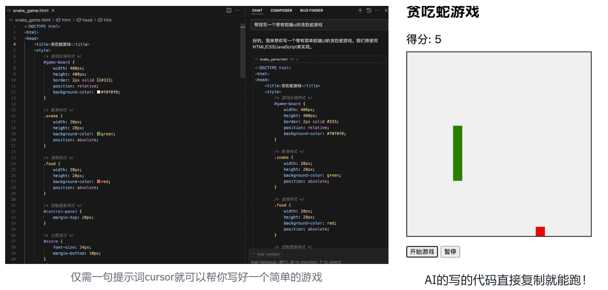

The code written by AI can be directly copied and run!

Thanks to the powerful coding capabilities of today's large models, we can focus more on our application architecture and products, including the functions we want to implement, architectural design, target users, etc. It is important to be able to capture the needs of users, and in what form? In other words, in the current AI era, product thinking is also very important for application developers.

The following is how we use the CAMEL framework to build a real and usable software application - NavigatorAI (travel planning assistant), which uses many common and practical CAMEL modules and knowledge points.

> **Special Note**: NavigatorAI follows[CC BY-NC](https://creativecommons.org/licenses/by-nc/4.0/)The agreement is for learning purposes only, not for commercial use! ! !

### 5.1.1 Goals and interaction forms

First of all, make our goals clear. The core goal of the project is to realize an intelligent travel planning assistant: users only need to enter the destination and number of days, and the system can automatically generate a detailed travel itinerary, including daily activity arrangements, dining recommendations, attraction information, etc. The system** also supports dynamic adjustment of itineraries based on user feedback, supports online reading and editing**, and provides export in multiple formats (Markdown, HTML or PDF) to facilitate users to save or share. This not only improves the efficiency of itinerary planning, but also brings users a more convenient and professional travel experience.

Based on the goals, we can design our overall application architecture diagram as follows:

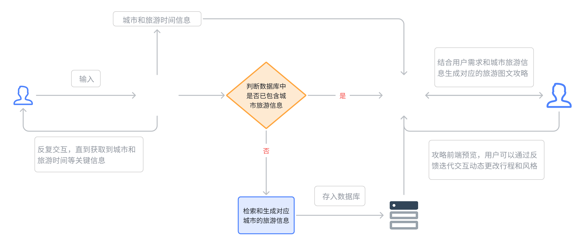

### 5.1.2 Modular design

In modern software development, modular design ideas are generally chosen, aiming to improve the maintainability, scalability and development efficiency of the code by decomposing the system into multiple independent and reusable modules. The core idea of modular design is **decoupling**, which means to separate different functions of the system through clear boundaries and interfaces, so that each module can be developed, tested and maintained independently without excessive dependence on other modules.

Therefore, through modular design, the development team can build complex systems more efficiently, while reducing the difficulty of long-term maintenance, which can help the development team collaborate to complete the development, design and testing of the entire project in a short time.

The travel planning assistant NavigatorAI also adopts a modular design idea. The entire comprehensive application can be divided into four sub-modules.

#### 5.1.2.1 **Information Collection Module**

In this module, the user and the **Information Collection Agent** engage in multiple rounds of back-and-forth dialogue until the Agent believes that it can extract key information such as the user's target travel city and travel days through the user's expression and context, and passes the information to the next module.

#### 5.1.2.2 **Strategy generation module**

* **Verify that the data exists**:

  * If there is travel data for the corresponding city and number of days in the database (that is, a cache hit), the reused data is loaded directly.

  * If the corresponding information is not found in the database, call the search tool (Google Search or DuckDuckGo) in Tool Calling for real-time information retrieval (the retrieved content includes famous attractions, local food, weather conditions and other data, which can be added freely as needed)

* **Generation of first draft of strategy**:

  * Next, the **Strategy Generation Agent** will combine the basic data retrieved above to generate a detailed itinerary in HTML format according to the predefined default format, including daily activity arrangements and recommended content.

* **Format Conversion**:

  * Export the generated HTML to PDF format and provide online preview on the front end to facilitate users to download/forward/save/modify.

#### 5.1.2.3 **Feedback Optimization Module**

* **Collect user feedback**:

  * Users can evaluate any part and content of the generated first draft of the strategy in the front-end preview, and support manual marking and drawing of parts that need optimization, which means that the form of feedback we receive is multi-modal (image understanding + text commentary).

* **Use feedback to optimize the Agent to understand intentions and adjust strategies iteratively**:

  * **Feedback Optimization Agent** analyzes user feedback and understands specific modification requirements;

  * Based on user feedback, new content is generated and optimized iteratively by combining multi-modal capabilities and tool calls.

* **Output the final strategy version**:

  * Generate PDF documents based on the final itinerary confirmed by the user.

  * Store the optimized itinerary in the database for future reuse.


## 5.2 User intention recognition module

This module is mainly used to collect users’ needs on where they want to go and how many days they want to go. We can achieve this through a suitable system prompt. In order to design the front-end and back-end separation in the subsequent software development, we also need to further encapsulate the module into a local service through flask.

````python
import os
import sys
import json
from typing import Optional
from flask import Flask, request, jsonify,Response

from dotenv import load_dotenv
from camel.configs import QwenConfig
from camel.models import ModelFactory
from camel.types import ModelPlatformType
from camel.agents import ChatAgent

load_dotenv()

API_KEY = os.getenv('MODELSCOPE_SDK_TOKEN')

SYSTEM_PROMPT = """
你是一个旅游信息提取助手。你的任务是从用户的输入中提取旅游目的地城市和行程天数，并根据提取情况决定是否需要用户补充信息。

用户输入可能包含以下信息：
* 旅游目的地城市名称（例如：北京、上海、巴黎、东京）
* 行程天数（例如：3天、5天、一周、两周）
* 可能会有其他无关信息，请忽略。

你需要将提取到的城市名称和行程天数以 JSON 格式返回，格式如下：
{"city": "城市名称", "days": 天数, "need_more_info": boolean}
* "city" 的值：
    * 如果成功提取到城市名称，则为城市名称字符串。
    * 如果无法提取到城市名称，则为 null。
* "days" 的值：
    * 如果成功提取到行程天数，则为数字。
    * 如果无法提取到行程天数，则为 null。
* "need_more_info" 的值：
    * 如果 "city" 或 "days" 中有任何一个为 null，则为 true，表示需要用户提供更多信息。
    * 如果 "city" 和 "days" 都不为 null，则为 false，表示不需要用户提供更多信息。
* 如果提取到的天数包含“天”或“日”等字样，请将其转换为数字。
* 如果提取到的天数包含“周”或“星期”，请将其转换为7的倍数。例如，“一周”转换为7，“两周”转换为14。
* 如果用户输入中包含多个城市，请只提取第一个城市。
* 如果用户输入中包含多个天数，请只提取第一个天数。

请严格按照 JSON 格式返回结果。

**示例：**

**用户输入：**
我想去北京玩三天，顺便看看长城。

**你的输出：**
{"city": "北京", "days": 3, "need_more_info": false,"response": "信息在Navigator的数据库中查询到啦，正在努力为您生成攻略~"}

**用户输入：**
我想去北京。

**你的输出：**
{"city": "北京", "days": null, "need_more_info": true,"response": "Navigator还不知道您打算去玩几天呢，请补充你计划的行程天数~"}
"""

app = Flask(__name__)

def create_travel_agent():
    qwen_model = ModelFactory.create(
        model_platform=ModelPlatformType.OPENAI_COMPATIBLE_MODEL,
        model_type="ZhipuAI/GLM-4.5",
        api_key=API_KEY,
        url="https://api-inference.modelscope.cn/v1",
        model_config_dict=QwenConfig(temperature=0.2).as_dict(),
    )

    agent = ChatAgent(
        system_message=SYSTEM_PROMPT,
        model=qwen_model,
        message_window_size=10,
        output_language='Chinese'
    )
    return agent

travel_agent = create_travel_agent()

def get_travel_info_camel(user_input: str, agent: ChatAgent) -> dict:
    try:
        response = agent.step(user_input)
        # 回到原始状态
        agent.reset()
        if not response or not response.msgs:
            raise ValueError("模型没有返回任何消息")
        json_output = response.msgs[0].content.strip().replace("```json", "").replace("```", "").strip()
        json_output = json.loads(json_output)
        json_output["query"] = user_input
        return json_output
    except json.JSONDecodeError:
        print("Error: 模型返回的不是有效的 JSON 格式。")
        return {
            'city': None,
            'days': None,
            'need_more_info': True,
            'query': user_input,
            'response': None
        }
    except Exception as e:
        print(f"An unexpected error occurred: {e}")
        return {
            'city': None,
            'days': None,
            'need_more_info': True,
            'query': user_input,
            'response': None
        }

@app.route('/extract_travel_info', methods=['POST'])
def extract_travel_info():
    try:
        request_data = request.get_json()
        if not request_data or 'query' not in request_data:
            return jsonify({'error': '请求数据无效'}), 400

        result = get_travel_info_camel(request_data['query'], travel_agent)
        response = {
            'city': result['city'],
            'days': result['days'],
            'need_more_info': result['need_more_info'],
            'query': result['query'],
            'response': result['response']
        }
        response_json = json.dumps(response, ensure_ascii=False)
        return Response(response_json, status=200, mimetype='application/json; charset=utf-8')
    except Exception as e:
        return jsonify({'error': f'服务器内部错误: {str(e)}'}), 500

if __name__ == "__main__":
    app.run(host="0.0.0.0", port=5001)
    
````

After this module is run, a service will be started on the local port 5001. We can request this service to interact with the **Information Collection Agent** in the module for multiple rounds.

Sample code using the Python requests library

```python
import requests

url = "http://localhost:8000/extract_travel_info"
data = {"query": "我想去北京玩三天"}
response = requests.post(url, json=data)
print(response.json())

>>>
{'city': '北京', 'days': 3, 'need_more_info': False, 'query': '我想去北京玩三天', 'response': '信息已经获取，正在帮你生成攻略。'}
```

Use curl's example command line. This time we don't specify the requirements clearly. Try:

```python
curl -X POST http://localhost:8000/extract_travel_info \
-H "Content-Type: application/json" \
-d '{"query": "我想去北京玩"}'

>>>
{"city": "北京", "days": null, "need_more_info": true, "query": "我想去北京玩", "response": "请补充旅游天数，你打算去玩几天呀。"}
```

Through the above two test examples, we can observe that the core function of the **Information Collection Module** allows us to independently analyze the problem and guide us to add the number of travel days when the information is incomplete. Some friends may think that there is no need to do this at all. It is enough to directly set a pop-up window on the start interface to let the user enter the city and number of days. In fact, we have also considered this solution. This is indeed more convenient and faster, and we specially added this module in the solution to take into account the possible expansion of more interactive space in the future, such as emotional companionship, etc. Of course, the plan that suits you is the best! Enjoy!

## 5.3 Travel information retrieval

Tourism information retrieval is a key link in the system to achieve data acquisition and processing. It is responsible for dynamically acquiring and generating high-quality tourism data based on the destination city and travel days input by the user.

The workflow of the module is divided into the following stages: First, the information input by the user is standardized, and the city name and time information are rewritten into a query template (query) suitable for search engines. Subsequently, the system calls **Google Search API** to perform text retrieval of attractions and food information, including attraction descriptions, distances, recommended food and other details; at the same time, in order to supplement image resources, the module also calls **DuckDuckGo search engine**, focusing on obtaining high-quality links to attractions and food pictures.

After the data retrieval is completed, the module further uses a large language model (LLM) to intelligently analyze and rerank the preliminary search results, optimizing the data quality from the perspective of relevance and user needs, ensuring comprehensive, accurate information and clear priorities. The optimized data will be stored in the database in a structured form, including the name, detailed description, recommendation reason, and image URL of each attraction and food.

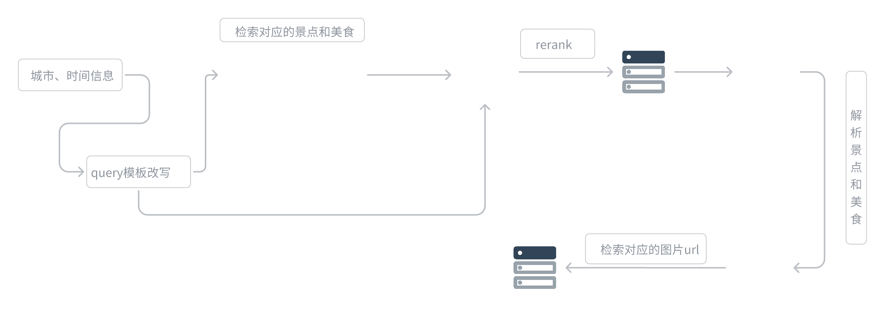


````python
from camel.toolkits import SearchToolkit
from camel.agents import ChatAgent
from camel.models import ModelFactory
from camel.types import ModelPlatformType
from camel.loaders import Firecrawl
from typing import List, Dict, Any

from flask import Flask, request, jsonify
import json
import os
import re
from dotenv import load_dotenv

load_dotenv()

os.environ["GOOGLE_API_KEY"] = os.getenv("GOOGLE_API_KEY")
os.environ["SEARCH_ENGINE_ID"] = os.getenv("SEARCH_ENGINE_ID")
os.environ["FIRECRAWL_API_KEY"] = os.getenv("FIRECRAWL_API_KEY")
os.environ["MODELSCOPE_SDK_TOKEN"] = os.getenv("MODELSCOPE_SDK_TOKEN")

app = Flask(__name__)

class TravelPlanner:
    def __init__(self, city: str, days: int):
        
        #定义地点和时间，设置默认值
        self.city = city
        self.days = days
        self.res = None        

        # 初始化模型和智能体
        self.model = ModelFactory.create(
            model_platform=ModelPlatformType.OPENAI_COMPATIBLE_MODEL,
            model_type="ZhipuAI/GLM-4.5",
            url='https://api-inference.modelscope.cn/v1/',
            api_key=os.getenv('MODELSCOPE_SDK_TOKEN')
        )

        # 初始化各种工具
        #重排序模型
        self.reranker_agent = ChatAgent(
            system_message="你是一搜索质量打分专家，要从{搜索结果}里找出和{query}里最相关的2条结果，保存他们的结果，保留result_id、title、description、url，严格以json格式输出",
            model=self.model,
            output_language='中文'
        )
        #景点抓取agent
        self.attraction_agent = ChatAgent(
            system_message="你是一个旅游信息提取专家，要根据内容提取出景点信息并返回json格式，严格以json格式输出",
            model=self.model,
            output_language='中文'
        )
        #美食抓取agent
        self.food_agent = ChatAgent(
            system_message="你是一个旅游信息提取专家，要根据内容提取出美食信息并返回json格式，严格以json格式输出",
            model=self.model,
            output_language='中文'
        )
        #base攻略生成agent
        self.base_guide_agent = ChatAgent(
            system_message="你是一个旅游攻略生成专家，要根据内容生成一个旅游攻略，严格以json格式输出",
            model=self.model,
            output_language='中文'
        )
        # self.firecrawl = Firecrawl()#后续功能
        self.search_toolkit = SearchToolkit()
        #如果此处案例中search_duckduckgo()方法报错，可参考2.7.3进阶案例中的办法进行重写

    def extract_json_from_response(self,response_content: str) -> List[Dict[str, Any]]:
            """从LLM响应中提取JSON内容"""
            try:
                # 优先解析裸 JSON，避免修改 JSON 字符串中的代码块标记。
                try:
                    parsed = json.loads(response_content)
                except json.JSONDecodeError:
                    # 同时兼容模型返回的 JSON 代码块（LF 或 CRLF 换行）。
                    match = re.search(
                        r'```json[ \t]*\r?\n(.*?)\r?\n```',
                        response_content,
                        re.DOTALL,
                    )
                    if match is None:
                        raise
                    parsed = json.loads(match.group(1))
                
                # 处理不同的JSON结构
                if isinstance(parsed, dict) and "related_results" in parsed:
                    return parsed["related_results"]
                elif isinstance(parsed, list):
                    return parsed
                else:
                    print("未找到预期的JSON结构")
                    return []
                
            except json.JSONDecodeError as e:
                print(f"解析JSON失败: {str(e)}")
                print(f"原始内容: {response_content}")
                return []
            except Exception as e:
                print(f"发生错误: {str(e)}")
                return []

    def search_and_rerank(self) -> Dict[str, Any]:
        """多次搜索并重排序，整合信息"""
        city = self.city
        days = self.days
        all_results = {}
    
        # 第一次搜索：旅游攻略
        try:
            query = f"{city}{days}天旅游攻略 最佳路线"
            search_results = self.search_toolkit.search_google(query=query, num_result_pages=5)
            prompt = f"请从以下搜索结果中筛选出最相关的{self.days}条{city}{days}天旅游攻略信息，并按照相关性排序：\n{json.dumps(search_results, ensure_ascii=False, indent=2)}"
            response = self.reranker_agent.step(prompt)
            all_results["guides"] = self.extract_json_from_response(response.msgs[0].content)
        except Exception as e:
            print(f"旅游攻略搜索失败: {str(e)}")
            all_results["guides"] = []
        
        # 第二次搜索：必去景点
        try:
            query = f"{city} 必去景点 top10 著名景点"
            search_results = self.search_toolkit.search_google(query=query, num_result_pages=5)
            prompt = f"请从以下搜索结果中筛选出最多{self.days}条{city}最值得去的景点信息，并按照热门程度排序：\n{json.dumps(search_results, ensure_ascii=False, indent=2)}"
            response = self.reranker_agent.step(prompt)
            all_results["attractions"] = self.extract_json_from_response(response.msgs[0].content)
        except Exception as e:
            print(f"景点搜索失败: {str(e)}")
            all_results["attractions"] = []
        
        # 第三次搜索：必吃美食
        try:
            query = f"{city} 必吃美食 特色小吃 推荐"
            search_results = self.search_toolkit.search_google(query=query, num_result_pages=5)
            prompt = f"请从以下搜索结果中筛选出最多{self.days}条{city}最具特色的美食信息，并按照推荐度排序：\n{json.dumps(search_results, ensure_ascii=False, indent=2)}"
            response = self.reranker_agent.step(prompt)
            all_results["must_eat"] = self.extract_json_from_response(response.msgs[0].content)
        except Exception as e:
            print(f"必吃美食搜索失败: {str(e)}")
            all_results["must_eat"] = []
        
        # 第四次搜索：特色美食
        try:
            query = f"{city} 特色美食 地方小吃 传统美食"
            search_results = self.search_toolkit.search_google(query=query, num_result_pages=5)
            prompt = f"请从以下搜索结果中筛选出最多{self.days}条{city}独特的地方特色美食信息，并按照特色程度排序：\n{json.dumps(search_results, ensure_ascii=False, indent=2)}"
            response = self.reranker_agent.step(prompt)
            all_results["local_food"] = self.extract_json_from_response(response.msgs[0].content)
        except Exception as e:
            print(f"特色美食搜索失败: {str(e)}")
            all_results["local_food"] = []
        
        # 整合所有信息
        final_result = {
            "city": city,
            "days": days,
            "travel_info": {
                "guides": [
                    {
                        "result_id": item.get("result_id"),
                        "title": item.get("title"),
                        "description": item.get("description"),
                        "long_description": item.get("long_description"),
                    }
                    for item in all_results["guides"]
                ],
                "attractions": [
                    {
                        "result_id": item.get("result_id"),
                        "title": item.get("title"),
                        "description": item.get("description"),
                        "long_description": item.get("long_description"),
                    }
                    for item in all_results["attractions"]
                ],
                "must_eat": [
                    {
                        "result_id": item.get("result_id"),
                        "title": item.get("title"),
                        "description": item.get("description"),
                        "long_description": item.get("long_description"),
                    }
                    for item in all_results["must_eat"]
                ],
                "local_food": [
                    {
                        "result_id": item.get("result_id"),
                        "title": item.get("title"),
                        "description": item.get("description"),
                        "long_description": item.get("long_description"),
                    }
                    for item in all_results["local_food"]
                ]
            }
        }
        
        return final_result
    
    def extract_attractions_and_food(self) -> Dict:
        travel_info = self.search_and_rerank()

        # 提供一个base攻略路线，直接根据整个travel_info生成
        prompt = f"""
        参考以下信息，生成一个{self.city}{self.days}天攻略路线，直接根据整个travel_info生成
        {travel_info}
        【输出格式】
        {{
            "base_guide": "攻略内容"
        }}
        """
        base_guide = self.base_guide_agent.step(prompt)
        print(f"这是base攻略: {base_guide.msgs[0].content}")

        """提取景点和美食信息"""
        # 从描述中提取具体的景点和美食
        attractions_text = " ".join([item["description"] for item in travel_info["travel_info"]["attractions"] + travel_info["travel_info"]["guides"]])
        print(f"这是景点信息: {attractions_text}")
        food_text = " ".join([
            item["description"] 
            for item in travel_info["travel_info"]["must_eat"] + travel_info["travel_info"]["local_food"]
        ])
        print(f"这是美食信息: {food_text}")
        # 使用LLM提取并整理信息
        attractions_prompt = f"""
        请从以下文本中提取出具体的景点名称，注意不能遗漏景点信息，要尽量多提取景点信息，并为每个景点提供简短描述：
        {attractions_text}
        请以JSON格式返回，格式如下：
        {{
            "attractions": [
                {{"name": "景点名称", "description": "简短描述"}}
            ]
        }}
        """
        
        food_prompt = f"""
        请从以下文本中提取出具体的美食名称或者美食店铺，注意不能遗漏美食信息，要尽量多提取美食信息，并为每个美食和店铺提供简短描述：
        {food_text}
        请以JSON格式返回，格式如下：
        {{
            "foods": [
                {{"name": "美食名称", "description": "简短描述"}}
            ],
            "food_shop": [
                {{"name": "美食店铺", "description": "简短描述"}}
            ]
        }}
        """
        
        # 使用attraction_agent处理提取
        attractions_response = self.attraction_agent.step(attractions_prompt)
        foods_response = self.food_agent.step(food_prompt)
        
        print(f"这是景点信息: {attractions_response.msgs[0].content}")
        print(f"这是美食信息: {foods_response.msgs[0].content}")
        
        return {
            "base_guide": base_guide.msgs[0].content,
            "attractions": attractions_response.msgs[0].content,
            "foods": foods_response.msgs[0].content
        }
    
    def process_attractions_and_food(self) -> Dict:
        def clean_json_string(json_str: str) -> str:
            """清理JSON字符串，移除markdown代码块标记"""
            # 移除 ```Starting with json
            if '```json' in json_str:
                json_str = json_str.split('```json')[-1]
            # Remove ``` 结尾
            if '```' in json_str:
                json_str = json_str.split('```')[0]
            return json_str.strip()
        
        city = self.city
        """处理景点和美食信息，添加图片URL"""
        # 获取原始数据
        results = self.extract_attractions_and_food()
        
        # 解析JSON字符串
        base_guide = json.loads(clean_json_string(results['base_guide']))
        attractions_data = json.loads(clean_json_string(results['attractions']))
        foods_data= json.loads(clean_json_string(results['foods']))
        foods_list = foods_data['foods']
        food_shops_list = foods_data['food_shop']
        
        # 创建结果字典
        result = {
            "city": city,
            "days": self.days,
            "base路线": base_guide,
            "景点": [],
            "美食": [],
            "美食店铺": []
        }
        
        # 处理景点信息
        for attraction in attractions_data['attractions']:
            try:
                # 使用DuckDuckGo搜索图片
                images = self.search_toolkit.search_duckduckgo(
                    query=f"{city} {attraction['name']} 实景图",
                    source="images",
                    max_results=1
                )
                
                # 添加图片URL
                attraction_with_image = {
                    "name": attraction['name'],
                    "describe": attraction['description'],
                    "图片url": images[0]["image"] if images else "",
                }
                result['景点'].append(attraction_with_image)
                
            except Exception as e:
                print(f"搜索{attraction['name']}的图片时出错: {str(e)}")
                # 如果出错，仍然添加景点信息，但不包含图片URL
                result['景点'].append({
                    "name": attraction["name"],
                    "describe": attraction["description"],
                    "图片url": "",
                })
        
        # 处理美食信息
        for food in foods_list:
            try:
                # 使用DuckDuckGo搜索图片
                images = self.search_toolkit.search_duckduckgo(
                    query=f"{city} {food['name']} 美食",
                    source="images",
                    max_results=1
                )
                
                # 添加图片URL
                food_with_image = {
                    "name": food["name"],
                    "describe": food["description"],
                    "图片url": images[0]["image"] if images else "",
                }
                result['美食'].append(food_with_image)
                
            except Exception as e:
                print(f"搜索{food['name']}的图片时出错: {str(e)}")
                # 如果出错，仍然添加美食信息，但不包含图片URL
                result['美食'].append({
                    "name": food["name"],
                    "describe": food["description"],
                    "图片url": ""
                })
        # 处理美食店铺信息
        for food_shop in food_shops_list:
            try:
                # 使用DuckDuckGo搜索图片
                images = self.search_toolkit.search_duckduckgo(
                    query=f"{city} {food_shop['name']} 美食店铺",
                    source="images",
                    max_results=1
                )
                # 添加图片URL
                food_shop_with_image = {
                    "name": food_shop["name"],
                    "describe": food_shop["description"],
                    "图片url": images[0]["image"] if images else "",
                }
                result['美食店铺'].append(food_shop_with_image)
            except Exception as e:
                print(f"搜索{food_shop['name']}的图片时出错: {str(e)}")
                # 如果出错，仍然添加美食店铺信息，但不包含图片URL
                result['美食店铺'].append({
                    "name": food_shop["name"],
                    "describe": food_shop["description"],
                    "图片url": ""
                })
        try:
            # 获取当前脚本所在目录
            current_dir = os.path.dirname(os.path.abspath(__file__))
            # 创建storage目录路径
            storage_dir = os.path.join(current_dir, "storage")
            # 确保storage目录存在
            os.makedirs(storage_dir, exist_ok=True)
            
            # 生成文件名（使用城市名和日期）
            filename = os.path.join(storage_dir, f"{self.city}{self.days}天旅游信息.json")
            
            # 将结果写入JSON文件
            with open(filename, 'w', encoding='utf-8') as f:
                json.dump(result, f, ensure_ascii=False, indent=4)
            print(f"旅游攻略已保存到文件：{filename}")
        except Exception as e:
            print(f"保存JSON文件时出错: {str(e)}")
        
        return result

@app.route('/get_travel_plan', methods=['POST'])
def get_travel_plan():
   try:
       # 获取请求数据
       data = request.get_json()
       
       # 验证输入数据
       if not data or 'city' not in data or 'days' not in data:
           return jsonify({
               'status': 'error',
               'message': '请求必须包含city和days参数'
           }), 400
           
       city = data['city']
       days = data['days']
       
       # 验证days是否为整数
       try:
           days = int(days)
       except ValueError:
           return jsonify({
               'status': 'error',
               'message': 'days参数必须为整数'
           }), 400
           
       # 创建TravelPlanner实例并获取结果
       travel_planner = TravelPlanner(city=city, days=days)
       results = travel_planner.process_attractions_and_food()
       
       return jsonify({
           'status': 'success',
           'data': results
       })
       
   except Exception as e:
       return jsonify({
           'status': 'error',
           'message': f'处理请求时发生错误: {str(e)}'
       }), 500
if __name__ == '__main__':
   app.run(host='0.0.0.0', port=5002, debug=True)
````

Similarly, we started a service on the local port 5002. We used the requests library to call and test the effect:

```python
import requests
import json

# API端点
url = "http://localhost:5000/get_travel_plan"

# 请求数据
data = {
    "city": "上海",
    "days": 3
}

# 发送POST请求
try:
    response = requests.post(url, json=data)
    
    # 检查响应状态
    if response.status_code == 200:
        result = response.json()
        print("获取到的旅游计划：")
        print(json.dumps(result, ensure_ascii=False, indent=2))
    else:
        print(f"请求失败: {response.status_code}")
        print(f"错误信息: {response.text}")
        
except requests.exceptions.RequestException as e:
    print(f"发送请求时发生错误: {e}")
```

This module is used to collect and organize travel information. The information mainly includes some tourist attractions, food information and URLs of corresponding pictures, so that we can later convert them into graphic guides.

In the application development of large language models, we often use JSON as the logical storage format of intermediate data because it is convenient for interaction, well represents structured information, and is convenient for human reading and understanding.

The following are the three reference results generated (in the files in the docs directory)

```python
filename = os.path.join(storage_dir, f"{self.city}{self.days}天旅游信息.json")
```

The naming logic is <span style="color: rgb(36,91,219); background-color: inherit">{location}</span>+<span style="color: rgb(100,37,208); background-color: inherit">{time}</span>+<span style="color: rgb(222,120,2); background-color: inherit">Travel information.json</span>


## 5.4 Strategy generation module

This module implements a travel itinerary planning service. The main process is as follows:

The core idea is to use the city and travel days information transmitted from the front end to first search whether the corresponding tourism data (such as attractions, food, etc.) already exists in the local database. If not, the corresponding tourism information will be automatically retrieved and generated and stored. Subsequently, the backend will use the CAME library and the Qwen2.5-72B-Instruct model, combined with a system message containing trip planning rules, to guide the large model to generate a complete multi-day itinerary. In order to make the results easy to view on the front end, the code will format the text given by the model into HTML, and if necessary, convert the image links in it into `` tag, allowing users to directly preview the itinerary guide page. The backend can also convert that HTML to PDF for export if the user wants to download it. When the user is not satisfied with the current results, he can interact with the large model again and dynamically adjust and optimize the final travel plan through multiple rounds of dialogue. The whole process is shown in the figure: when city and day information is input, the system first determines whether there is available data in the local database; if it exists, it directly calls the large model to generate the itinerary; if it does not exist, it retrieves and stores the data before generating itinerary; finally, the generated HTML or PDF is viewed through the front-end interface. If the user still needs to modify it, it iterates through the large model again. This completes a complete process from retrieving data to generating and displaying customized travel guides.

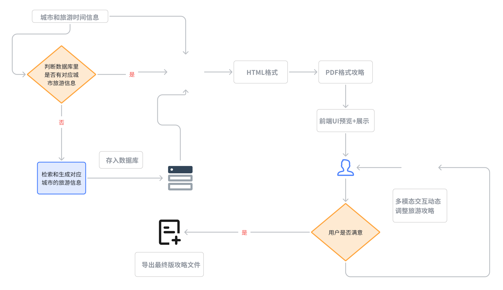


```python
import os
import json
import re
from flask import Flask, request, jsonify

from camel.configs import QwenConfig
from camel.models import ModelFactory
from camel.types import ModelPlatformType
from camel.toolkits import SearchToolkit
from camel.agents import ChatAgent
from dotenv import load_dotenv

load_dotenv()

app = Flask(__name__)

# 环境变量
os.environ["GOOGLE_API_KEY"] = os.getenv("GOOGLE_API_KEY")
os.environ["SEARCH_ENGINE_ID"] = os.getenv("SEARCH_ENGINE_ID")

# 模型初始化
qwen_model = ModelFactory.create(
    model_platform=ModelPlatformType.OPENAI_COMPATIBLE_MODEL,
    model_type="ZhipuAI/GLM-4.5",
    api_key=os.getenv("MODELSCOPE_SDK_TOKEN"),
    url="https://api-inference.modelscope.cn/v1",
    model_config_dict=QwenConfig(temperature=0.2).as_dict(),
)

tools_list = [
    *SearchToolkit().get_tools(),
]

sys_msg = """
你是一位专业的旅游规划师。请你根据用户输入的旅行需求，包括旅行天数、景点/美食的距离、描述、图片URL、预计游玩/就餐时长等信息，为用户提供一个详细的行程规划。

请遵循以下要求：
1. 按照 Day1、Day2、... 的形式组织输出，直到满足用户指定的天数。
2. 每一天的行程请从早餐开始，食物尽量选用当地特色小吃美食，列出上午活动、午餐、下午活动、晚餐、夜间活动（若有），并在末尾总结住宿或返程安排。
3. 对每个景点或美食，提供其基本信息： 
   - 名称
   - 描述
   - 预计游玩/就餐时长（如果用户未提供，可以不写或自行估计）
   - 图片URL（如果有）
4. 请调用在线搜索工具在行程中对移动或出行所需时长做出合理估计。
5. 输出语言为中文。
6. 保持回复简洁、有条理，但必须包含用户想要的所有信息。
"""

agent = ChatAgent(
    system_message=sys_msg,
    model=qwen_model,
    message_window_size=10,
    output_language='Chinese',
    tools=tools_list
)

def create_usr_msg(data: dict) -> str:
    """
    同你原先的实现，用于生成给大模型的用户输入消息
    """
    city = data.get("city", "")
    days_str = data.get("days", "1")
    try:
        days = int(days_str)
    except ValueError:
        days = 1

    lines = []
    lines.append(f"我准备去{city}旅行，共 {days} 天。下面是我提供的旅行信息：\n")
    
    scenic_spots = data.get("景点", [])
    foods = data.get("美食", [])

    if scenic_spots:
        lines.append("- 景点：")
        for i, spot in enumerate(scenic_spots, 1):
            lines.append(f"  {i}. {spot.get('name', '未知景点名称')}")
            if '距离' in spot:
                lines.append(f"     - 距离：{spot['距离']}")
            if 'describe' in spot:
                lines.append(f"     - 描述：{spot['describe']}")
            if '图片url' in spot:
                lines.append(f"     - 图片URL：{spot['图片url']}")

    if foods:
        lines.append("\n- 美食：")
        for i, food in enumerate(foods, 1):
            lines.append(f"  {i}. {food.get('name', '未知美食名称')}")
            if 'describe' in food:
                lines.append(f"     - 描述：{food['describe']}")
            if '图片url' in food:
                lines.append(f"     - 图片URL：{food['图片url']}")

    lines.append(f"""
    \n请你根据以上信息，规划一个 {days} 天的行程表。
    从每天的早餐开始，到晚餐结束，列出一天的行程，包括对出行方式或移动距离的简单说明。
    如果有多种景点组合，你可以给出最优的路线推荐。请按以下格式输出：

    Day1:
    - 早餐：
    - 上午：
    - 午餐：
    - 下午：
    - 晚餐：
    ...

    Day2:
    ...

    Day{days}:
    ...
    """
    )
    return "\n".join(lines)

def fix_exclamation_link(text: str) -> str:
    """
    先把类似  的写法，提取出其中的 http://xx.jpg，
    替换成纯 http://xx.jpg
    """
    md_pattern = re.compile(r'!\[.*?\]\((https?://\S+)\)')
    # 将  只保留 http://xxx
    # 比如把 "" -> "http://xx.jpg"
    return md_pattern.sub(lambda m: m.group(1), text)

def convert_picurl_to_img_tag(text: str, width: int = 300, height: int = 200) -> str:
    """
    将文本中的图片URL替换为带样式的HTML img标签，并让图片居中显示和统一大小
    兼容两步：先处理 ，再匹配 - 图片URL: http://url
    """
    # 第一步：把  变成纯 url
    text_fixed = fix_exclamation_link(text)

    pattern = re.compile(r'-\s*图片URL：\s*(https?://\S+)')
    replaced_text = pattern.sub(
        rf'''
        <div style="text-align: center;">
            
        </div>
        ''',
        text_fixed
    )
    return replaced_text

def generate_cards_html(data_dict):
    """
    生成景点和美食卡片的 HTML 片段
    """
    spots = data_dict.get("景点", [])
    foods = data_dict.get("美食", [])

    html_parts = []
    # 景点推荐
    html_parts.append("<h2>景点推荐</h2>")
    if spots:
        html_parts.append('<div class="card-container">')
        for spot in spots:
            name = spot.get("name", "")
            desc = spot.get("describe", "")
            distance = spot.get("距离", "")
            url = spot.get("图片url", "")
            card_html = f"""
            <div class="card">
            <div class="card-image">
                
            </div>
            <div class="card-content">
                <h3>{name}</h3>
                <p><strong>距离:</strong> {distance}</p>
                <p>{desc}</p>
            </div>
            </div>
            """
            html_parts.append(card_html)
        html_parts.append("</div>")
    else:
        html_parts.append("<p>暂无景点推荐</p>")

    # 美食推荐
    html_parts.append("<h2>美食推荐</h2>")
    if foods:
        html_parts.append('<div class="card-container">')
        for food in foods:
            name = food.get("name", "")
            desc = food.get("describe", "")
            url = food.get("图片url", "")
            card_html = f"""
            <div class="card">
            <div class="card-image">
                
            </div>
            <div class="card-content">
                <h3>{name}</h3>
                <p>{desc}</p>
            </div>
            </div>
            """
            html_parts.append(card_html)
        html_parts.append("</div>")
    else:
        html_parts.append("<p>暂无美食推荐</p>")

    return "\n".join(html_parts)

def generate_html_report(itinerary_text, data_dict):
    """
    将多日行程文本 + 景点美食卡片，合并生成完整HTML
    """
    html_parts = []
    html_parts.append("<!DOCTYPE html>")
    html_parts.append("<html><head><meta charset='utf-8'><title>旅行推荐</title>")
    # 可以内联一些 CSS 样式
    html_parts.append("<style>")
    html_parts.append("""
    body {
       font-family: "Microsoft YaHei", sans-serif;
       margin: 20px;
       background-color: #f8f8f8;
       line-height: 1.6;
    }
    h1, h2 {
       color: #333;
    }
    .itinerary-text {
       background-color: #fff;
       padding: 20px;
       border-radius: 8px;
       box-shadow: 0 2px 5px rgba(0,0,0,0.1);
       margin-bottom: 30px;
    }
    .card-container {
       display: flex;
       flex-wrap: wrap;
       gap: 20px;
       margin: 20px 0;
    }
    .card {
       flex: 0 0 calc(300px);
       border: 1px solid #ccc;
       border-radius: 10px;
       overflow: hidden;
       box-shadow: 0 2px 5px rgba(0,0,0,0.1);
       background-color: #fff;
    }
    .card-image {
       width: 100%;
       height: 200px;
       overflow: hidden;
       background: #f8f8f8;
       text-align: center;
    }
    .card-image img {
       max-width: 100%;
       max-height: 100%;
       object-fit: cover;
    }
    .card-content {
       padding: 10px 15px;
    }
    .card-content h3 {
       margin-top: 0;
       margin-bottom: 10px;
       font-size: 18px;
    }
    .card-content p {
       margin: 5px 0;
    }
    .image-center {
        text-align: center;
        margin: 20px 0;
    }
    .image-center img {
        width: 300px;
        height: 200px;
        object-fit: cover;
    }
    """)
    html_parts.append("</style></head><body>")

    # 标题
    html_parts.append("<h1>旅行行程与推荐</h1>")

    # 行程文本
    html_parts.append('<div class="itinerary-text">')
    for line in itinerary_text.split("\n"):
        if not line.strip():
            continue
        if line.strip().startswith("Day"):
            html_parts.append(f"<h2>{line.strip()}</h2>")
        else:
            html_parts.append(f"<p>{line}</p>")
    html_parts.append('</div>')

    # 景点/美食卡片
    cards_html = generate_cards_html(data_dict)
    html_parts.append(cards_html)

    html_parts.append("</body></html>")
    return "\n".join(html_parts)

def save_html_file(city: str, days: str, html_content: str) -> str:
    """
    保存HTML内容到文件
    
    Args:
        city: 城市名
        days: 旅行天数
        html_content: HTML内容
        
    Returns:
        str: 保存的文件路径
    """
    # 确保storage目录存在
    storage_dir = "storage"
    if not os.path.exists(storage_dir):
        os.makedirs(storage_dir)
        
    # 生成文件名
    filename = f"{storage_dir}/{city}{days}天旅游攻略.html"
    
    # 保存HTML内容
    with open(filename, "w", encoding="utf-8") as f:
        f.write(html_content)
        
    return filename

@app.route("/generate_itinerary_html", methods=["POST"])
def generate_itinerary_html():
    """
    请求 JSON 格式：
    {
      "city": "成都",
      "days": "3"
    }
    返回生成的HTML文件路径和内容
    """
    req_data = request.json or {}
    city = req_data.get("city", "")
    days = req_data.get("days", "1")

    json_filename = f"storage/{city}{days}天旅游信息.json"
    if not os.path.exists(json_filename):
        return jsonify({"error": f"文件 {json_filename} 不存在，请检查输入的目的地和天数！"}), 404

    try:
        with open(json_filename, "r", encoding="utf-8") as f:
            data = json.load(f)
    except json.JSONDecodeError:
        return jsonify({"error": f"文件 {json_filename} 格式错误，请检查文件内容！"}), 400

    # 1. 生成用户输入并调用大模型
    usr_msg = create_usr_msg(data)
    response = agent.step(usr_msg)

    # 2. 将模型输出中的图片URL替换成 
    model_output = response.msgs[0].content
    end_output = convert_picurl_to_img_tag(model_output)

    # 3. 生成完整 HTML 报告
    html_content = generate_html_report(end_output, data)

    # 4. 保存HTML文件
    saved_file = save_html_file(city, days, html_content)

    # 5. 返回文件路径和HTML内容
    return jsonify({
        "file_path": saved_file,
        "html_content": html_content
    }), 200

if __name__ == "__main__":
    app.run(host="0.0.0.0", port=5003, debug=True)
```

Here we use another way to test the service interface. Friends who are familiar with software development should have used Postman.

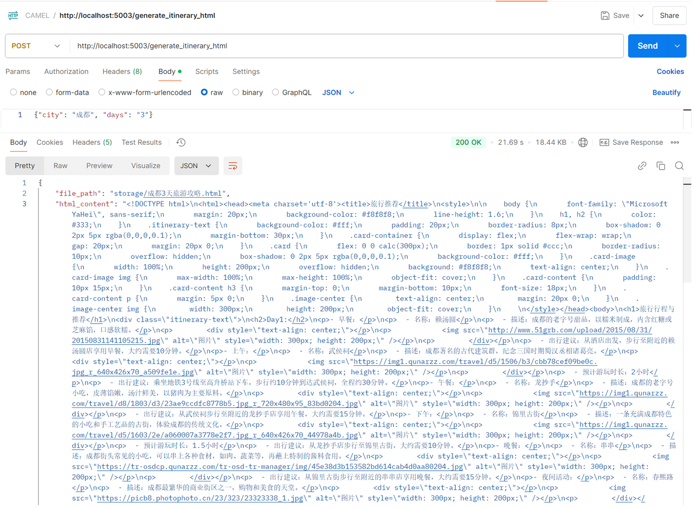

We use Post request in postman to send a piece of data to simulate the front-end request, so as to get the data returned by the back-end, that is, html\_content, and then save it to the local storage database by the save logic.

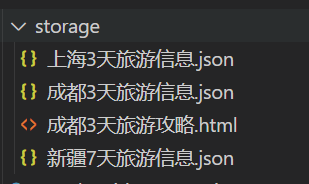

At this point, we have actually got a good displayable guide. You can open it by double-clicking it in your local browser and see the rendering effect.


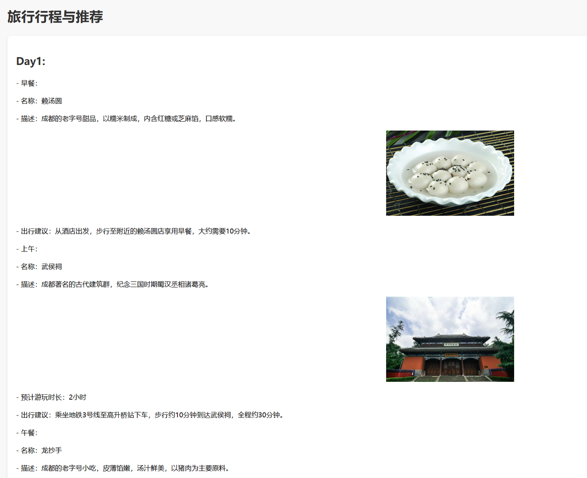

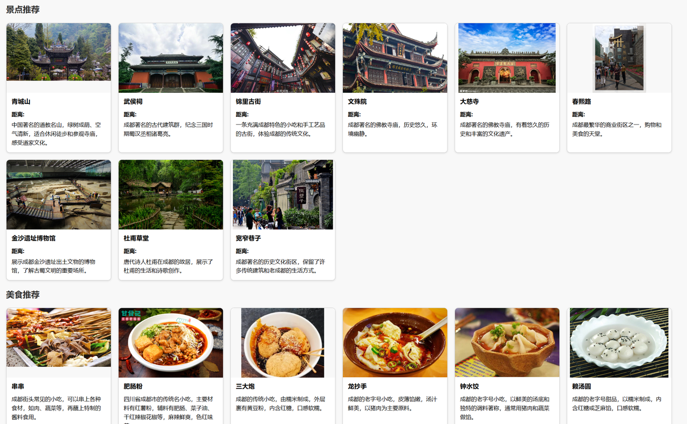

Finally, we convert the HTML into a PDF format that is consistent on any display device, ensuring the uniformity of the guide without having to worry about misalignment, line breaks and other issues.

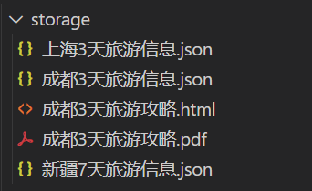


## 5.5 Feedback optimization module

The feedback optimization module requires the use of a large language model with multi-modal capabilities, so you need to apply for a large model with image understanding capabilities (here we use gpt-4o to demonstrate).

In feedback optimization, all our operations are based on PDF. Although there are intermediate processes, they are imperceptible to the user. Specifically, for a PDF, we will first identify the part marked and circled by the user, and then convert the entire page where it is located into the form of an image as part of the output source and hand it over to the **Feedback Optimization Agent with multi-modal understanding capabilities. **

**Feedback Optimization Agent** can well understand the user's modification prompts and intentions, make corrections at the HTML level, repeat the previous travel information retrieval and guide generation modules, complete the closed loop, and iteratively optimize the travel guide until the user is satisfied.

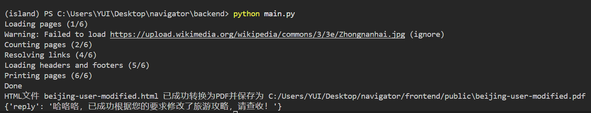

Edit PDF online and adjust to your needs:
Request 1: Replace the red part with Zhongnanhai for me

Need 2: Help me adjust the copywriting to Xiaohongshu style

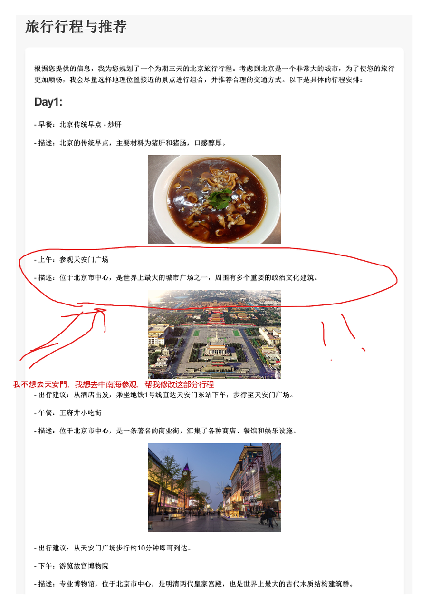

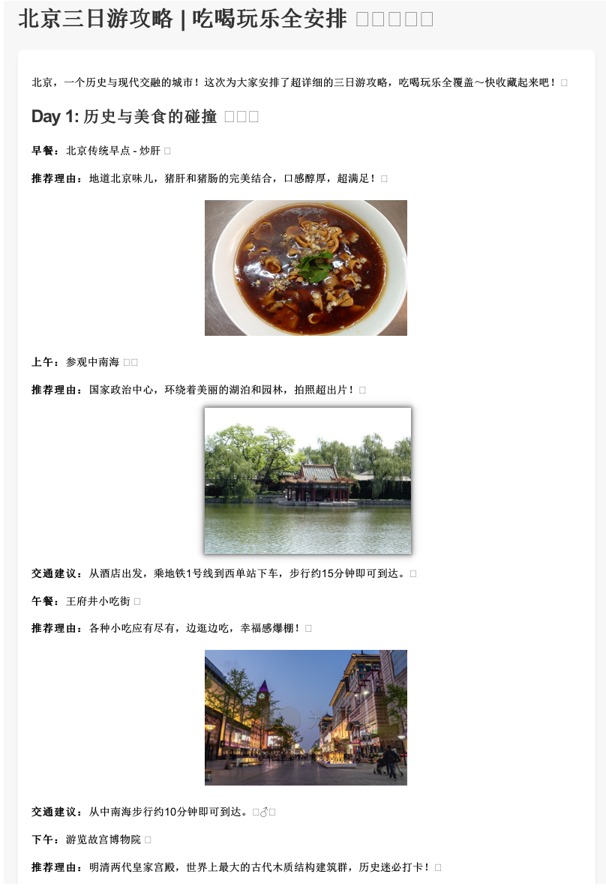

It is observed that the copywriting style is indeed more lively, and the red circle part has been correctly modified to Zhongnanhai and matches the accompanying picture very well.

## 5.6 Eat with front end

In the comprehensive case, in order to let everyone intuitively feel the fun of developing Agent products based on the CAMEL framework as much as possible, we have also prepared an exquisite front-end for everyone, which together with several previous back-end modules constitutes our NavigatorAI travel planning assistant application.

Only some functional descriptions and introductions are given here. The specific framework and principles of the front-end are not within the scope of discussion in this tutorial. Interested students can expand on their own\~

### UI online interaction module

The UI online interaction module is a key part of the system that interacts with users and is designed to enable online preview, editing and feedback of generated itinerary content through an intuitive interface. Users can directly view the generated PDF document in the interface, select, mark or enter modification comments in real time, and the system will dynamically adjust the itinerary content based on the feedback provided by the user.

The sidebars on the left and right are the history + settings bar and the file interaction bar. Both sides support expansion and hiding, which is very convenient and user-friendly.

Support day and night mode switching

> Dark mode

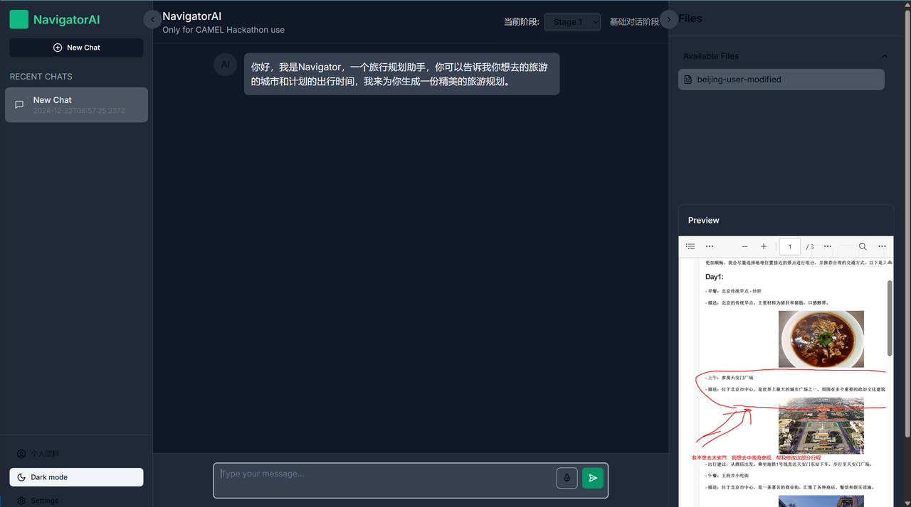

> Light mode

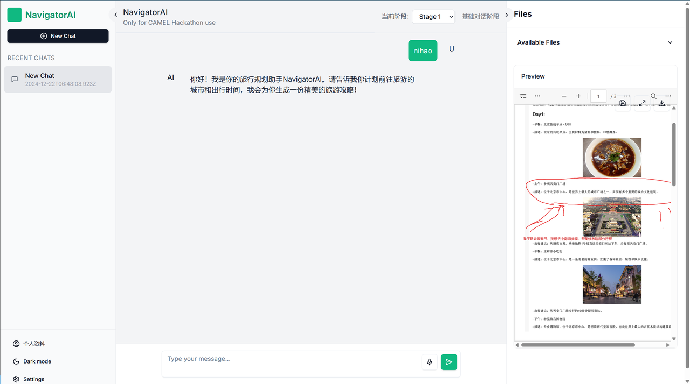

1. **PDF online rendering**

   * The generated itinerary copy is directly embedded into the interface in PDF format, and users can browse the content in real time.

   * Supports high-quality PDF rendering to ensure users can intuitively view text, images, and layout.


2. **Dynamic interactive editing**

   * Users can directly click on any content in the PDF document to annotate or edit it.

   * A circle selection tool is provided, allowing users to highlight the parts of the text that need to be modified and attach text descriptions.

   * The input box supports modification suggestions for specific paragraphs, attraction descriptions or pictures.


3. **Feedback and Dynamic Adjustment**

   * The user's modification opinions will be automatically passed to the large model (LLM), and the system will analyze the feedback and optimize the itinerary content.

   * Supports multiple rounds of interaction, and users can repeatedly adjust the copy until they are satisfied.


4. **Live preview**

   * Adjusted content is immediately re-rendered in the interface, so users don't have to wait to see the updated PDF document.

   * Maintain an efficient interaction process and improve user experience.

### Personal information input module

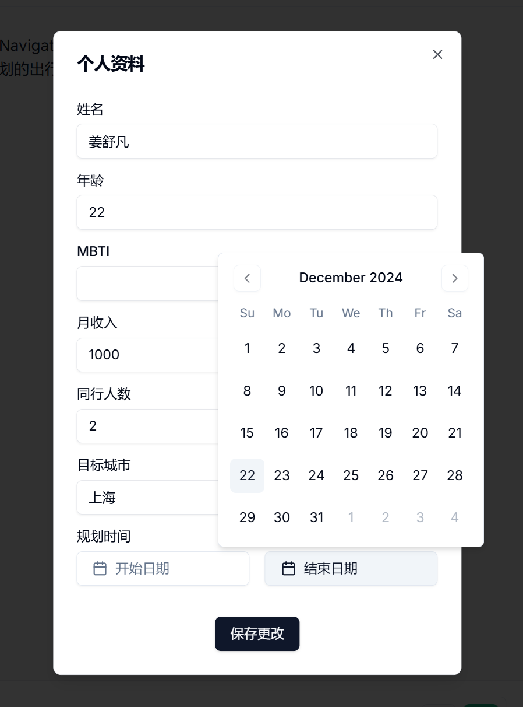

The personal information input module is an important part of the system, used to collect users' basic information in order to generate travel itineraries that better meet personalized needs. Through an intuitive and friendly interface design, users can quickly fill in relevant information, and the module customizes and generates itinerary content based on these input data.

1. **User basic information entry**

   * Support users to enter personal information including name, age, MBTI (personality type), monthly income and other personal information.

   * The data is used to optimize recommendations for travel planning, such as recommending activities and food that fit your budget.

2. **Travel Preferences**

   * Users can specify the target city, the number of people traveling with them, and the specific dates of the trip (start and end dates).

   * The system will calculate the number of travel days based on this information and match the corresponding attractions and activities.

3) **Interactive Calendar Component**

   * Embedded calendar design allows users to quickly select departure and return dates.

   * The interface is clear and the operation is intuitive. It also supports date range verification to avoid selecting invalid time ranges.

4) **Instant saving and updating**

   * Provide a "Save Changes" button to allow users to modify input information and save it in real time to ensure accurate data updates.

   * The convenient data interaction design reduces the user's operational burden and improves usage efficiency.

### Model selection

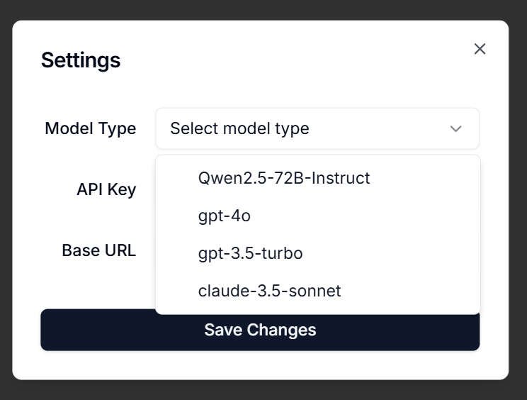

Our model selection module is a configuration tool designed for multi-language model application needs. Users only need a few simple steps to switch models in the interface and quickly complete the initial configuration, **switching and managing multiple mainstream models at any time**.

The drop-down menu integrates currently supported models:

* **Qwen2.5-72B-Instruct**: The latest open source model from Tongyi Qianwen team. (Most of the demonstrations in the comprehensive case are based on this API)

* **gpt-4o**: Has strong reasoning capabilities and multi-modal capabilities, and can handle a series of complex tasks.

* **gpt-3.5-turbo**: lightweight and fast response.

* **claude-3.5-sonnet**: Suitable for scenarios such as dialogue generation and natural language understanding.


## 5.7 Final coursework

**Assignment 1:**[OWL](https://github.com/camel-ai/owl)It is an open source project based on CAMEL that focuses on completing complex tasks in the real world. Please refer to the sample code in OWL, use various built-in tools in CAMEL and combine it with your own defined tools to build a comprehensive use case that can solve specific complex tasks. Click[here](https://github.com/camel-ai/owl/blob/main/community_usecase/COMMUNITY_CALL_FOR_USE_CASES.md#%E5%8A%A0%E5%85%A5owl%E7%A4%BE%E5%8C%BA%E8%B4%A1%E7%8C%AE%E6%82%A8%E7%9A%84%E7%94%A8%E4%BE%8B)View details.

**Assignment 2:** Through systematic learning, I believe you have understood how to build your own Agent and multi-Agent system. Please review the overall content and think about where we can further optimize the multi-agent system, and submit your ideas to the CAMEL warehouse[issue list](https://github.com/camel-ai/camel/issues)in, and refer to[Contributor Guide](https://github.com/camel-ai/camel/blob/master/CONTRIBUTING.md)Submit your code for optimization.